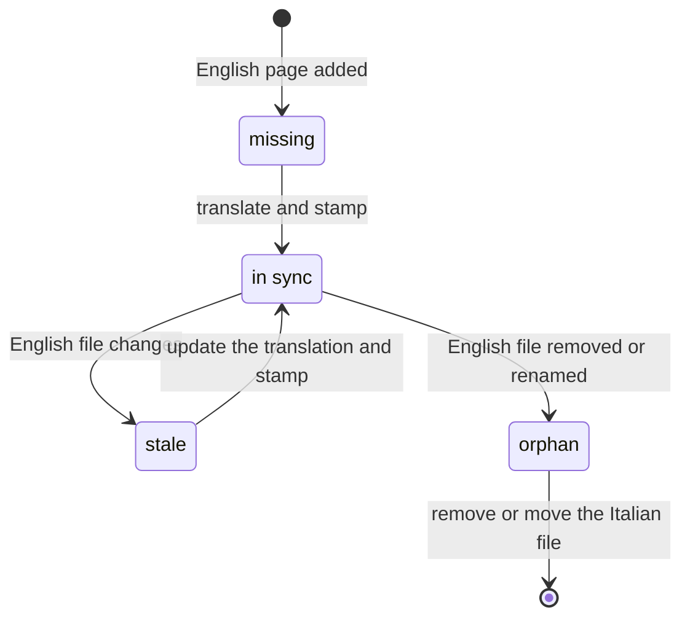

import FlowExplorer from '@site/src/components/FlowExplorer';
import docsAsCodeGates from '@site/src/data/flows/docs-as-code-gates.json';

# Documentation as code

## Understand

These guidelines are written, reviewed and published the way software is. That is what "documentation as code" means. The community guide Write the Docs describes it as ["writing documentation with the same tools as code"](https://www.writethedocs.org/guide/docs-as-code/): version control, plain-text markup, code reviews and automated tests. Google puts it this way: ["Documentation is often so tightly coupled to code that it should, as much as possible, be treated as code"](https://abseil.io/resources/swe-book/html/ch10.html), which for Google means source control, clear ownership, reviews of every change and periodic testing.

**The problem.** Guidelines kept in a wiki or in office documents drift. Google describes its own internal wiki: ["Because there were no true owners for documents, many became obsolete"](https://abseil.io/resources/swe-book/html/ch10.html), and "the people who could fix the documents were not the people who used them". The fix was to move the important documentation under source control, so that changes "could be handled using the existing code review process"; after that, in Google's words, "the documentation began to dramatically improve".

**Why it matters.** DORA, Google Cloud's research programme, reports ["a clear link between documentation quality and organizational performance"](https://dora.dev/capabilities/documentation-quality/). The page attributes the data to the 2022 State of DevOps Report and shows no date of its own.

**The outcome here.** Every guideline is a text file. A change is proposed, checked by automated gates and built into a website in English and Italian. The terms used in this chapter:

- **Repository**: the folder of files kept under version control with git. Microsoft lists versioning, peer reviews and an audit trail as the benefits of keeping documentation in [unified source control](https://learn.microsoft.com/azure/well-architected/operational-excellence/principles).
- **Pull request**: a proposed change that other people can read and comment on before it is merged, that is, before it becomes part of the main copy of the files. Microsoft Learn takes changes to its documentation [this way](https://learn.microsoft.com/contribute/content/how-to-write-overview).
- **Gate**: an automated check that stops a change when it fails. Microsoft describes quality gates as a way to ["enforce best practices to reduce risks"](https://learn.microsoft.com/azure/well-architected/operational-excellence/principles); that text is about workload artifacts in general, not about documentation in particular.
- **Build** and **static site**: the build turns the text files into a website made of ready-made files. Docusaurus, the tool used here, says its only responsibility is ["to build your site and emit static files"](https://docusaurus.io/docs/deployment); any web host can then serve them.
- **Locale**: one language version of the site. Docusaurus builds ["one single-page application per locale"](https://docusaurus.io/docs/i18n/tutorial), that is, one self-contained copy of the site per language; here English is at the root of the site and Italian under `/it/`.

Two things are not in place yet, and this chapter says so wherever it matters: nothing on the forge, the service that hosts the repository, enforces the gates (they run on the author's workstation and, since 2026-11-14, on every pull request as a check that reports a result but does not stop a merge), and the site is not published yet.


The flow below follows one change from the edit to the built site. Each gate step says what makes it fail.

<FlowExplorer flow={docsAsCodeGates} />

### One source, three audiences

Every chapter has the same four sections, so each reader knows where to look: **Understand** for stakeholders, **Decide** for architects, **Copy** for delivery teams, and **Verification status** for anyone who wants to know what was really run. The gate `task content:lint` rejects a chapter that lacks one of them (`tools/content-lint.mjs`).

Microsoft names three audiences for architecture diagrams as well: ["implementers, security reviewers, and business stakeholders"](https://learn.microsoft.com/azure/well-architected/architect-role/design-diagrams). Google's advice is more cautious: for customers and providers of a system, ["As much as possible, documents intended for one should be kept apart from documents intended for the other"](https://abseil.io/resources/swe-book/html/ch10.html). This project does the opposite of keeping them apart: one chapter serves three audiences, and only its fixed sections separate them. One research lane, in its own analysis, reads that as consistent with Google's advice but stricter; that is the lane's reading, not a finding, and nothing here shows that fixed sections are enough. It is listed as a cost under [Known limits](#known-limits).

### English is the source, Italian is checked

English is the only source; Italian is a translation of it. Microsoft's documentation works the same way: the PowerShell documentation says ["All translations start from the English content first"](https://learn.microsoft.com/powershell/scripting/community/contributing/get-started-writing?view=powershell-7.6), the Dynamics 365 contributor guide accepts pull requests ["only to the source files in English (US)"](https://learn.microsoft.com/dynamics365/fin-ops-core/dev-itpro/help/contributor-guide), and Microsoft Learn [falls back to English](https://learn.microsoft.com/training/support/integrations-learn-platform-api-catalog-best-practices) when a translation is missing.

Docusaurus keeps the translated files in a folder that mirrors the English one, `website/i18n/[locale]/[pluginName]/...` ([i18n introduction](https://docusaurus.io/docs/i18n/introduction)). It does not check that a translation is still current: ["it is your responsibility to maintain the respective translated files"](https://docusaurus.io/docs/i18n/git), and "we unfortunately don't have a good way to help you do so".

This repository closes that gap with its own check, `tools/i18n-parity.mjs`. Each Italian file carries a stamp, `source_sha256`, which is the fingerprint (SHA-256 hash) of the English file it was translated from. `task i18n:check` compares the two folders and reports three problems:



- `missing`: an English page has no Italian file.
- `stale`: the stamp in the Italian file differs from the fingerprint of the English file, or the Italian file has no stamp.
- `orphan`: an Italian file has no English page.

The check covers Markdown and MDX pages and nothing else: `tools/i18n-parity.mjs` reads only `.md` and `.mdx` files. Two kinds of Italian text are outside it:

- **The text inside the interactive flow files** is checked only for being present, not for being current (`tools/flows.mjs`).
- **The text of the site frame**, such as the labels in the navigation bar, is not in any page. Docusaurus has a second kind of translation file for text outside pages: its command `docusaurus write-translations` is described as ["Write the JSON translation files that you will have to translate"](https://docusaurus.io/docs/cli). This repository has no JSON file under `website/i18n/it/`, and the parity check does not look for one. The effect is visible: in the local build, the navigation label "Guidelines", set in `website/docusaurus.config.ts`, is in English on the Italian pages (see [Verification status](#verification-status)). The labels of the Docusaurus theme itself are a different case, because Docusaurus ships [an Italian translation of them](https://github.com/facebook/docusaurus/tree/main/packages/docusaurus-theme-translations/locales). UNVERIFIED: exactly which texts the JSON translation files hold; the research has only the sentence quoted above.

Translation is easier when the English is written for it. Google's style guide asks for [shorter sentences, the same term for the same concept, and no idioms](https://developers.google.com/style/translation).

### Three kinds of diagram

- **Architecture diagrams** are drawn with draw.io. The source file lives in `diagrams/` and its SVG image in `website/static/diagrams/`. Microsoft recommends to ["Store diagram source files in the same repository or documentation store as the workload's other versioned assets"](https://learn.microsoft.com/azure/well-architected/architect-role/design-diagrams), and Google's style guide says ["Use SVG files if possible because SVGs stay sharp when you zoom in on the image"](https://developers.google.com/style/images). A draw.io SVG [can include the diagram data](https://www.drawio.com/doc/faq/export-diagram), so the image can be reopened and edited. Labels stay in English in both languages, because one image serves both locales and text inside figures ["increases localization costs if figures are localized"](https://developers.google.com/style/images). The same page says that text inside a graphic "hurts accessibility and searchability". The architecture diagrams here carry their labels as text inside the figure, so that cost applies to them.
- **Mermaid diagrams** are written as text inside the page, like the one above; Docusaurus renders them through its [Mermaid theme](https://docusaurus.io/docs/markdown-features/diagrams).
- **Interactive flows** are step-through diagrams, like the one after the pipeline image. Each one is drawn by a React component, a reusable piece of interface code (`website/src/components/FlowExplorer/`). Docusaurus can embed it because its pages are MDX, a format that ["allows you to write JSX within your Markdown files and render them as React components"](https://docusaurus.io/docs/markdown-features/react); JSX is the notation such components are written in.

Which kind serves which purpose is this project's own convention, not a research finding; it is written in the project's skills `drawio-diagram` (architecture diagrams) and `interactive-diagram` (step-through flows). No skill says when to use Mermaid; using it for small diagrams that change together with the text around them is the author's proposal.

## Decide

### Options

Nine options were examined against the criteria. Seven of them have enough findings to be scored and totalled. The other two, Confluence Cloud and SharePoint Server Subscription Edition, are examined but not totalled: no finding sets a level for them on two languages, on automated checks or on components and diagrams, and those three criteria carry 55 of the 100 weight points. The rule is under [Which options are scored](#which-options-are-scored). The four site generators are compared in the decided context: content in a repository on GitHub Enterprise Cloud and the built site published on GitHub Pages.

- **Docusaurus in git, English canonical, Italian translated and checked by a parity gate, published on GitHub Pages.** A static site generator, [MIT-licensed](https://github.com/facebook/docusaurus/blob/main/LICENSE), at version 3.10.2 in `website/package.json`. Two languages from one tree with a path per locale ([i18n tutorial](https://docusaurus.io/docs/i18n/tutorial)), React components in pages through [MDX](https://docusaurus.io/docs/markdown-features/react), Mermaid through the [official theme](https://docusaurus.io/docs/markdown-features/diagrams). It has no check for stale translations ([i18n with git](https://docusaurus.io/docs/i18n/git)). Version 3.10 ["will be the last release in the v3.x line"](https://docusaurus.io/blog). This repository runs it today.
- **Hugo with the Docsy theme in git.** Hugo has releases numbered v0.164.0 to v0.169.0 dated July to October on its [releases page](https://github.com/gohugoio/hugo/releases) (the research tool inferred the year 2026). Docsy is a Hugo theme [created at Google](https://opensource.googleblog.com/2019/07/announcing-docsy-website-theme-for.html), now described as an Apache-2.0 [Linux Foundation project](https://github.com/google/docsy). It has one content root per language and a [language menu](https://www.docsy.dev/docs/language/).
- **Antora in git.** A generator for [AsciiDoc content kept in one or more git repositories](https://docs.antora.org/antora/latest/), licensed under MPL-2.0, with versions taken from [branches or tags](https://docs.antora.org/antora/latest/content-source-versioning-methods/). Markdown is not listed as an input.
- **Material for MkDocs in git.** [MIT-licensed](https://squidfunk.github.io/mkdocs-material/) and [in maintenance mode](https://squidfunk.github.io/mkdocs-material/blog/2025/11/05/zensical/): "Feature development has ended", with critical fixes "through May 5, 2027". It ["only supports setting a canonical language for the entire project"](https://squidfunk.github.io/mkdocs-material/setup/changing-the-language/).
- **Markdown rendered by GitHub (GitHub Enterprise Cloud), with no site build.** GitHub renders Markdown files, and [Mermaid diagrams in them](https://docs.github.com/en/get-started/writing-on-github/working-with-advanced-formatting/creating-diagrams), straight from the repository.
- **Azure DevOps Services wiki published as code.** Markdown in a repository; the head of the branch is the published wiki and ["No other workflows are involved"](https://learn.microsoft.com/azure/devops/project/wiki/publish-repo-to-wiki?view=azure-devops). It sits outside the decided forge.
- **Confluence Cloud (Premium plan)**, examined and not totalled. A wiki edited in the browser. The plan is named because [approvals](https://support.atlassian.com/confluence-cloud/docs/request-and-manage-approvals-in-confluence/) exist only on the Premium and Enterprise plans. Prices were not verified.
- **SharePoint Online (pages and document libraries).** Pages and documents edited in the browser, with [content approval](https://learn.microsoft.com/sharepoint/dev/business-apps/power-automate/guidance/require-doc-approval) and [multilingual pages](https://support.microsoft.com/office/create-multilingual-communication-sites-pages-and-news-2bb7d610-5453-41c6-a0e8-6f40b3ed750c) translated by hand. No plan is named, because the research has no finding at plan level.
- **SharePoint Server Subscription Edition**, examined and not totalled. The on-premises product, with [no planned end of support](https://learn.microsoft.com/lifecycle/additional-support-server-modern-lifecycle-policy) and an earliest possible date of December 31, 2035.

#### Which options are scored

An option has cells in the matrix when it passes three tests:

1. **It can be adopted.** This organisation must be able to buy or run it today.
2. **It is a shape of its own.** A shape that exists on the decided forge is scored once, there. The same shape on another forge has no column of its own.
3. **The research went far enough to say what the option does with content, from primary sources.** An option that came up with findings only on who can open it, on the environment that builds it or on the markup it accepts, or only from secondary sources, was not taken through the scoring cell by cell. No cells were worked out for such an option, so it has no coverage figure.

An option that has cells gets totals only when its **coverage** is more than 50. Coverage is the weight of the criteria whose cell a finding or a definition narrows below the full range 1-5. A total that rests mostly on cells with no finding would say more about the gaps in the research than about the option. The threshold of 50 is the author's judgment, and no option is close to it: the seven totalled options have a coverage of 80 or more, and the two others have 45 (see the coverage row of each table below).

Considered and without cells, each with the test it does not pass:

- **Confluence Data Center** (test 1): new customers [cannot buy it since March 30, 2026](https://www.atlassian.com/licensing/data-center-end-of-life), and it becomes read-only on March 28, 2029. Whether this organisation ever held paid Data Center seats, which decides whether it could still buy it, is not established.
- **Plain Markdown in a self-managed forge (GitLab, Forgejo)** (test 2): it is the shape of Markdown rendered by GitHub, on another forge. GitLab renders [Markdown documents in repositories and Mermaid](https://docs.gitlab.com/user/markdown/). The Azure DevOps wiki also sits outside the decided forge, but it is a different shape (a wiki published from a branch of a repository), so it has a column. A self-managed forge changes facts that three criteria look at:
  - Review (C1): on GitLab, approvals that block a merge are in the [Premium and Ultimate tiers](https://docs.gitlab.com/user/project/merge_requests/approvals/); the Free tier has optional approvals only. Forgejo's branch protection can block merging ["unless a given number of approvals are obtained on a pull request"](https://forgejo.org/docs/latest/user/protection/).
  - Checks that stop a merge (C3): on GitLab, "Pipelines must succeed" is a [project setting](https://docs.gitlab.com/user/project/merge_requests/auto_merge/) in every tier. Forgejo's branch-protection page does not mention required status checks; only [Gitea's documentation](https://docs.gitea.com/usage/access-control/protected-branches/) describes them, and whether Forgejo behaves the same is not confirmed.
  - Own infrastructure (C7): a self-managed forge runs, by definition, on infrastructure the organisation operates.

  The case is spelled out under [When to deviate](#when-to-deviate).
- **Plain Markdown built by GitHub Pages with Jekyll** (test 3): GitHub's documentation describes the build environment, which is [Jekyll 3.10.0](https://pages.github.com/versions/) with plugins from a fixed list; a site that uses any other plugin [cannot be built by GitHub Pages](https://docs.github.com/en/pages/setting-up-a-github-pages-site-with-jekyll/about-github-pages-and-jekyll). GitHub's pages on Jekyll do not mention several languages, link checking during the build, `.mdx` files or JavaScript components, and Mermaid on a Jekyll-built Pages site has only a secondary source. Jekyll's own documentation was not researched, so what the tool does about languages, checks and components is unknown, not absent.
- **Forge wikis** (Azure DevOps provisioned wiki, GitLab wiki, GitHub wiki) (test 3): the research covers who can read and edit them and which markup they accept; it has nothing on two languages or on automated checks. A GitHub wiki in a private repository is visible [only to people with access to the repository](https://docs.github.com/en/communities/documenting-your-project-with-wikis/about-wikis); a GitLab wiki is [a separate Git repository](https://docs.gitlab.com/user/project/wiki/) edited directly, with no merge-request step described; in a private Azure DevOps project Stakeholders [can read the provisioned wiki](https://learn.microsoft.com/azure/devops/project/wiki/manage-readme-wiki-permissions?view=azure-devops) and cannot edit it.
- **Azure DevOps Server** (test 3): no finding covers publishing a code wiki on the Server product.
- **Zensical**, the successor of Material for MkDocs (test 3): its language and versioning support is not established. **docfx** (test 3): one secondary source. **Wiki.js** (test 3): no readable source.
- **Weblate**: a translation tool, not a publishing option; see [Choices inside the decision](#choices-inside-the-decision).

Hosting options other than GitHub Pages (Azure Static Web Apps, Azure Storage, Cloud Storage, Cloud Run, Firebase Hosting, GitLab Pages, an internal web server) were researched and are left to the later hosting chapter; see [Where the site is published](#where-the-site-is-published).

### Weighted matrix

The matrix is a comparison, not a ranking: the tool was chosen by the decider (see [Recommendation](#recommendation)). It shows what the evidence settles and what it leaves open.

**Criteria.** Each traces to a need stated in the project specification (`docs/superpowers/specs/2026-11-10-cloud-architect-devops-design.md`) or in the brief of this topic (`docs/superpowers/plans/2026-11-10-phase-0-foundations.md`). The weights sum to 100 (15 + 20 + 20 + 15 + 10 + 10 + 5 + 5); their sizes are the author's judgment.

| Id | Criterion | Weight | Need it traces to |
|---|---|---|---|
| C1 | Review and audit trail per change | 15 | Compliance and audit in the core of the guidelines (specification); the author applies it to documentation changes |
| C2 | English and Italian from one tree, stale translations detected | 20 | Bilingual guidelines, Italian translated and checked (specification and brief) |
| C3 | Automated checks that can stop publication | 20 | `task verify` must pass before a phase is closed (specification); the author applies it to publication |
| C4 | Interactive components and diagrams in pages | 15 | draw.io, Mermaid and interactive diagrams (brief) |
| C5 | Reach for the three audiences | 10 | Architects, delivery teams and stakeholders together (specification) |
| C6 | Continuity and exit cost | 10 | Avoid lock-in (specification, stated for cloud providers); the author applies it to tooling |
| C7 | Own infrastructure and offline use | 5 | On-prem Rancher among the targets, and everything provable locally (specification) |
| C8 | Versioned: git history and tags | 5 | The decider's definition of "versioned", with no published version selector |

**Scoring rule.** Each criterion has two sub-needs, A and B, each at level 0, 1 or 2; the score is 1 + A + B, so 1 to 5. C8 has one sub-need and scores 1 + 2 x A.

- Only research findings set a level. Secondary sources, unverified items and the researchers' own trade-off analysis set none.
- A sub-need that no finding settles keeps every level the findings do not exclude, so a cell can be a range. Nothing is filled in by judgment. A page that does not mention a capability says nothing either way.
- Level 1 is settled only when one finding documents the partial case and a finding says that the full case is not met. When only the partial case is documented, the sub-need stays open between 1 and 2.
- In a few cases a level follows from what the option is, and the text says "by definition": content in git has git history; a site served by a vendor's service is not on the organisation's own infrastructure.
- This repository's own setup (its parity check, its tasks, its pages) is not scored for any option. The Docusaurus column is the tool published on GitHub Pages, nothing more.
- A combined option (Hugo with Docsy, Material for MkDocs with MkDocs underneath, any generator with GitHub) takes the weaker part on each sub-need.
- Two unknowns about GitHub are shared by several columns and count once when two of those columns are compared: whether a pull-request review can be made required (C1), and the lifecycle of GitHub Enterprise Cloud and GitHub Pages (C6).

| Criterion | Sub-need A (level 1 is the partial case) | Sub-need B (level 1 is the partial case) |
|---|---|---|
| C1 | Every change is recorded with its author and can be compared with the previous state. 1: history per version, without the author of each change inside a version | Review before publication can be made mandatory. 1: review only optional, or mandatory for part of the content |
| C2 | Both languages come from one source tree, each with its own address. 1: only as separate projects, without an address per language, or through add-ons | The option itself detects a stale translation before publication. 1: a signal to translators, with no check that stops publication |
| C3 | Broken internal links stop publication, by default or by a documented setting. 1: only some link forms, or only with an added tool | Project-specific checks run before publication and stop it on failure. 1: only metadata checks, or checks that do not stop publication |
| C4 | An interactive component can be embedded in a content page. 1: building blocks documented, embedding in a page not documented | Mermaid diagrams and SVG images render in pages. 1: only one of the two, or Mermaid only through an external rendering server |
| C5 | Readers who do not author, inside or outside the organisation, can read without a role or seat on the authoring tool and without publishing to everyone. 1: only with a role or seat, or only by publishing to everyone. Read access granted to a person on a repository or a site is a role, whether or not it costs a licence | People who do not use git can contribute through the option's own editing, with a review step. 1: only through git and pull requests, a forge's web editor included |
| C6 | Continuity: a release or product change dated 2026, or an explicit active status, and no announced end of maintenance, of feature development or of the release line in use. 1: such an end is announced. 0: maintenance has ended | A finding names another tool that reads the content source as it is. 1: the content leaves only as files that need rewriting, or through export formats |
| C7 | The published guidelines can be served from infrastructure the organisation operates. 1: only with an extra self-hosted service | The build, where there is one, and the reading work without Internet access. 1: only one of the two |
| C8 | The whole set has git history and tags. 1: history per page or document, or a whole-set export | (none) |

**Matrix.** The seven options with a coverage above 50. A single number is a settled score; a range runs from every open point counted against the option to every open point counted in its favour.

| Criterion | Weight | Docusaurus | Hugo + Docsy | Antora | Material for MkDocs | Markdown on GitHub | Azure DevOps code wiki | SharePoint Online |
|---|---|---|---|---|---|---|---|---|
| C1 Review and audit trail | 15 | 4-5 | 4-5 | 4-5 | 4-5 | 4-5 | 5 | 3-5 |
| C2 Two languages | 20 | 3 | 2-5 | 1-5 | 2-4 | 1-5 | 1-5 | 3-5 |
| C3 Automated checks | 20 | 5 | 4-5 | 4-5 | 5 | 4-5 | 4 | 2-5 |
| C4 Components and diagrams | 15 | 4-5 | 3-5 | 2-5 | 2-5 | 2-5 | 2-3 | 1-5 |
| C5 Reach | 10 | 3-4 | 3-4 | 3-4 | 3-4 | 3 | 3 | 4-5 |
| C6 Continuity and exit | 10 | 2-4 | 2-5 | 2-5 | 3-4 | 3-5 | 4-5 | 3-5 |
| C7 Own infrastructure, offline | 5 | 1-2 | 1-2 | 1-2 | 1-2 | 1 | 1 | 1 |
| C8 Versioned | 5 | 5 | 5 | 5 | 5 | 5 | 5 | 3 |
| Coverage | | 100 | 100 | 80 | 100 | 80 | 80 | 85 |
| **Floor total** | 100 | **360** | **305** | **270** | **320** | **280** | **305** | **250** |
| **Ceiling total** | 100 | **425** | **475** | **475** | **445** | **460** | **410** | **470** |

A cell of 1-5 is a cell with no finding. Coverage is 100 minus the weight of those cells: Antora, Markdown on GitHub and the Azure DevOps code wiki have none on two languages (100 - 20 = 80), and SharePoint Online has none on components and diagrams (100 - 15 = 85).

Arithmetic, weight x score in the order C1 to C8, recomputed on 2026-11-14 from the sub-need levels given below.

Floor totals:

- Docusaurus: 60 + 60 + 100 + 60 + 30 + 20 + 5 + 25 = 360
- Hugo + Docsy: 60 + 40 + 80 + 45 + 30 + 20 + 5 + 25 = 305
- Antora: 60 + 20 + 80 + 30 + 30 + 20 + 5 + 25 = 270
- Material for MkDocs: 60 + 40 + 100 + 30 + 30 + 30 + 5 + 25 = 320
- Markdown on GitHub: 60 + 20 + 80 + 30 + 30 + 30 + 5 + 25 = 280
- Azure DevOps code wiki: 75 + 20 + 80 + 30 + 30 + 40 + 5 + 25 = 305
- SharePoint Online: 45 + 60 + 40 + 15 + 40 + 30 + 5 + 15 = 250

Ceiling totals:

- Docusaurus: 75 + 60 + 100 + 75 + 40 + 40 + 10 + 25 = 425
- Hugo + Docsy: 75 + 100 + 100 + 75 + 40 + 50 + 10 + 25 = 475
- Antora: 75 + 100 + 100 + 75 + 40 + 50 + 10 + 25 = 475
- Material for MkDocs: 75 + 80 + 100 + 75 + 40 + 40 + 10 + 25 = 445
- Markdown on GitHub: 75 + 100 + 100 + 75 + 30 + 50 + 5 + 25 = 460
- Azure DevOps code wiki: 75 + 100 + 80 + 45 + 30 + 50 + 5 + 25 = 410
- SharePoint Online: 75 + 100 + 100 + 75 + 50 + 50 + 5 + 15 = 470

**Examined, not totalled.** For Confluence Cloud and SharePoint Server SE no finding sets a level on three criteria that together carry 55 points ("no finding" in the table), so their coverage is 100 - 20 - 20 - 15 = 45 and they get no totals. Their floor and ceiling would lie 220 points apart on those three criteria alone (55 x 1 against 55 x 5), which says nothing about either product. The cells that do have findings are reported here, and each is explained with the others below.

| Criterion | Weight | Confluence Cloud (Premium) | SharePoint Server SE |
|---|---|---|---|
| C1 Review and audit trail | 15 | 3-5 | 3-5 |
| C2 Two languages | 20 | no finding | no finding |
| C3 Automated checks | 20 | no finding | no finding |
| C4 Components and diagrams | 15 | no finding | no finding |
| C5 Reach | 10 | 5 | 4-5 |
| C6 Continuity and exit | 10 | 4-5 | 3-5 |
| C7 Own infrastructure, offline | 5 | 1 | 3-5 |
| C8 Versioned | 5 | 3 | 3 |
| Coverage | | 45 | 45 |

#### Why each cell scores as it does

"A2" means sub-need A at level 2; "B 1-2" means sub-need B is open between levels 1 and 2. The entries cover both tables above.

**C1 Review and audit trail.**

- Docusaurus, Hugo + Docsy, Antora, Material for MkDocs, Markdown on GitHub: 4-5 (A2, B 1-2). The content is files in a git repository on GitHub, so A is 2 by definition. On GitHub the Read role [can review pull requests](https://docs.github.com/en/enterprise-cloud@latest/organizations/managing-user-access-to-your-organizations-repositories/managing-repository-roles/repository-roles-for-an-organization); whether a review can be made required before merging is not in the research. One unknown, shared by the five. In this row the Azure DevOps code wiki (5) stands above the five options on GitHub (4-5) only because required reviewers were researched for Azure Repos and not for GitHub: the gap shows what the research covered, not a documented difference between the two forges.
- Azure DevOps code wiki: 5 (A2, B2). Both wiki types are [stored in Git](https://learn.microsoft.com/azure/devops/project/wiki/provisioned-vs-published-wiki?view=azure-devops), and a minimum number of reviewers is a [branch policy](https://learn.microsoft.com/azure/devops/repos/git/branch-policies-overview?view=azure-devops), off by default, on the published branch.
- Confluence Cloud: 3-5 (A 1-2, B 1-2). [Page history](https://support.atlassian.com/confluence-cloud/docs/use-confluence-for-technical-documentation/) shows each version with date, author and comments; whether several editors inside one version are told apart is not established. A space admin can [require approval](https://support.atlassian.com/confluence-cloud/docs/request-and-manage-approvals-in-confluence/) before new pages go live; the article does not say whether this covers edits of existing pages.
- SharePoint Online: 3-5 (A 1-2, B 1-2). [Version history](https://learn.microsoft.com/sharepoint/version-overview) identifies who made the changes; several co-authors inside one version are not described. [Content approval](https://learn.microsoft.com/sharepoint/dev/business-apps/power-automate/guidance/require-doc-approval) keeps a document in a library invisible until it is approved, which makes review mandatory for part of the content. For pages, a [page approval flow](https://learn.microsoft.com/power-automate/customize-sharepoint-page-approvals) sends each added or modified page for approval; whether that flow needs a licence was not looked up, and no plan is named for this option, so level 2 is not settled.
- SharePoint Server SE: 3-5 (A 1-2, B 1-2). Versions, check-in comments and a content approval step in which a draft stays pending until approved are in the [planning guide](https://learn.microsoft.com/sharepoint/governance/versioning-content-approval-and-check-out-planning). As for SharePoint Online, that step is about documents in a library; no finding says that approval can be made mandatory for pages, so B is open in the same way.

**C2 English and Italian.**

- Docusaurus: 3 (A2, B0). Translated files sit in one tree and each locale has its own path ([i18n introduction](https://docusaurus.io/docs/i18n/introduction), [i18n tutorial](https://docusaurus.io/docs/i18n/tutorial)). Stale translations are not detected: ["we unfortunately don't have a good way to help you do so"](https://docusaurus.io/docs/i18n/git).
- Hugo + Docsy: 2-5 (A 1-2, B 0-2). One content root per language ([Docsy](https://www.docsy.dev/docs/language/)), with translations linked [by path, content directory or a shared key](https://gohugo.io/content-management/multilingual/); no finding states that each language has its own address, and neither page covers outdated translations.
- Antora: 1-5 (A 0-2, B 0-2). No official Antora page on localization was found; the only reports are secondary.
- Material for MkDocs: 2-4 (A1, B 0-2). One project per language, linked by the [language selector](https://squidfunk.github.io/mkdocs-material/setup/changing-the-language/).
- Markdown on GitHub, Azure DevOps code wiki: 1-5 (A 0-2, B 0-2). No finding settles either sub-need.
- Confluence Cloud, SharePoint Server SE: no finding sets a level. For Confluence Cloud, two research files disagree on whether Atlassian's article on translating page content covers Cloud, and a request for [page versions per language](https://jira.atlassian.com/browse/CONFCLOUD-64788) is unresolved. For SharePoint Server, [variations](https://learn.microsoft.com/sharepoint/sites/plan-for-multilingual-sites) are documented without naming an edition.
- SharePoint Online: 3-5 (A 1-2, B 1-2). [Multilingual pages](https://support.microsoft.com/office/create-multilingual-communication-sites-pages-and-news-2bb7d610-5453-41c6-a0e8-6f40b3ed750c) on communication sites; translators are emailed when the default page changes, and each translation page is updated by hand.
- One research lane concludes, in its trade-off analysis, that none of the generators it examined detects stale translations. That is analysis of pages that are silent on the point, not a finding, so it sets no level. If it were scored, C2 B would be 0 for Hugo + Docsy, Antora and Material for MkDocs, and each of their ceiling totals would fall by 40.

**C3 Automated checks.**

- B is 2 for the five options on GitHub: a failing required status check [prevents merging](https://docs.github.com/en/repositories/configuring-branches-and-merges-in-your-repository/managing-protected-branches/about-protected-branches), also for people with push access; [rulesets](https://docs.github.com/en/repositories/configuring-branches-and-merges-in-your-repository/managing-rulesets/available-rules-for-rulesets) have a rule that requires status checks to pass; and for GitHub Pages GitHub recommends a [deployment protection rule](https://docs.github.com/en/pages/getting-started-with-github-pages/configuring-a-publishing-source-for-your-github-pages-site) so that only the default branch can deploy. This is a GitHub feature, not a feature of any generator, and it is not wired in this repository.
- Docusaurus: 5 (A2, B2). `onBrokenLinks` throws by default, in a production build only; `markdown.hooks.onBrokenMarkdownLinks` defaults to `warn` and accepts `throw`; `onBrokenAnchors` defaults to `warn` ([configuration reference](https://docusaurus.io/docs/api/docusaurus-config)).
- Hugo + Docsy: 4-5 (A 1-2, B2). Links written with `ref` or `relref` [fail the build by default](https://gohugo.io/configuration/all/); the [embedded link render hook](https://gohugo.io/render-hooks/links/) does not report a destination it cannot resolve.
- Antora: 4-5 (A 1-2, B2). The documented example logs an unresolved cross reference [at error level](https://docs.antora.org/antora/latest/playbook/runtime-log-format/), and a [failure level](https://docs.antora.org/antora/latest/playbook/runtime-log-failure-level/) makes the build exit non-zero; its default is `fatal`, so it has to be set to `error`.
- Material for MkDocs: 5 (A2, B2). Link validation at level `warn` is ["intended for use with `mkdocs build --strict` (where it becomes an error)"](https://www.mkdocs.org/user-guide/configuration/).
- Markdown on GitHub: 4-5 (A 1-2, B2). There is no build; a link checker such as [lychee](https://lychee.cli.rs/) can run as a required check. Link checking by GitHub itself has no finding.
- Azure DevOps code wiki: 4 (A1, B2). Nothing runs between merge and publication; built-in link checking runs only when a page is [moved in the wiki interface](https://learn.microsoft.com/azure/devops/project/wiki/add-edit-wiki?view=azure-devops). With a required build validation, "The pull request can't complete until the required build succeeds" ([branch policies](https://learn.microsoft.com/azure/devops/repos/git/branch-policies-overview?view=azure-devops), [pull request security](https://learn.microsoft.com/azure/devops/repos/git/secure-repositories-pull-requests?view=azure-devops)).
- SharePoint Online: 2-5 (A 0-2, B 1-2); a [required column](https://learn.microsoft.com/troubleshoot/sharepoint/lists-and-libraries/upload-file-using-new-experience) is a metadata check.
- Confluence Cloud: no finding on automated checks. SharePoint Server SE: no finding for this edition.

**C4 Components and diagrams.**

- Docusaurus: 4-5 (A2, B 1-2). Components through [MDX](https://docusaurus.io/docs/markdown-features/react) and Mermaid through the [theme](https://docusaurus.io/docs/markdown-features/diagrams). SVG images in pages have no research finding; this repository embeds them, which is not scored.
- Hugo + Docsy: 3-5 (A 1-2, B 1-2). [Shortcodes](https://gohugo.io/content-management/shortcodes/) are templates that generate HTML, and [`js.Build`](https://gohugo.io/functions/js/build/) bundles React code, but its page does not document embedding a component in a Markdown page. Docsy renders [Mermaid from a code block](https://www.docsy.dev/docs/content/diagrams-and-formulae/).
- Antora: 2-5 (A 0-2, B 1-2). Mermaid through the [asciidoctor-kroki extension](https://docs.asciidoctor.org/kroki-extension/latest/), which needs a Kroki server.
- Material for MkDocs: 2-5 (A 0-2, B 1-2). ["native support for Mermaid.js diagrams"](https://squidfunk.github.io/mkdocs-material/reference/diagrams/); components are not addressed in the pages read.
- Markdown on GitHub: 2-5 (A 0-2, B 1-2). [Mermaid in Markdown files](https://docs.github.com/en/get-started/writing-on-github/working-with-advanced-formatting/creating-diagrams).
- Azure DevOps code wiki: 2-3 (A0, B 1-2). ["Markdown in Azure DevOps doesn't support JavaScript or iframes"](https://learn.microsoft.com/azure/devops/project/wiki/markdown-guidance?view=azure-devops); Mermaid has "limited syntax support", with `flowchart` syntax among the unsupported, and SVG is not among the listed attachment image formats.
- SharePoint Online: 1-5 (A 0-2, B 0-2). No finding on Mermaid, SVG or components.
- Confluence Cloud, SharePoint Server SE: no finding on Mermaid, SVG or components.

**C5 Reach.**

- Docusaurus, Hugo + Docsy, Antora, Material for MkDocs: 3-4 (A1, B 1-2). A privately published GitHub Pages site can be read only by people with read access to the repository, and read access to a repository is a role on the authoring tool; otherwise the site is public. With Enterprise Managed Users, sites can only be private and are accessible only to enterprise members, who hold accounts on the same forge ([GitHub's page on private sites](https://docs.github.com/en/enterprise-cloud@latest/pages/getting-started-with-github-pages/about-privately-published-github-pages-sites)). Every documented route is the level-1 case, and the page presents each as the only way in, so A is settled at 1. Whether those readers also consume a licence is not documented; the answer would not change the level. Contributing through git and pull requests is available by definition; an editor of the tool's own has no finding, so B is open.
- Markdown on GitHub: 3 (A1, B1). Readers need a role on the repository, and organisation members and outside collaborators on private or internal repositories [consume a licence](https://docs.github.com/en/enterprise-cloud@latest/billing/reference/github-license-users); a public repository is open to everyone. B is 1 by definition: GitHub is the whole option, and an edit made in its web editor is still a commit in git, which the key counts as level 1.
- Azure DevOps code wiki: 3 (A1, B1). In private projects free Stakeholder users [cannot read published code wikis](https://learn.microsoft.com/azure/devops/project/wiki/manage-readme-wiki-permissions?view=azure-devops), and adding or editing pages needs [at least Basic access](https://learn.microsoft.com/azure/devops/project/wiki/wiki-create-repo?view=azure-devops).
- Confluence Cloud: 5 (A2, B2). On the Premium plan, anonymous access limited by an IP allowlist needs no licence, according to an Atlassian [knowledge-base article](https://confluence.atlassian.com/spaces/CONFKB/pages/1381400731/Methods+to+allow+unlicensed+users+to+read+Confluence+Cloud+content) that Atlassian itself flags as requiring fixes. The flag does not set the finding aside, but the cell is only as good as that article: the research advises re-checking it before relying on anonymous access, and it found a third-party claim, not confirmed by any Atlassian page, that anonymous access ends after December 1, 2026. An unconfirmed claim sets no level; if it proved true, this cell would have to be scored again. B2: pages are edited in the browser, and [approvals](https://support.atlassian.com/confluence-cloud/docs/request-and-manage-approvals-in-confluence/) exist on the Premium plan.
- SharePoint Online: 4-5 (A 1-2, B2). Microsoft Entra B2B guests [need no licence for most collaboration features](https://learn.microsoft.com/microsoft-365/enterprise/external-guest-access) and see only what is shared with them. That finding covers guests from outside the organisation, and a guest still has to be given access. For readers inside the organisation the research has only a secondary source, a [Microsoft Q&A answer](https://learn.microsoft.com/answers/a/12221844) saying they must hold a licence that includes SharePoint Online, and a secondary source sets no level. Reading with a role or a seat is documented, so A is at least 1; reading without either is neither documented nor excluded, so A is open. B2: documents are edited in the browser and, with content approval, stay invisible until approved.
- SharePoint Server SE: 4-5 (A 1-2, B2). Approved content is visible to users with read permission ([planning guide](https://learn.microsoft.com/sharepoint/governance/versioning-content-approval-and-check-out-planning)); reader licensing was not looked up.

**C6 Continuity and exit cost.**

- For the four generators and for Markdown on GitHub, A is the weaker of the tool and of GitHub. The research has no lifecycle finding for GitHub Enterprise Cloud or GitHub Pages: one unknown (0-2), shared by the five.
- Docusaurus: 2-4 (A 0-1, B 1-2). The tool is at level 1: 3.10 ["will be the last release in the v3.x line, and it helps you prepare for Docusaurus v4"](https://docusaurus.io/blog). No finding names another tool that reads MDX pages as they are. Two research lanes conclude, in their trade-off analysis, that pages with components would need rewriting to move; if that were scored, the Docusaurus ceiling would fall by 10, to 415.
- Hugo + Docsy: 2-5 (A 0-2, B 1-2). Hugo has dated releases; for Docsy the research has a version and no dated release or maintenance status.
- Antora: 2-5 (A 0-2, B 1-2). Antora 3 is listed as active, with its end of life not set, on a [release schedule](https://docs.antora.org/antora/latest/project/release-schedule/) whose dates are estimates.
- Material for MkDocs: 3-4 (A 0-1, B2). Maintenance mode, and the same post says MkDocs itself is "unmaintained since August 2024"; its successor Zensical ["can natively read `mkdocs.yml`"](https://squidfunk.github.io/mkdocs-material/blog/2025/11/05/zensical/).
- Markdown on GitHub: 3-5 (A 0-2, B2). GitLab renders the same [Markdown documents and Mermaid](https://docs.gitlab.com/user/markdown/).
- Azure DevOps code wiki: 4-5 (A2, B 1-2). A [2026 update](https://learn.microsoft.com/azure/devops/release-notes/2026/wiki/sprint-274-update) added standard Mermaid fences; `.order` files and `::: mermaid` blocks are specific to Azure DevOps.
- Confluence Cloud: 4-5 (A2, B 1-2). A product change dated May 2026 in the knowledge-base article cited under C5; content leaves through [export formats](https://support.atlassian.com/confluence-cloud/docs/export-content-to-word-pdf-html-and-xml/) (Word, PDF, CSV, HTML, XML).
- SharePoint Online: 3-5 (A2, B 0-2). The level rests on thin evidence, the [removal of the SharePoint 2013 workflow engine](https://learn.microsoft.com/troubleshoot/sharepoint/workflows/item-pending-status) from existing tenants on 2026-04-02; no finding says how content leaves.
- SharePoint Server SE: 3-5 (A2, B 0-2). [No planned end of support](https://learn.microsoft.com/lifecycle/additional-support-server-modern-lifecycle-policy); no finding on how content leaves.

**C7 Own infrastructure and offline use.**

- The four generators published on GitHub Pages: 1-2 (A0, B 0-1). GitHub's service serves the site, so by definition it is not on the organisation's own infrastructure and cannot be read without Internet access. Whether the build runs without Internet access is open. For Docusaurus the only finding covers installing dependencies: with `--offline`, pnpm ["will use only packages already available in the store"](https://pnpm.io/cli/install).
- Markdown on GitHub, Azure DevOps code wiki, Confluence Cloud, SharePoint Online: 1 (A0, B0), by definition: vendor-operated services with no build of their own.
- SharePoint Server SE: 3-5 (A2, B 0-2). Server software the organisation runs, by definition; reading without Internet access has no finding.
- The output of a generator is static files that another host could serve: ["It is now up to you to choose how to host those static files"](https://docusaurus.io/docs/deployment). That is why the hosting chapter could change these cells; it does not raise them here.

**C8 Versioned.**

- The six options whose content is files in git: 5 (A2), by definition. DORA counts supporting documentation among what [belongs in version control](https://dora.dev/capabilities/version-control/).
- Confluence Cloud, SharePoint Online, SharePoint Server SE: 3 (A1). History per page or per document; level 2 is excluded by definition, because "versioned" here means git history and tags.

#### What the matrix shows, and what it does not

- **Every range overlaps.** Docusaurus runs from 360 to 425, and the range of each of the six totalled alternatives overlaps it.
- **No totalled alternative is separated from Docusaurus.** Each of the six was also compared with Docusaurus criterion by criterion, over every combination of levels the findings leave open, with each shared GitHub unknown taking one value for both options. A positive number means Docusaurus higher:

  | Alternative | Difference under the weights above | Difference under equal weights |
  |---|---|---|
  | Hugo + Docsy | -90 to 105 | -7 to 8 |
  | Antora | -90 to 130 | -7 to 9 |
  | Material for MkDocs | -60 to 90 | -5 to 7 |
  | Markdown on GitHub | -75 to 120 | -5 to 8 |
  | Azure DevOps code wiki | -50 to 120 | -4 to 8 |
  | SharePoint Online | -110 to 175 | -7 to 13 |

  Every difference runs from below zero to above zero. On this evidence none of the six is shown to be better than Docusaurus, and none is shown to be worse.
- **For four alternatives this holds for any weights.** For Hugo + Docsy, Antora, Material for MkDocs and Markdown on GitHub, the difference from Docusaurus includes zero on every criterion. On some criteria it can go only one way: Docusaurus is not lower than Hugo + Docsy, Antora or Markdown on GitHub on automated checks; it is not lower than Markdown on GitHub on reach and on own infrastructure, and not higher on continuity.
- **For the other two, some weights would separate them.** Settled directions: the Azure DevOps code wiki is lower than Docusaurus on automated checks and on components and diagrams; SharePoint Online is lower on versioning. On reach SharePoint Online is not lower than Docusaurus (4-5 against 3-4), and whether it is higher is open.
- **The two options without totals can be compared only where they have findings.** Confluence Cloud is higher than Docusaurus on reach (5 against 3-4), a result that rests on the knowledge-base article flagged as requiring fixes, and lower on versioning (3 against 5). SharePoint Server SE is higher on own infrastructure (3-5 against 1-2) and lower on versioning (3 against 5). On two languages, automated checks, and components and diagrams, nothing can be said about either.
- **What could separate an option from Docusaurus is its open cells.** For Docusaurus they are: whether a pull-request review can be made required on GitHub (C1), SVG images in pages (C4), whether the tool offers editing of its own (C5), the lifecycle of GitHub and whether another tool reads MDX pages as they are (C6), and building without Internet access (C7).

### Recommendation

**Docusaurus in git, English canonical, Italian translated and checked by a parity gate, published on GitHub Pages.** This is the decider's choice. The matrix is a comparison; it is not the source of the decision. Three reasons decide it:

1. **The tool is already in use.** In this repository the bilingual site, including pages with the step-through component, builds in both locales (see [Verification status](#verification-status)).
2. **In the decider's judgment it meets the stated needs.** What the evidence shows is narrower, and the table below says so need by need.
3. **The alternatives were examined, and the evidence separates none of the six totalled alternatives from Docusaurus**, in either direction. For Confluence Cloud and SharePoint Server SE the evidence is too thin to total. The comparison neither argues against the choice nor proves it.

| Need | What the evidence shows | Score |
|---|---|---|
| C1 Review and audit trail | The audit trail comes from git on GitHub, not from Docusaurus. Mandatory review is open: pull-request review exists, whether it can be made required was not researched, and nothing enforces review today | 4-5 |
| C2 Two languages | One tree with a path per locale: met by the tool. Stale translations: not detected by the tool; this repository's own check is written to report them, and its unit tests for the stale case pass (see Verification status). It has not yet reported a stale page of this site | 3 |
| C3 Automated checks | Broken internal links fail the build by default; broken Markdown file links fail by a setting this repository uses; anchors only warn, and whether external URLs are checked is not documented. Checks that stop a merge are a GitHub feature and are not wired today | 5 |
| C4 Components and diagrams | Components and Mermaid: met by the tool. SVG images in pages: no research finding | 4-5 |
| C5 Reach | Partly met. Readers of a private GitHub Pages site need read access to the repository, which is a role on the authoring tool; otherwise the site is public. That part is settled, and the hosting chapter decides between the two. Contributors have git and pull requests; no other route with a review step is documented | 3-4 |
| C6 Continuity and exit | Partly met: the end of the 3.x line is announced. Exit cost is open in the matrix; two research lanes conclude that MDX pages with components would need rewriting | 2-4 |
| C7 Own infrastructure, offline | Not met on the decided host: GitHub Pages serves the site. Building without Internet access is open | 1-2 |
| C8 Versioned | Met by git history and tags, not by the tool | 5 |

The cost of rebuilding the existing site on another tool was not measured.

### When to deviate

- **Most authors do not use git and will not open pull requests.** Keep the site and add a self-hosted [Weblate](https://docs.weblate.org/en/latest/formats.html) for translators; it lists Markdown files among its formats, and whether it handles MDX is not in the research. If review of each change in git is not required, use a platform edited in the browser (SharePoint Online or Confluence Cloud); both are vendor-operated services, so this repository's file-based checks would not apply to their content.
- **More than two languages, or external translators.** Move translation to Weblate. UNVERIFIED: the number of languages at which the stamp check stops being enough; no finding sets it, it is the author's judgment.
- **One language, no interactive components, a few pages for engineers who all have repository access.** [Markdown rendered by GitHub](https://docs.github.com/en/get-started/writing-on-github/working-with-advanced-formatting/creating-diagrams) is enough; on a self-managed GitLab the same shape is [Markdown rendered by GitLab](https://docs.gitlab.com/user/markdown/).
- **The forge is self-managed, or the guidelines must be served from the organisation's own infrastructure** (this reverses the decision on the forge, on the host, or on both). Own infrastructure is the one need that the table under [Recommendation](#recommendation) marks as not met (C7). Keep Docusaurus and change what is around it: the build output is static files, and ["It is now up to you to choose how to host those static files"](https://docusaurus.io/docs/deployment). Then score review (C1), checks that stop a merge (C3), reach (C5), continuity (C6) and own infrastructure (C7) again for that forge and that host; none of them was scored there. What the research found for a self-managed GitLab:
  - Review: approvals that block a merge need the [Premium or Ultimate tier](https://docs.gitlab.com/user/project/merge_requests/approvals/); the Free tier has optional approvals only.
  - Checks: "Pipelines must succeed" is a [project setting](https://docs.gitlab.com/user/project/merge_requests/auto_merge/) in every tier; the page does not state its default. Enforcing it for every project of a group is [Premium and Ultimate](https://docs.gitlab.com/user/group/manage/).
  - Publication: [GitLab Pages](https://docs.gitlab.com/user/project/pages/) is in the Free tier, and on a self-managed instance an administrator has to configure it.
  - Reach: Pages [access control](https://docs.gitlab.com/user/project/pages/pages_access_control/) is in every tier, once an administrator has enabled it on a self-managed instance. Its choices are "Only Project Members" and "Everyone", so a site that is not open to everyone still asks each reader for a role on the project.
  - A preview of the site per merge request (parallel deployments) is [Premium and Ultimate](https://docs.gitlab.com/user/project/pages/parallel_deployments/).

  For Forgejo the research has less: branch protection can require [a number of approvals](https://forgejo.org/docs/latest/user/protection/), and required status checks are not mentioned in Forgejo's own documentation (see [Which options are scored](#which-options-are-scored)). Building without Internet access is not established for any generator (see [Known limits](#known-limits)).
- **The organisation leaves GitHub Enterprise Cloud, or moves to GitHub Enterprise Cloud with data residency.** Private publishing on GitHub Pages depends on Enterprise Cloud, and Pages is not mentioned in the feature list for data residency (see [Where the site is published](#where-the-site-is-published)). Decide the host again.
- **Documentation assembled from many repositories, several product versions side by side, one language.** Antora, which takes content from [one or more git repositories](https://docs.antora.org/antora/latest/) and versions from [branches or tags](https://docs.antora.org/antora/latest/content-source-versioning-methods/), accepting AsciiDoc as the content language.
- **A published version selector becomes a requirement** (this reverses the decision on versioning). Enable Docusaurus docs versioning, keep ["the number of your versions below 10"](https://docusaurus.io/docs/versioning), and budget a translated copy per version. UNVERIFIED: the folder layout of translated versioned docs.
- **The organisation moves its documentation to Azure DevOps** (this reverses the decision on the forge), every reader has Basic access, and neither interactive components nor SVG images are needed. The published code wiki in a private project, with [branch policies](https://learn.microsoft.com/azure/devops/repos/git/branch-policies-overview?view=azure-devops) as the only gate.
- **Docusaurus v4 breaks the site's components, or the project stops releasing.** Re-examine the alternatives, starting from their open cells. Hugo + Docsy has content roots per language, but embedding a component in its pages is [not documented](https://gohugo.io/functions/js/build/).
- **An existing Material for MkDocs estate.** Plan its move to Zensical before [May 5, 2027](https://squidfunk.github.io/mkdocs-material/blog/2025/11/05/zensical/). UNVERIFIED: Zensical's language and versioning support.
- **Stakeholders must read without a role on the repository and the site may not be public.** GitHub's [page on private sites](https://docs.github.com/en/enterprise-cloud@latest/pages/getting-started-with-github-pages/about-privately-published-github-pages-sites) describes no way to do this: a private site is readable only with read access to the repository. With Enterprise Managed Users, sites are accessible only to enterprise members, and whether a member who has no read access to the repository can open one is not documented. It is a hosting question, and the hosting chapter decides.
- **The hosting chapter chooses a host other than GitHub Pages.** Re-score reach, continuity and own infrastructure (C5 A, C6 A, C7) for the generators on that host.
- **Research closes open cells** of Docusaurus or of an alternative. Re-score; the comparison can then separate options.

### Decision record

See [ADR 0001](../adr/0001-docs-as-code-with-docusaurus.md). Its status is `proposed`; only the decider can accept it.

### Choices inside the decision

- **Translation workflow.** Translate in git and gate with the hash stamp, as this repository does. Docusaurus lists for its git workflow the advantages ["Easy to get started"](https://docusaurus.io/docs/i18n/git) and "Low friction", and the shortcomings "Hard to maintain" and "Hard for non-developers". The researched alternatives are a self-hosted Weblate, whose recommended production install is [Docker](https://docs.weblate.org/en/latest/admin/install.html) and whose licence is [GPL version 3 or later](https://docs.weblate.org/en/latest/contributing/license.html), and machine translation as a first draft with Cloud Translation, whose [supported formats](https://docs.cloud.google.com/translate/docs/supported-formats) are plain text and HTML for text translation, and office and PDF files (`.doc`, `.docx`, `.pdf`, `.ppt`, `.pptx`, `.xls`, `.xlsx`) for document translation on the Advanced API; the page does not mention Markdown or MDX. None of these was exercised.
- **Versioning.** Git history and tags. Docusaurus docs versioning stays off (`website/versions.json` does not exist): it copies the whole docs folder per version, and Docusaurus itself says ["Most of the time, you don't need versioning"](https://docusaurus.io/docs/versioning).
- **Link-check gaps.** Internal links fail a production build by default, and Markdown file links fail because `website/docusaurus.config.ts` sets `markdown.hooks.onBrokenMarkdownLinks` to `throw`. Two gaps remain. Broken anchors (links to a heading inside a page) only [warn by default](https://docusaurus.io/docs/api/docusaurus-config), and this repository does not set `onBrokenAnchors`. External URLs: whether the build checks them is not established. The configuration reference does not say; the only statement found is a [maintainer comment from 2020](https://github.com/facebook/docusaurus/issues/3303), a secondary source older than version 3, saying they are not, and a third-party pull request, not verified, claims the opposite. No page with an unreachable external URL was built here to find out, and no task in `Taskfile.yml` checks external URLs. This chapter therefore treats external links as unchecked, without claiming that Docusaurus skips them. Vendor URLs do move: during the research, a Google Cloud documentation URL [answered with a permanent redirect](https://cloud.google.com/storage/docs/hosting-static-website) to a new host. Closing the gaps (for example with `onBrokenAnchors: 'throw'`, a value the setting accepts, or with a link checker such as [lychee](https://lychee.cli.rs/)) is a separate follow-up. UNVERIFIED: lychee's licence and whether it checks external URLs.
- **Where the gates run.** On a workstation, with `task verify`, and, since 2026-11-14, on GitHub for every pull request and every push to `main`: `.github/workflows/verify.yml` runs each gate of `task verify` except `doctor`, which requires the tools of the local test bed. That workflow reports a result and does not stop a merge, because no required status check is configured. Enforcement on the forge is wired in the delivery phase. On GitHub Enterprise Cloud, the decided forge, the research found these building blocks and limits:
  - a failing required status check prevents merging, but branch protection [does not apply to repository administrators by default](https://docs.github.com/en/repositories/configuring-branches-and-merges-in-your-repository/managing-protected-branches/about-protected-branches);
  - a required check that is skipped by a path filter [stays pending and blocks the merge](https://docs.github.com/en/pull-requests/collaborating-with-pull-requests/collaborating-on-repositories-with-code-quality-features/troubleshooting-required-status-checks);
  - a ruleset in [evaluate mode](https://docs.github.com/en/enterprise-cloud@latest/repositories/configuring-branches-and-merges-in-your-repository/managing-rulesets/about-rulesets) does not enforce;
  - with a merge queue, the workflow must listen to the [`merge_group` event](https://docs.github.com/en/repositories/configuring-branches-and-merges-in-your-repository/configuring-pull-request-merges/managing-a-merge-queue);
  - whether a pull-request review can be made required was not researched.

  For comparison: on Azure Repos a build validation set to Required [blocks completion of the pull request](https://learn.microsoft.com/azure/devops/repos/git/branch-policies?view=azure-devops#set-build-validation); on GitLab, "Pipelines must succeed" is a [project setting](https://docs.gitlab.com/user/project/merge_requests/auto_merge/) in every tier, while approvals that block a merge need [Premium or Ultimate](https://docs.gitlab.com/user/project/merge_requests/approvals/); the official local runner for Google Cloud Build is [archived and no longer supported](https://github.com/GoogleCloudPlatform/cloud-build-local), so a Cloud Build pipeline cannot be tried locally with a supported tool.
- **Publishing on GitHub Pages.** See [Where the site is published](#where-the-site-is-published).
- **Diagram toolchain.** draw.io Desktop ["is designed to be completely isolated from the Internet, apart from the update process"](https://github.com/jgraph/drawio-desktop) and is licensed under [GPL v3](https://github.com/jgraph/drawio-desktop/blob/dev/LICENSE). An exported SVG can carry its editable source, although ["Some third-party tools strip the embedded XML metadata"](https://www.drawio.com/docs/manual/export/export-diagram/). UNVERIFIED: the command-line flags `--export`, `--format`, `--border`, `--theme` and `--output` that `tools/diagrams.mjs` passes to draw.io have no official reference page in the research; of the flags the script uses, official text shows only `--embed-diagram`. Microsoft [permits the Azure icons](https://learn.microsoft.com/azure/architecture/icons/) "in architectural diagrams, training materials, or documentation". UNVERIFIED: the terms of use of the Google Cloud icons. Mermaid is [MIT-licensed](https://github.com/mermaid-js/mermaid/blob/develop/LICENSE). React Flow, on which the step-through component is built, is MIT-licensed, and its attribution mark may be removed [only with a Pro subscription](https://reactflow.dev/learn/troubleshooting/remove-attribution).
- **Search.** None is configured; it is later work. The routes Docusaurus documents are Algolia DocSearch (a hosted service), Typesense DocSearch (self-hosted or cloud) and local search plugins ([search](https://docusaurus.io/docs/search)).

## Copy

There is no runnable piece under `reference/` for this topic: the project plan sets it to none (`docs/superpowers/plans/2026-11-10-phase-0-foundations.md`), because the working example is this repository itself.

The parts to copy are in the table below. They do not run as copied: each needs what its second column says, and `task verify`, as written in this repository, also runs two steps that belong to this project and not to documentation (`doctor` and `agentic:lint`). The table was made by reading the files. Copying them into a second repository and running them there was not tried (see [Verification status](#verification-status)).

| Copy | What it needs before it runs |
|---|---|
| `Taskfile.yml` | The `task` command. Keep the tasks `test:tools`, `content:lint`, `i18n:check`, `diagrams:check`, `diagrams:export`, `flows:check`, `site:build`, `site:dev` and `verify`, and delete the `testbed:*` and `machine:*` tasks, which belong to this project's test bed. In `verify`, delete the steps `doctor` and `agentic:lint`, or keep `doctor` after the change in the next row |
| `tools/doctor.mjs` with `tools/toolchain.json` (optional) | Node.js only. `tools/toolchain.json` marks `docker`, `minikube`, `kubectl`, `helm` and `drawio` as required, so `task doctor` exits 1 on a machine that is set up only for documentation, and `task verify` stops at its first step. Reduce the list to `node`, `pnpm` and `task`, plus `drawio` if the machine exports diagrams |
| `tools/agentic-lint.mjs` (do not copy) | It checks this project's `.claude/` folder. Delete the `agentic:lint` task together with its step in `verify` |
| `tools/content-lint.mjs` with its test, and `templates/` | The npm package `gray-matter`, which the script imports; here it is a development dependency in the root `package.json` (version 4.0.3). The test reads the files in `templates/`. The two content folders are constants at the top of the script |
| `tools/i18n-parity.mjs` with its test | Node.js only. The same two folder constants |
| `tools/diagrams.mjs` with its test | For `task diagrams:export`: a `drawio` command on the `PATH`; this repository gets it from draw.io Desktop, installed with the command given in `tools/toolchain.json`. For `task diagrams:check`: the file `diagrams/manifest.json`, which the export writes; without it every exported diagram is reported as `stale` |
| `tools/flows.mjs` with `website/src/components/FlowExplorer/` | The script imports `flow-schema.mjs` from the component folder, so the two go together. The component needs the npm package `@xyflow/react` in `website/package.json` (version 12.12.1 here). Leave both out if you do not need step-through diagrams, and delete `flows:check` |
| `website/docusaurus.config.ts`, `website/sidebars.ts`, `website/package.json` | `pnpm`, and a `pnpm-workspace.yaml` in the root that lists `website`: `task site:build` runs `pnpm --filter website build` |

In this repository, one command runs every gate in order and stops at the first failure:

```bash
task verify
```

### The gates

| Gate | Task | What makes it fail | Where it is defined |
|---|---|---|---|
| Content shape | `task content:lint` | A chapter without `owner`, a valid `status`, a `last_reviewed` date or one of its four sections; a decision record without `status`, `date`, `deciders` or one of its three required sections, or outside `adr/` | `tools/content-lint.mjs` |
| Translation parity | `task i18n:check` | An Italian page that is `missing`, `orphan` or `stale` against its English source | `tools/i18n-parity.mjs` |
| Diagram freshness | `task diagrams:check` | A draw.io source with no SVG export (`missing`), whose export does not match the current source (`stale`) or with more than one page (`multipage`); an SVG with no source (`orphan`) | `tools/diagrams.mjs`, `diagrams/manifest.json` |
| Flow check | `task flows:check` | A flow file that is not valid JSON or breaks the flow schema; every text needs both English and Italian | `tools/flows.mjs`, `website/src/components/FlowExplorer/flow-schema.mjs` |
| Site build | `task site:build` | A build error in either locale, a broken internal link or a broken Markdown file link | `website/docusaurus.config.ts` |

`task verify` also runs `doctor` (the required tools are installed), `test:tools` (the unit tests of the gate scripts) and `agentic:lint` (the project's skills, agents and workflows are well formed).

After translating a page, stamp it so that the parity gate knows which English version it matches. The path is relative to `website/docs/`:

```bash
node tools/i18n-parity.mjs stamp 00-foundations/docs-as-code.mdx
```

### Adoption checklist

These steps are derived from this repository's own files; no research finding prescribes them. They were not run in a second repository, so treat the list as a starting point and expect to correct it.

- [ ] Put the content in a git repository. Create a Docusaurus site in a `website/` folder with two locales, the source language as the default (`i18n` in `website/docusaurus.config.ts`), and add a `pnpm-workspace.yaml` in the root that lists `website`.
- [ ] Set `onBrokenLinks` and `markdown.hooks.onBrokenMarkdownLinks` to `throw`, and decide whether to set `onBrokenAnchors` to `throw` as well (see the link-check gaps above).
- [ ] Enable Mermaid: add the theme `@docusaurus/theme-mermaid` and set `markdown.mermaid` to `true`.
- [ ] Copy `templates/` and `tools/content-lint.mjs` with its test, add `gray-matter` to the root `package.json`, and adapt the required fields and sections to your document types.
- [ ] Copy `tools/i18n-parity.mjs` with its test and adapt the two folder constants at the top of the file.
- [ ] Decide what to do about the text of the site frame (navigation labels, site title): the parity gate does not cover it (see [English is the source, Italian is checked](#english-is-the-source-italian-is-checked)).
- [ ] Copy `tools/diagrams.mjs` with its test, make a `drawio` command available on every machine that exports diagrams, and run `task diagrams:export` once so that `diagrams/manifest.json` exists.
- [ ] If you need step-through diagrams, copy `website/src/components/FlowExplorer/` together with `tools/flows.mjs`, and add `@xyflow/react` to `website/package.json`.
- [ ] Copy `Taskfile.yml` and remove what belongs to this project: the `testbed:*` and `machine:*` tasks, the `agentic:lint` task and its step in `verify`, and the `doctor` step unless you also copy `tools/doctor.mjs` and reduce `tools/toolchain.json` to the tools you need.
- [ ] Use a supported Node.js line: `tools/toolchain.json` requires 22 or later, and Node.js 20, the [minimum Docusaurus documents](https://docusaurus.io/docs/installation), is [end of life](https://nodejs.org/en/about/previous-releases).
- [ ] Install the dependencies with `pnpm install`, run `task verify` and record the result.
- [ ] In the delivery phase, make the same tasks required checks on the forge and configure publication (next section).

## Where the site is published

The decided destination is GitHub Pages. Nothing is published yet: `website/docusaurus.config.ts` still has a placeholder `url`, and the repository has no deployment workflow.

A privately published GitHub Pages site needs GitHub Enterprise Cloud ([visibility](https://docs.github.com/en/pages/getting-started-with-github-pages/changing-the-visibility-of-your-github-pages-site)) and can be read only by people with read access to the repository; otherwise the site is public on the Internet ([private sites](https://docs.github.com/en/enterprise-cloud@latest/pages/getting-started-with-github-pages/about-privately-published-github-pages-sites)). Who may read the site, whether the limits below are acceptable, and the alternatives on Azure, Google Cloud and on-prem are decided in a later hosting chapter with its own decision record. Because the build produces static files, and ["It is now up to you to choose how to host those static files"](https://docusaurus.io/docs/deployment), that chapter can change what this one says about own infrastructure and offline reading.

What the research records about the decided host, apart from reader access. None of it was exercised:

- **Exit cost.** Private publishing exists only with GitHub Enterprise Cloud. After an organisation leaves Enterprise Cloud, its existing private sites stay private, they cannot be made public, and no new private site can be created ([private sites](https://docs.github.com/en/enterprise-cloud@latest/pages/getting-started-with-github-pages/about-privately-published-github-pages-sites)). The site itself is static files that another host can serve; by the research lane's analysis, what ties it to Pages is the deployment workflow and its environment, which would be written again for another host.
- **Data residency.** GitHub's [feature overview for GitHub Enterprise Cloud with data residency](https://docs.github.com/en/enterprise-cloud@latest/admin/data-residency/feature-overview-for-github-enterprise-cloud-with-data-residency) does not mention GitHub Pages in any of its tables, neither as available nor as unavailable. That silence confirms nothing: whether Pages can be used there is not established.
- **No preview per pull request.** The GitHub Pages pages read ([limits](https://docs.github.com/en/pages/getting-started-with-github-pages/github-pages-limits), [custom workflows](https://docs.github.com/en/pages/getting-started-with-github-pages/using-custom-workflows-with-github-pages), [publishing source](https://docs.github.com/en/pages/getting-started-with-github-pages/configuring-a-publishing-source-for-your-github-pages-site)) describe no preview deployment per pull request, and no official announcement of one was found. As documented, Pages gives a reviewer no rendered view of a change before it is merged; the reviewer reads the source, or builds the branch locally with `task site:build` or `task site:dev`. Third-party actions for previews are known only from secondary sources.
- **Published limits.** A published site may be no larger than 1 GB, there is a soft bandwidth limit of 100 GB per month, and a deployment times out after 10 minutes ([limits](https://docs.github.com/en/pages/getting-started-with-github-pages/github-pages-limits)). The page also gives a soft limit of 10 builds per hour; the two research files that read it disagree on whether it applies to a site deployed by a custom workflow. For scale, the local build of this site on 2026-11-14 is recorded under [Verification status](#verification-status).

Delivery-phase work named by the research, none of it exercised:

- Set `url` and `baseUrl` for the Pages address, and set `trailingSlash` explicitly, as the [Docusaurus deployment guide](https://docusaurus.io/docs/deployment) recommends for GitHub Pages. The guide's example workflow sets up Node.js 20, which is end of life; this repository requires 22.
- Enable custom workflows as the Pages publishing source. The deploy job needs the permissions `pages: write` and `id-token: write` and an environment ([custom workflows](https://docs.github.com/en/pages/getting-started-with-github-pages/using-custom-workflows-with-github-pages)).
- Add a deployment protection rule so that only the default branch can deploy ([publishing source](https://docs.github.com/en/pages/getting-started-with-github-pages/configuring-a-publishing-source-for-your-github-pages-site)).

## Known limits

Covered by a decision of the decider:

- `task i18n:check` reports a page as missing until its Italian translation exists. The decider accepted this for ADR 0001 during the pilot. On 2026-11-14, before either was translated, it reported ADR 0001 and this chapter.
- The link check is partial: broken anchors only warn, and external URLs are treated as unchecked, because whether the build checks them is not established (see [Choices inside the decision](#choices-inside-the-decision)). A fix is a separate follow-up.
- Nothing on the forge enforces the gates today: they run on a workstation and, as a check that does not stop a merge, on every pull request; forge-side enforcement is wired in the delivery phase.
- The site has no search until the later work on search.

Open points for the hosting chapter, not accepted here:

- **Reader access.** Without Enterprise Managed Users, stakeholders who have no role on the repository can read a GitHub Pages site only if it is public. With Enterprise Managed Users a site cannot be public and only enterprise members can read it; whether a member without read access to the repository can open it is not documented. Whether readers of a private site consume a licence is not documented in the pages read.
- **Published limits of GitHub Pages**: 1 GB per site, a soft limit of 100 GB of bandwidth per month, 10 minutes per deployment (see [Where the site is published](#where-the-site-is-published)).
- **Own infrastructure and offline reading.** As published on GitHub Pages, the site is served by GitHub's service.

Consequences that no decision covers; the decider accepts them only by accepting the ADR:

- **Stale-translation detection is this project's own code**, to own and to test. It covers Markdown and MDX pages; the Italian text inside flow files is checked for presence only.
- **The text of the site frame is outside the parity gate.** The gate does not read JSON translation files, and this repository has none: the navigation label "Guidelines" is in English on the Italian pages.
- **A page with no Italian file is still built under `/it/`, with its English text.** This was observed on 2026-11-14 for this chapter and for ADR 0001, before either had an Italian file (see [Verification status](#verification-status)). `task i18n:check` is the check that reports a missing Italian file.
- **Leaving GitHub Enterprise Cloud has a cost for a private site**: existing private sites stay private and cannot be made public, and no new private site can be created (see [Where the site is published](#where-the-site-is-published)).
- **GitHub Pages under GitHub Enterprise Cloud with data residency is not documented**, neither as available nor as unavailable.
- **The decided host has no documented preview per pull request.** A reviewer sees the rendered change only by building the branch locally.
- **Pages with components are MDX**, where ["anything that looks like HTML is actually JSX"](https://docusaurus.io/docs/markdown-features/react) and the format ["is quite strict"](https://docusaurus.io/docs/markdown-features/react). Two research lanes conclude, in their analysis, that such pages would need rewriting to move to another generator. This chapter is one such page.
- **On GitHub, administrators are exempt from branch protection by default**, and whether a pull-request review can be made required was not researched.
- **A migration is ahead.** Docusaurus 3.10 is the last release of the 3.x line; the research has no date for v4 and does not say how long 3.10 receives fixes. `website/package.json` still admits Node.js 20 (`>=20.0`), while `tools/toolchain.json` requires 22.
- **Building without Internet access is not established.** Installing dependencies offline needs a pre-filled package store. UNVERIFIED: whether the built site makes requests to the Internet when it is read.
- **Contributors need git and pull requests.** The research names no other contribution route with a review step, and Docusaurus calls its git translation workflow "Hard for non-developers".
- **Diagram labels are English in both languages, and they are text inside figures**, which Google's style guide says ["hurts accessibility and searchability"](https://developers.google.com/style/images).
- **One chapter serves three audiences**, where Google advises keeping the documents for the customers of a system apart from those for its providers. It relies on the fixed sections, and nothing here shows that they are enough (see [One source, three audiences](#one-source-three-audiences)).
- **The parts under Copy were not tried in a second repository.**
- **The cost of rebuilding the site on another tool, should the choice change, was not measured.**

## Verification status

- **Exercised live locally:** these commands were run on 2026-11-14 on a workstation, in the repository root, with this chapter, its diagram and its flow in place, and, except for the last entry, before this chapter and ADR 0001 had an Italian file. What they say about missing translations describes that day. None needs a container, a cluster or a cloud account.
  - `task content:lint`: printed `content lint OK`; exit 0.
  - `task test:tools`: 59 tests, 59 passed, 0 failed; exit 0. Among them are the unit tests of the parity check, including "IT file with no source_sha256 is stale" and "editing EN after stamp makes the pair stale again". These tests run on temporary files, not on this site's pages.
  - `task i18n:check`: printed `missing 00-foundations/docs-as-code.mdx` and `missing adr/0001-docs-as-code-with-docusaurus.md`; exit 201 (the task failed, as expected on that day, when neither page had an Italian file). It shows the gate reporting `missing` on real pages; in this record it has not reported a `stale` or `orphan` page of this site.
  - `task diagrams:check`: printed `diagrams OK`; exit 0.
  - `task flows:check`: printed `flows OK (2)`; exit 0.
  - `task site:build`: printed `[SUCCESS] Generated static files in "build".` and `[SUCCESS] Generated static files in "build/it".`; exit 0. The output has no Docusaurus warning; its only warning is a Node.js `ExperimentalWarning` about `localStorage`.
  - Inspection of the output of that build, each command run from the repository root. In the list, EN page stands for `website/build/foundations/docs-as-code/index.html`, IT page for `website/build/it/foundations/docs-as-code/index.html` and IT record for `website/build/it/adr/docs-as-code-with-docusaurus/index.html`.
    - `test -f` on the EN page, on the IT page, on the IT record and on `website/build/diagrams/00-foundations/docs-as-code-pipeline.svg`: exit 0 each time, so the four files exist.
    - `grep -c ']*src="/diagrams/00-foundations/docs-as-code-pipeline.svg"'` on the EN page and on the IT page: printed `1` for each, so both pages have an image element that points to the pipeline image.
    - `grep -c '<html lang="it"'` on the IT page and on the IT record: printed `1` for each.
    - `grep -c '<h2[^>]*>Known limits<'` on the IT page: printed `1`. `grep -c '<h2[^>]*>Context and Problem Statement<'` on the IT record: printed `1`. Both pages under `/it/` carry their English headings, because neither had an Italian file.
    - `grep -c '>Guidelines<'` on the IT page: printed `1`. The navigation label is in English on an Italian page.
    - `find website/i18n -name '*.json'`: printed nothing. The repository has no JSON translation file.
    - `du -sh website/build`: printed `14M` for the whole site in both languages.
  - `task verify`, run on 2026-11-14 after this chapter and ADR 0001 had their Italian files: exit 0. Its eight steps ran in order: `doctor` printed `ok` for 14 tools and `warn missing` for `argocd` and `kubeconform`; `test:tools` reported 59 tests, 59 passed, 0 failed; then `content lint OK`, `i18n parity OK`, `diagrams OK`, `flows OK (2)`, `agentic lint OK`, and the site build printed `[SUCCESS] Generated static files in "build".` and `[SUCCESS] Generated static files in "build/it".`. This is the only run in this list made with the Italian files in place.
- **Exercised on GitHub** (a hosted runner; no cloud resource of this project): [run 43624258863](https://github.com/massimilianolapuma/cloud-architect-devops/actions/runs/43624258863) of `.github/workflows/verify.yml`, on 2026-11-14, for commit `a3105a7`, started by a pull request: conclusion `success`. Its seven gates passed: `test:tools`, `content:lint`, `i18n:check`, `diagrams:check`, `flows:check`, `agentic:lint` and `site:build`. `doctor` is not part of that workflow. The run was made before this entry and the sentences about the workflow were added to this chapter.
- **Not exercised:**
  - The pages in a browser: that the SVG image is displayed, that the Mermaid diagram renders and that the step-through flow responds. The build compiles them; nobody looked at them for this record.
  - The parts listed under Copy and the adoption checklist in a second repository. They were read, not run anywhere else.
  - Whether the Docusaurus build checks external URLs: no page with an unreachable external URL was built.
  - `docusaurus write-translations` and JSON translation files for the site frame.
  - Publication on GitHub Pages, private or public, and everything in [Where the site is published](#where-the-site-is-published).
  - Any forge-side enforcement of the gates: required status checks, rulesets, deployment protection rules, required reviews.
  - Every alternative option in the matrix, and every hosting alternative.
  - Weblate and machine translation.
  - A build without Internet access.
