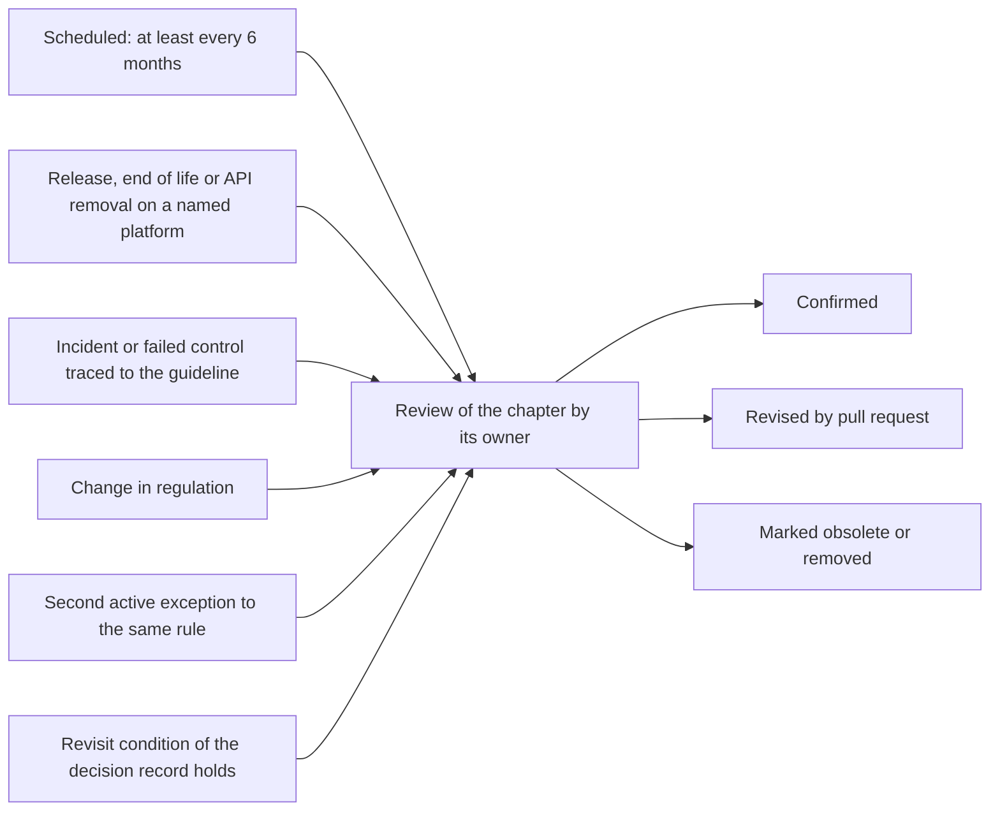

# Governing the guidelines

## Understand

A **guideline** is a chapter of this site that tells teams how to design, build or run systems. A **rule** is one statement inside a chapter that teams are expected to follow. Governing the guidelines means answering four questions: who owns each chapter, how a team asks for an exception when it cannot follow a rule, where that exception is recorded and when it ends, and how often a chapter is checked to see whether it is still right.

**The problem.** Documents that nobody owns decay. Google's engineering book says it plainly: ["Documents without owners become stale and difficult to maintain"](https://abseil.io/resources/swe-book/html/ch10.html). Exceptions decay too: an exception with no end date stays in force until someone remembers to remove it. On Azure Policy, the expiry date of an exemption is [optional](https://learn.microsoft.com/azure/governance/policy/concepts/exemption-structure), and the pages read for Google Cloud's [Organization Policy](https://docs.cloud.google.com/organization-policy/overview) document no expiry for an override at all (an absence on the pages read, not a confirmed fact).

**Why it matters.** The project specification puts compliance and audit at the core, and it already names one rule that admits a deviation only as an approved and recorded exception: point-in-time restore of a single tenant's data, which loses data (`docs/superpowers/specs/2026-11-10-cloud-architect-devops-design.md`, section C). An auditor will ask who allowed a deviation, why, until when, and what compensates for it.

**The outcome here.** Every chapter has one named owner. An exception is a short file in this repository, requested and approved by pull request, with a mandatory end date. Every chapter is reviewed at least every 6 months, and earlier when something changes. This repository is public, and on GitHub ["Public repositories are accessible to everyone on the internet"](https://docs.github.com/en/enterprise-cloud@latest/repositories/creating-and-managing-repositories/about-repositories), so a record holds only what may be public; anything else goes to a private repository.

Two things are not in place on 2026-11-18, and this chapter says so wherever it matters. No check reads an expiry date or compares a review date with today's date (`tools/content-lint.mjs`). And no rule on the forge, the service that hosts the repository (here GitHub), has been set up to require a review or a passing check before a merge: [ADR 0001](/adr/0001-docs-as-code-with-docusaurus.md) records that no required status check is configured and that enforcement on the forge is wired in the delivery phase, and `.github/workflows/verify.yml` runs the gates on every pull request and says it stops a merge only if a branch protection makes its job a required status check. The forge's settings themselves were not read for this chapter. The work that closes both gaps is listed under [Adoption checklist](#adoption-checklist).

The terms used in this chapter:

- **Pull request**: a proposed change to the repository that others can read, comment on and approve before it is merged into the main version.
- **Lint** and **gates**: automated checks of the repository's files. The lint checks that each document has its required fields and sections; the gates are the full set of checks run by `task verify`, of which the lint is one.
- **Owner**: the one person, or role, accountable for a chapter. Microsoft Learn defines the owner of an article as the one ["responsible for decisions about the content of the article"](https://learn.microsoft.com/contribute/content/metadata).
- **Decision record (ADR)**: a short document that records one decision, the options considered and the reasons. Its **deciders** are the people named in it who took the decision.
- **Exception**: permission, limited in scope and in time, not to follow a rule. Microsoft's Defender for Cloud keeps two actions apart: [removing a rule](https://learn.microsoft.com/azure/defender-for-cloud/exempt-resource) means the control should never apply; an exemption means the control stays valid and remediation is temporarily not required. Asking that a rule stop applying to everyone is therefore a change to the guideline, not an exception.
- **Waiver** and **mitigation**: the two categories of an Azure Policy exemption. Mitigated: ["the policy intent is met through another method"](https://learn.microsoft.com/azure/governance/policy/concepts/exemption-structure). Waiver: "the non-compliance state of the resource is temporarily accepted".
- **Compensating control**: a measure that reduces, by other means, the risk that the rule addressed. Google's enterprise foundations blueprint says that the people who grant an exception should be able to [judge the case and decide whether compensating controls are needed](https://docs.cloud.google.com/architecture/blueprints/security-foundations/operation-best-practices).
- **Expiry**: the date after which an exception no longer applies.
- **Register**: the list of every exception, active or not.
- **Review**: a check of a chapter by its owner, on a schedule or because something happened.
- **Code owner**: on GitHub, a person or team named for a path in a file called `CODEOWNERS`. Code owners are [automatically requested for review](https://docs.github.com/en/enterprise-cloud@latest/repositories/managing-your-repositorys-settings-and-features/customizing-your-repository/about-code-owners) on pull requests that touch their files.
- **Ruleset** and **branch protection**: two GitHub features that set conditions for a merge, such as a pull request, an approving review or a passing check ([rulesets](https://docs.github.com/en/enterprise-cloud@latest/repositories/configuring-branches-and-merges-in-your-repository/managing-rulesets/about-rulesets)).
- **Required status check**: an automated check that must pass before a merge; without that setting, a check only reports.
- **Bypass**: a permission to merge or push past a rule that applies to everyone else.
- **Platform object**: the object a policy engine uses to exempt something, such as an Azure Policy exemption or a Kyverno `PolicyException`. It is the enforcement of an exception on that platform; the record in this repository is the decision.

### Who owns what

| Role | Who | Accountable for |
|---|---|---|
| Chapter owner | The person named in the chapter's `owner` field | The content of the chapter; its review on schedule; deciding exceptions to its rules; keeping its Verification status true |
| Deputy | A second person with write access to the repository, named when the forge rules are wired in the delivery phase | Approving the exceptions that the owner requests for his own chapters |
| Deciders | The people named in the `deciders` field of the chapter's decision record | Settling a disputed exception; deciding a second renewal of the same exception; naming a new owner when one leaves |
| Requester | The team that cannot follow a rule | Opening the pull request with the record, and keeping to its scope and end date |
| Approver | The owner, or the deputy when the owner is the requester | Approving or rejecting the request in the pull request |
| Platform team | Whoever operates the engine that enforces the rule (Azure Policy, Organization Policy, a cluster's admission controller) | Creating the platform object of an approved exception, and removing it when the exception ends |

Why one owner and not a list: Backstage's software catalog says ["There will always be one ultimate owner"](https://backstage.io/docs/features/software-catalog/descriptor-format/), and the Cloud Adoption Framework gives every risk a [single primary owner](https://learn.microsoft.com/azure/cloud-adoption-framework/govern/assess-cloud-risks), an "individual or role". The deciders are the escalation point, as the executive sponsor is in the [Cloud Adoption Framework](https://learn.microsoft.com/azure/cloud-adoption-framework/govern/build-cloud-governance-team) and the CTO is in Google's [example error budget policy](https://sre.google/workbook/error-budget-policy/). The framework's example RACI matrix makes the cloud platform teams and the workload teams responsible for [enforcing policies and monitoring compliance](https://learn.microsoft.com/azure/cloud-adoption-framework/govern/build-cloud-governance-team).

**When an owner leaves** or stops reviewing, the deciders name a new owner by pull request, and every review of a chapter confirms that its owner is still active. Kubernetes keeps its owner lists current the same way: inactive approvers are moved to [`emeritus_approvers`](https://www.kubernetes.dev/docs/guide/owners/), and leads of a group who are unreachable for over a month [should be removed](https://github.com/kubernetes/community/blob/master/committee-steering/governance/sig-governance.md).

**One person, every role.** On 2026-11-18 one person owns every chapter and is the decider of every decision record, and no deputy is named. On GitHub ["Pull request authors cannot approve their own pull requests"](https://docs.github.com/en/enterprise-cloud@latest/pull-requests/collaborating-with-pull-requests/reviewing-changes-in-pull-requests/approving-a-pull-request-with-required-reviews), so the owner cannot approve an exception he requests for his own chapter. Until the deputy is named, such an exception is merged by the owner without an independent approval; its record names him as both requester and approver, which shows it; the dated report (see [Forge settings that enforce it](#forge-settings-that-enforce-it)) lists every such record still active; and the deputy, once named, confirms each one by a pull request the deputy approves, or closes it.

### The life of an exception

1. **Request.** The requester opens a pull request that adds one record with `status: proposed`, and marks it ready for review: ["Code owners are not automatically requested to review draft pull requests"](https://docs.github.com/en/enterprise-cloud@latest/repositories/managing-your-repositorys-settings-and-features/customizing-your-repository/about-code-owners).
2. **Decision.** The owner of the chapter, or the deputy when the owner is the requester, decides. The approver first pushes the commit that sets `status: approved` or `rejected` and fills in `approved_by` and `approved_on`, and then approves the review. A rejected request is merged as a rejected record, so that the register shows what was refused; a request the requester abandons is merged as `withdrawn`.
3. **Active.** The platform team creates the platform object, which carries the record's identifier and, where the platform has one, the same expiry date (see [Exceptions that a platform enforces](#exceptions-that-a-platform-enforces)).
4. **Warning.** From 30 days before the expiry date, the dated report lists the record.
5. **End**, in one of three ways:
   - **Expired.** The date has passed. Nobody edits the record: "expired" is read from the date, and the record stays in the repository, as Azure keeps an expired exemption: ["The object is preserved for record-keeping, but the exemption is no longer honored"](https://learn.microsoft.com/azure/governance/policy/concepts/exemption-structure). Where the platform documents no expiry, the platform team removes the platform object by hand.
   - **Renewed.** A new record that names the one it `replaces`; the old record's status becomes `replaced`. The owner decides a first renewal; a second renewal of the same exception goes to the deciders and triggers a review of the rule.
   - **Closed early.** The requester complies before the date; the record's status becomes `closed`, and the platform team removes the platform object by hand, because its own expiry date, where the platform has one, is still in the future.

An exception lasts at most 6 months from its approval.


### When the guidelines are reviewed

Every chapter is reviewed at least every 6 months, and earlier when one of these events occurs:

- a minor release, an end of life or an API removal on a platform the chapter names: Kubernetes ships [about three minor releases a year](https://kubernetes.io/releases/release/), maintains [the three most recent minor releases](https://kubernetes.io/releases/) and removes beta APIs on a [published policy](https://kubernetes.io/docs/reference/using-api/deprecation-policy/); SUSE publishes the [Rancher and RKE2 lifecycle dates](https://www.suse.com/lifecycle/);
- an incident or a failed control traced to the guideline, or a change in regulation: the Cloud Adoption Framework recommends event-based reviews ["such as a failed governance policy, technology change, or regulatory compliance change"](https://learn.microsoft.com/azure/cloud-adoption-framework/govern/document-cloud-governance-policies) next to scheduled ones;
- a second active exception to the same rule: a trigger the decider set; no research finding names it (the framework's nearest advice, to ["adjust policies and enforcement mechanisms"](https://learn.microsoft.com/azure/cloud-adoption-framework/govern/monitor-cloud-governance), is about low-risk violations under audit-first enforcement, not about recurring exceptions);
- a revisit condition of the chapter's decision record becoming true.



A review covers accuracy, clarity for the audience and consistency of writing, the three kinds of review in [Google's engineering book](https://abseil.io/resources/swe-book/html/ch10.html), and also the sources, the Verification status, the owner, and the open exceptions with their platform objects. Its outcome is one of three: confirmed; revised by pull request; or, for a chapter that no longer serves a purpose, ["either remove it or identify it as obsolete"](https://abseil.io/resources/swe-book/html/ch10.html). How a chapter is marked obsolete is not designed yet: the chapter `status` values are `draft`, `reviewed` and `approved` (`tools/content-lint.mjs`).

The documented intervals run from three months to a year: a reminder when a document ["hasn't been touched in, for example, three months"](https://abseil.io/resources/swe-book/html/ch10.html), ["every four months"](https://learn.microsoft.com/azure/well-architected/design-guides/implementing-recommendations) for a Well-Architected Review, ["quarterly, biannually, or yearly"](https://learn.microsoft.com/azure/cloud-adoption-framework/govern/assess-cloud-risks) for a risk review, and a [revisit date](https://sre.google/workbook/error-budget-policy/) about a year after approval. Six months is the decider's choice within that range.

`last_reviewed` changes only after a real review, not after a typo fix, as the .NET documentation does for its own date field ([.NET docs guide](https://learn.microsoft.com/contribute/content/dotnet/dotnet-style-guide)), and only the owner changes it. Decision records get no review date of their own: an accepted record is not edited (["Don't go back and edit accepted records"](https://learn.microsoft.com/azure/well-architected/architect-role/architecture-decision-record)), and its revisit conditions are checked at each review of the chapter it supports.

## Decide

What is already fixed under every option below: the chapters live in this repository and change by pull request ([ADR 0001](/adr/0001-docs-as-code-with-docusaurus.md)), and every chapter has an `owner` and a `last_reviewed` date that `task content:lint` requires. What is open: where an exception is requested and recorded, what makes it expire, how the owner of the guideline takes part in the decision, how often a chapter is reviewed, and, because the repository is public, what a record here may contain.

The decider has chosen the first option below. The matrix compares the options on the evidence; it is not a ranking that decides. For each option, [What the comparison shows](#what-the-comparison-shows) says where the evidence separates it from the chosen option and where it does not.

### Options

- **A. Governance records in the guidelines repository.** An exception is a file with fixed fields in a folder of the chapter it relaxes, requested and approved by pull request, with a mandatory expiry date. Microsoft's [Azure Policy as Code](https://learn.microsoft.com/azure/governance/policy/concepts/policy-as-code) layout likewise keeps each exemption file in source control next to the assignment it relaxes, deployed only after review. On the forge: the code owner's review required by a ruleset, the gates made a required status check, and a scheduled workflow that reports lapsed records.
- **B. Platform-native exemption objects as the register.** Each platform keeps its own record: Azure Policy [exemptions](https://learn.microsoft.com/azure/governance/policy/concepts/exemption-structure) and [attestations](https://learn.microsoft.com/azure/governance/policy/concepts/attestation-structure), Defender for Cloud [exemptions](https://learn.microsoft.com/azure/defender-for-cloud/exempt-resource); Google Cloud Organization Policy overrides at [folder or project level](https://docs.cloud.google.com/architecture/security-foundations/preventative-controls) and [tag conditions](https://docs.cloud.google.com/organization-policy/scope-policies), Policy Controller [namespace exemptions](https://docs.cloud.google.com/kubernetes-engine/policy-controller/docs/how-to/policy-controller-exclude-namespaces); on a cluster, Kyverno [`PolicyException`](https://kyverno.io/docs/exceptions/), [Gatekeeper](https://open-policy-agent.github.io/gatekeeper/website/docs/exempt-namespaces/) and [Kubewarden](https://documentation.suse.com/cloudnative/admission-controller/1.38/en/howtos/policies.html) namespace exclusions, and [Pod Security Admission](https://kubernetes.io/docs/concepts/security/pod-security-admission/) exemptions. There is no register outside the platforms.
- **C. Governance body and tracker.** Requests are tickets decided by a named group, and the tracker is the register, as in the Kubernetes [release exception process](https://github.com/kubernetes/sig-release/blob/master/releases/EXCEPTIONS.md). Three trackers were researched, and a fact about one is not used for another:
  - **C1. GitHub Issues and Projects**, with the issues in this repository.
  - **C2. Azure Boards** (Azure DevOps Services), with a custom work item type.
  - **C3. Jira Cloud**, in a company-managed space on a paid plan.

  Jira Service Management, which the research lists as an option of its own, is not scored on its own: its approvals were read on its own pages ([set-up](https://support.atlassian.com/jira-service-management-cloud/docs/set-up-approvals/), [`approval.exclude`](https://support.atlassian.com/jira/kb/jira-service-management-cloud-approval-workflow-properties/)), but its per-approver history rests on one entry of Atlassian's public tracker, [JSDCLOUD-6264](https://jira.atlassian.com/browse/JSDCLOUD-6264) ("History should be set when each approver approves a transition", closed as fixed), not on a product page, and its fields and audit log were not read. It is named under [When to deviate](#when-to-deviate).
- **D. Decision records only.** Every exception is a decision record in the existing `adr/` folder, with the existing contract, named per chapter so that a `CODEOWNERS` line per chapter can match it. The Well-Architected Framework keeps decision records [version controlled](https://learn.microsoft.com/azure/well-architected/operational-excellence/tools-processes) and makes the log [append-only](https://learn.microsoft.com/azure/well-architected/architect-role/architecture-decision-record), with a status.

### Weighted matrix

#### How the options are scored

Every option is scored **as designed**: with the mechanisms its documentation describes, configured as the option needs them, none of them exercised. For the chosen option that includes a new document type and its lint rule, a dated report, and forge settings that are not in place; for a tracker, the configuration of that product. Cells that rest on such work are marked †. Decision records only (D) is scored with the existing contract, which has no expiry field; D with the contract extended is scored separately, under [Sensitivity](#sensitivity).

Three rules apply to every option:

- **Unverified points are not credited.** A property that only an unverified point would support scores as not met; the best case appears only in the sensitivity analysis.
- **Ways around halve a property.** A way around counts when the research documents it and it works while the configuration stays as designed: a role or permission that skips the rule, a deletion, or the product not applying the rule (a run delayed, dropped or switched off; a required reviewer silently not assigned). Editing or switching off the configuration itself is open to the administrators of every option and is not counted for any.
- **Properties, not impressions.** For expiry, audit evidence and the owner's part, each property counts 2 if met, 1 if met with a documented way around, 0 if not met. A written rule counts 0, and so does a check or a review that is not required: it reports and refuses nothing. Expiry has two properties, and its level is 1 + points. Audit evidence and the owner's part have three properties (0 to 6 points), converted to a level as 0 → 1, 1 → 2, 2 → 2, 3 → 3, 4 → 4, 5 → 4, 6 → 5.

#### Criteria and levels

The decider set the weights on 2026-11-18.

| Id | Criterion | Weight | Levels |
|---|---|---|---|
| K1 | One register for every platform, and for rules that no engine enforces | 15 | 5: one format in one place for exceptions to rules enforced on Azure, on Google Cloud, on a cluster, and to process rules. 3: all four can be recorded, in more than one format or place. 2: each platform has its own format and place, and a process rule can be recorded on one platform only. 1: only rules a platform's engine enforces can have a record |
| K2 | Expiry that cannot be skipped | 25 | Properties: (p) the system refuses a record without a valid expiry date before the record is accepted; (q) lapsed and soon-to-lapse records are reported on a schedule that nobody has to start. Level = 1 + points |
| K3 | Evidence for an audit | 20 | Properties: (a) requester, approver, approval date, reason and compensating control are named parts of the record; (b) the approval is recorded by the system that holds the record, not only typed into it; (c) a lapsed, closed or rejected record stays readable with its history |
| K4 | The owner of the guideline is in the loop | 15 | Properties: (r1) the system asks the owner of the guideline concerned, not a fixed group or whoever the requester names; (r2) the system requires an approval before the record is accepted; (r3) the requester cannot approve his own request (counted only when (r2) counts) |
| K5 | Cost to run, and testable locally | 15 | 5: nothing new. 4: new checks in the repository's own tools, runnable offline, and settings on the existing forge; no new product, seat or account. 3: no new product, but the records live in a service that cannot be run or tested locally. 2: a separate product to choose, license, configure and keep, not testable locally. 1: a real tenant, organisation or cluster per platform to create and read each record |
| K6 | Exit cost | 10 | 5: records, history and system-recorded approvals leave as plain files, nothing to rebuild. 4: records and history leave as plain files; the approvals stay on the forge and must be read out through its API; the enforcement must be rebuilt. 3: a documented export with current values only; history needs a second mechanism; the workflow must be rebuilt. 2: only a limited export, and that history leaves is not documented. 1: records spread over several platforms, each read separately with a real tenant, organisation or cluster |

K1 comes from the scope of the guidelines (Azure, Google Cloud, on-prem, and process rules such as the restore rule above); K2 and K4 from the questions this chapter answers; K3 from the specification, which puts compliance and audit at the core; K5 from its requirement that everything be provable locally at zero cloud cost at the start, and the Cloud Adoption Framework recommends keeping the governance team [small](https://learn.microsoft.com/azure/cloud-adoption-framework/govern/build-cloud-governance-team); K6 from its aim of avoiding lock-in.

Not criteria, and why:

- **The review cycle**: under every option the chapters stay in the repository with a `last_reviewed` date, so it does not separate the options.
- **The exception's effect on the platform.** In every option that keeps a register (A, C1, C2, C3, D), the exception takes effect when its platform object is created, which does not wait for the record: whoever holds the Azure permissions can [create an exemption](https://learn.microsoft.com/azure/governance/policy/concepts/exemption-structure), whoever can attach a tag grants a [tag-based exception](https://docs.cloud.google.com/resource-manager/docs/tags/tags-overview), and a Kyverno exception is accepted from its [configured namespace](https://kyverno.io/docs/installation/customization/). In B the record is the object, and where a date is set some platforms end the exception on their own: an Azure exemption is no longer honoured after its date, and a Kyverno exception can be deleted by a [`DeletingPolicy`](https://kyverno.io/docs/policy-types/deleting-policy/). On this point B is ahead of every register option. It is not scored, and it is stated as a limit of the decision.
- **Who can read a record**: its effect on audit evidence is scored in K3 (a), and what may be public is a rule of the recommendation.

#### Matrix

| Criterion | Weight | A. Records in the repository | B. Platform-native objects | C1. GitHub Issues and Projects | C2. Azure Boards | C3. Jira Cloud | D. Decision records only |
|---|---|---|---|---|---|---|---|
| K1 One register | 15 | 5 | 2 | 5 | 5 | 5 | 5 |
| K2 Expiry | 25 | 3 † | 2 | 2 † | 3 † | 2 † | 1 |
| K3 Audit evidence | 20 | 4 † | 2 | 2 † | 3 † | 3 † | 3 † |
| K4 Owner in the loop | 15 | 4 † | 1 | 2 † | 2 † | 4 † | 4 † |
| K5 Cost, local | 15 | 4 | 1 | 3 | 2 | 2 | 4 |
| K6 Exit cost | 10 | 4 | 1 | 2 | 3 | 2 | 4 |
| **Total** | 100 | **390** | **160** | **260** | **300** | **295** | **320** |

Arithmetic (weight x level):

- A: 15x5 + 25x3 + 20x4 + 15x4 + 15x4 + 10x4 = 75 + 75 + 80 + 60 + 60 + 40 = 390
- B: 15x2 + 25x2 + 20x2 + 15x1 + 15x1 + 10x1 = 30 + 50 + 40 + 15 + 15 + 10 = 160
- C1: 15x5 + 25x2 + 20x2 + 15x2 + 15x3 + 10x2 = 75 + 50 + 40 + 30 + 45 + 20 = 260
- C2: 15x5 + 25x3 + 20x3 + 15x2 + 15x2 + 10x3 = 75 + 75 + 60 + 30 + 30 + 30 = 300
- C3: 15x5 + 25x2 + 20x3 + 15x4 + 15x2 + 10x2 = 75 + 50 + 60 + 60 + 30 + 20 = 295
- D: 15x5 + 25x1 + 20x3 + 15x4 + 15x4 + 10x4 = 75 + 25 + 60 + 60 + 60 + 40 = 320

The totals compare; they do not rank. C2 (300) and C3 (295) are 5 points apart, and with other weights their order reverses (S7): the evidence does not order them.

#### Why each cell scores as it does

**K1 One register.** A, C1, C2, C3 and D are 5 by definition: a file or a ticket is tied to no platform. For A, the detail kept in the private repository does not make a second register; every exception has its record here, in one format. B is 2: each mechanism exempts only from its own engine. An Azure Policy exemption targets a [policy assignment](https://learn.microsoft.com/azure/governance/policy/concepts/exemption-structure), an Organization Policy override relaxes a constraint on a [folder or project](https://docs.cloud.google.com/organization-policy/overview), and a Kyverno exception lets resources bypass [a given policy and rule](https://kyverno.io/docs/exceptions/). A rule that no engine enforces has a platform object only on Azure, as an [attestation](https://learn.microsoft.com/azure/governance/policy/concepts/attestation-structure) for a policy with the `manual` effect.

**K2 Expiry** (properties (p) and (q)):

- **A: 3 †** (1 + 2 points). (p) 1: a lint rule for exception records inside `task content:lint`, made a required status check; required checks ["must pass before the pull request can be merged"](https://docs.github.com/en/enterprise-cloud@latest/pull-requests/collaborating-with-pull-requests/collaborating-on-repositories-with-code-quality-features/about-status-checks). Way around: unless an app is pinned as the expected source of the check, a status of the same name set by another person or integration satisfies it; with pinning, ["If the status is set by any other person or integration, merging won't be allowed"](https://docs.github.com/en/enterprise-cloud@latest/repositories/configuring-branches-and-merges-in-your-repository/managing-rulesets/available-rules-for-rulesets). Whether the GitHub Actions app, which runs the gates, can be pinned is not in the research, so the way around counts. A trap that needs a change to the workflow file, and so is not counted: a skipped required job reports "Success" and does not stop a merge ([status checks](https://docs.github.com/en/enterprise-cloud@latest/pull-requests/collaborating-with-pull-requests/collaborating-on-repositories-with-code-quality-features/about-status-checks)); the guard is a code owner on `.github/` and no condition on the job. (q) 1: a scheduled workflow that [opens an issue](https://docs.github.com/en/enterprise-cloud@latest/actions/tutorials/manage-your-work/schedule-issue-creation). Ways around: scheduled runs can be [delayed or dropped](https://docs.github.com/en/enterprise-cloud@latest/actions/reference/workflows-and-actions/events-that-trigger-workflows) under load, and in a public repository they are [switched off](https://docs.github.com/en/enterprise-cloud@latest/actions/how-tos/manage-workflow-runs/disable-and-enable-workflows) after 60 days with no repository activity.
- **B: 2** (1 point). (p) 1, on some platforms only: the Defender portal, in Public Preview, makes the [expiry mandatory](https://learn.microsoft.com/azure/defender-for-cloud/exempt-resource); on Azure Policy it is [optional](https://learn.microsoft.com/azure/governance/policy/concepts/exemption-structure), and so it is in the Defender for Cloud Azure portal; no expiry is documented on the pages read for Organization Policy, the [Kyverno exception](https://kyverno.io/docs/exceptions/), [Gatekeeper](https://open-policy-agent.github.io/gatekeeper/website/docs/exempt-namespaces/) or [Kubewarden](https://documentation.suse.com/cloudnative/admission-controller/1.38/en/howtos/policies.html); Pod Security Admission exemptions are [statically configured](https://kubernetes.io/docs/concepts/security/pod-security-admission/). (q) 0: the research found no automatic notification at Azure exemption expiry; Microsoft publishes a [sample query](https://learn.microsoft.com/azure/governance/policy/samples/resource-graph-samples) for exemptions expiring within 90 days, which someone has to run.
- **C1: 2 †** (1 point). (p) 0: issue forms have [no date element](https://docs.github.com/en/communities/using-templates-to-encourage-useful-issues-and-pull-requests/syntax-for-githubs-form-schema); organisation [issue fields](https://docs.github.com/en/enterprise-cloud@latest/issues/tracking-your-work-with-issues/using-issues/managing-issue-fields-in-your-organization) have a Date type but are in public preview for select organisations and [cannot be set from templates](https://docs.github.com/en/issues/tracking-your-work-with-issues/using-issues/adding-and-managing-issue-fields), and whether they can be required is not documented. (q) 1: a scheduled workflow, with A's ways around.
- **C2: 3 †** (2 points). (p) 0: a custom field [can be required](https://learn.microsoft.com/azure/devops/organizations/settings/work/add-custom-field?view=azure-devops), and rules are [enforced through the API too](https://learn.microsoft.com/en-us/azure/devops/organizations/settings/work/rule-reference?view=azure-devops), but whether a required field can be a date is not in the research. (q) 2: notifications are [event-driven only](https://learn.microsoft.com/azure/devops/organizations/notifications/about-notifications?view=azure-devops), so a [scheduled pipeline](https://learn.microsoft.com/azure/devops/pipelines/process/scheduled-triggers?view=azure-devops) reports lapsed items; its limits cap runs and do not skip them. UNVERIFIED: whether a scheduled pipeline runs by default only when the source has changed, and whether a setting makes it run always; the research covers neither. The scoring is asymmetric here: A's (q) is halved because GitHub documents that its scheduled runs can be delayed, dropped or switched off, while C2's (q) is credited in full only because the research found no such limit for scheduled pipelines, an absence on the pages read, not a confirmed fact. If a scheduled pipeline skips runs on an unchanged source, C2's (q) drops to 1, K2 to 2, and C2 totals 275.
- **C3: 2 †** (1 point). (p) 0: fields [can be made required](https://support.atlassian.com/jira/kb/cant-create-issues-because-of-required-fields-in-jira-cloud/), but whether the field can be a date is not in the research. (q) 1: a [scheduled automation](https://support.atlassian.com/jira-software-cloud/docs/automation-triggers/) acts on the work items a query returns. Ways around: a scheduled flow that fails 10 times in a row switches itself off, and flows stop at 100% of the [monthly allowance](https://support.atlassian.com/cloud-automation/docs/how-is-my-usage-calculated/) unless extra usage is enabled.
- **D: 1** (0 points). The decision record contract has `status`, `date` and `deciders` and no expiry field (`tools/content-lint.mjs`). A written rule that asks for a date in the text counts 0.

**K3 Audit evidence** (properties (a), (b) and (c)):

- **A: 4 †** (1 + 1 + 2 = 4 points). (a) 1: the record's fields, checked by the lint rule in the required check; counted 1 because the check has the way around above, and because a record in a public repository keeps part of its content in the private repository. (b) 1: the approval is the code owner's review, required by a ruleset; GitHub returns each review with its [`user`, `state`, `submitted_at` and the `commit_id`](https://docs.github.com/en/enterprise-cloud@latest/rest/pulls/reviews) it applies to, and a dismissed review stays as a comment with a [mandatory explanation](https://docs.github.com/en/enterprise-cloud@latest/pull-requests/collaborating-with-pull-requests/reviewing-changes-in-pull-requests/dismissing-a-pull-request-review). Ways around: ["Repository owners and administrators can merge a pull request even if it hasn't received an approving review"](https://docs.github.com/en/enterprise-cloud@latest/pull-requests/collaborating-with-pull-requests/reviewing-changes-in-pull-requests/approving-a-pull-request-with-required-reviews), and ruleset [bypass actors](https://docs.github.com/en/enterprise-cloud@latest/repositories/configuring-branches-and-merges-in-your-repository/managing-rulesets/creating-rulesets-for-a-repository) can merge past the rules. (c) 2: the file stays in the repository after it lapses, and git keeps its history. Whether the history of the default branch can be rewritten is not covered by the research: a limit, named and not counted.
- **B: 2** (1 point). (a) 0: on Azure, `requestedBy`, `approvedBy`, `approvedOn` and `ticketRef` are [examples in free metadata](https://learn.microsoft.com/azure/governance/policy/concepts/exemption-structure), not required; no platform names requester and approver as parts of the record. (b) 0: that the platform logs who created an exemption is not in the research for Azure Policy or Organization Policy. (c) 1, on some platforms only: Azure keeps the expired object, but its guidance allows deleting expired exemptions at a revisit; a Kyverno exception deleted by a `DeletingPolicy` is gone.
- **C1: 2 †** (2 points). (a) 1: an issue form names the fields, and its required fields are [enforced only in public repositories](https://docs.github.com/en/communities/using-templates-to-encourage-useful-issues-and-pull-requests/syntax-for-githubs-form-schema); way around: ["Contributors can edit their issues"](https://docs.github.com/en/communities/using-templates-to-encourage-useful-issues-and-pull-requests/syntax-for-issue-forms). (b) 0: issues have no approval step; the rule against approving one's own work that the research found is for pull requests. (c) 1: a closed issue stays; way around: administrators can [delete an issue](https://docs.github.com/en/enterprise-cloud@latest/issues/tracking-your-work-with-issues/administering-issues/deleting-an-issue) permanently once the organisation allows it, and collaborators are not notified.
- **C2: 3 †** (3 points). (a) 1: a custom work item type with required fields; way around: holders of "Bypass rules on work item updates" [save work items without rule evaluation](https://learn.microsoft.com/en-us/azure/devops/organizations/settings/work/rule-reference?view=azure-devops). (b) 1: the transition to approved [restricted to an approvers group](https://learn.microsoft.com/azure/devops/release-notes/2020/sprint-172-update#azure-boards), stamped with the current user and time, and every revision records [who, when and which fields changed](https://learn.microsoft.com/azure/devops/boards/queries/history-and-auditing?view=azure-devops); same way around. (c) 1: deleting a work item [creates a revision and preserves it](https://learn.microsoft.com/en-us/azure/devops/boards/backlogs/remove-delete-work-items?view=azure-devops); way around: a destroyed work item cannot be restored.
- **C3: 3 †** (3 points). (a) 2: required fields, no way around documented. (b) 0: an [approval step](https://support.atlassian.com/jira-software-cloud/docs/set-up-approval-steps/) exists, but what it records about each approver is not documented on a Jira page. (c) 1: an [archived work item](https://support.atlassian.com/jira-software-cloud/docs/archive-an-issue/) can be restored; way around: deleted work items ["are permanently deleted"](https://support.atlassian.com/jira/kb/how-to-mass-delete-issues-in-jira/).
- **D: 3 †** (3 points). (a) 0: requester, scope and compensating control are not parts of a decision record. (b) 1: as A. (c) 2: as A.

**K4 Owner in the loop** (properties (r1), (r2) and (r3)):

- **A: 4 †** (1 + 1 + 2 = 4 points). (r1) 1: a `CODEOWNERS` line per chapter, matching the chapter file and its folder of records, requests that chapter's owner automatically; way around: ["If you specify a user or team that doesn't exist or has insufficient access, a code owner will not be assigned"](https://docs.github.com/en/enterprise-cloud@latest/repositories/managing-your-repositorys-settings-and-features/customizing-your-repository/about-code-owners). (r2) 1: with the code owner's review required, ["any pull request that modifies content with a code owner must be approved by that code owner before the pull request can be merged"](https://docs.github.com/en/enterprise-cloud@latest/repositories/configuring-branches-and-merges-in-your-repository/managing-rulesets/available-rules-for-rulesets); ways around: administrator merge and bypass actors. (r3) 2: [authors cannot approve their own pull requests](https://docs.github.com/en/enterprise-cloud@latest/pull-requests/collaborating-with-pull-requests/reviewing-changes-in-pull-requests/approving-a-pull-request-with-required-reviews).
- **B: 1** (0 points). Whoever holds the exemption permissions on the scope can [create an Azure exemption](https://learn.microsoft.com/azure/governance/policy/concepts/exemption-structure); whoever can attach a [tag](https://docs.cloud.google.com/resource-manager/docs/tags/tags-overview) grants a tag-based exception; a Kyverno exception is accepted from the [configured namespace](https://kyverno.io/docs/installation/customization/); Pod Security Admission exemptions on RKE2 are a [file on the node](https://docs.rke2.io/security/pod_security_standards). The owner of the guideline is part of none of them.
- **C1: 2 †** (2 points). (r1) 2: an issue form can set [`assignees`](https://docs.github.com/en/communities/using-templates-to-encourage-useful-issues-and-pull-requests/syntax-for-issue-forms), so a form per chapter assigns its owner. (r2) 0: nothing requires an approval on an issue. (r3) 0.
- **C2: 2 †** (1 point). (r1) 0: the approvers are a fixed group. (r2) 1: the restricted transition, with the bypass permission as way around. (r3) 0: the inherited process does not support [`NOTSAMEAS`](https://learn.microsoft.com/en-us/azure/devops/organizations/settings/work/rule-reference?view=azure-devops), and no rule against self-approval was found.
- **C3: 4 †** (4 points). (r1) 0: the approvers come from fields filled per request. (r2) 2: an [approval step](https://support.atlassian.com/jira-software-cloud/docs/set-up-approval-steps/) is required in the workflow; whether it exists on every plan is not documented, a limit named and not counted. (r3) 2: "Exclude approvers from" keeps the reporter from approving.
- **D: 4 †** (4 points). (r1) 1: `CODEOWNERS` patterns follow ["most of the same rules used in gitignore files"](https://docs.github.com/en/enterprise-cloud@latest/repositories/managing-your-repositorys-settings-and-features/customizing-your-repository/about-code-owners), and only `\#` escaping, `!` negation and `[ ]` ranges are excluded, so a line per chapter can match a file-name pattern for that chapter's exception records inside `adr/`; same way around as A. (r2) 1 and (r3) 2: as A.

**K5 Cost, local:**

- **A: 4.** A new document type, a lint rule and a report script in `tools/`, testable offline with `node --test`, and settings on the existing forge that need no cloud account. Code owners, protected branches and rulesets are available for a public repository on every plan, GitHub Free for organizations included ([code owners](https://raw.githubusercontent.com/github/docs/main/data/reusables/gated-features/code-owners.md), [protected branches](https://raw.githubusercontent.com/github/docs/main/data/reusables/gated-features/protected-branches.md), [rulesets](https://raw.githubusercontent.com/github/docs/main/data/reusables/gated-features/repo-rules.md)). Each published record also needs an Italian translation (`tools/i18n-parity.mjs`).
- **B: 1.** Creating or reading the records needs a real Azure tenant or Google Cloud organisation; on Google Cloud, more than 20 [Policy Analyzer](https://docs.cloud.google.com/policy-intelligence/docs/analyze-organization-policies) queries per organisation per day need a paid Security Command Center tier.
- **C1: 3.** No new product, but the records live in issues, outside git, and nothing of it runs locally.
- **C2: 2.** A separate product. Requesters can use free [Stakeholder access](https://learn.microsoft.com/en-us/azure/devops/organizations/security/stakeholder-access?view=azure-devops); the organisation [audit log](https://learn.microsoft.com/en-us/azure/devops/organizations/audit/azure-devops-auditing?view=azure-devops) is in public preview, needs Microsoft Entra ID, is off by default and keeps events 90 days.
- **C3: 2.** A separate product; the [audit log](https://support.atlassian.com/jira-cloud-administration/docs/audit-activities-in-jira-applications/) is not available on the Free plan; automation runs on a monthly step allowance, [billed beyond it](https://support.atlassian.com/cloud-automation/docs/how-is-my-usage-calculated/) from 2026-12-03.
- **D: 4.** The template, its lint rule and the pull request exist; the review that K3 and K4 credit needs the same forge settings as A.

**K6 Exit cost:**

- **A: 4.** The record files and their history move with the repository. The approval of record is a review on the forge, returned by its [REST API](https://docs.github.com/en/enterprise-cloud@latest/rest/pulls/reviews), so it has to be read out before leaving; the typed `approved_by` and `approved_on` travel with the file. `CODEOWNERS` is a plain file; rulesets must be re-expressed on another forge, and ["The bypass list of a ruleset is excluded from the exported JSON file"](https://docs.github.com/en/enterprise-cloud@latest/repositories/configuring-branches-and-merges-in-your-repository/managing-rulesets/managing-rulesets-for-a-repository).
- **B: 1.** Each platform is read separately, with a real tenant, organisation or cluster.
- **C1: 2.** A Projects view [exports as TSV](https://docs.github.com/en/enterprise-cloud@latest/issues/planning-and-tracking-with-projects/managing-your-project/exporting-your-projects-data); a [migration archive](https://docs.github.com/en/enterprise-cloud@latest/migrations/using-ghe-migrator/exporting-migration-data-from-githubcom) needs a preview API, is deleted after seven days and must stay under 20 GB; Projects are not in the [migrated data](https://docs.github.com/en/enterprise-server@3.19/migrations/using-ghe-migrator/about-ghe-migrator). The research contradicts itself on whether issue history migrates; if it does, the cell sits between 2 and 3, and at 3 C1 totals 270.
- **C2: 3.** [Export to CSV](https://learn.microsoft.com/en-us/azure/devops/boards/queries/import-work-items-from-csv?view=azure-devops) holds current values; the history needs the [revision APIs](https://learn.microsoft.com/rest/api/azure/devops/wit/?view=azure-devops-rest-7.1); a project moves to another organisation ["but not without losing data"](https://learn.microsoft.com/en-us/azure/devops/organizations/projects/about-projects?view=azure-devops).
- **C3: 2.** The [CSV export](https://support.atlassian.com/jira/kb/export-over-10-000-work-items-in-jira-cloud/) holds at most 10,000 work items per export; the [backup](https://support.atlassian.com/jira-cloud-administration/docs/export-issues/) excludes automation flows and does not say whether it includes change history.
- **D: 4.** As A.

#### Sensitivity

- **S1. Equal weights** (each criterion 100/6). A 400, D 350, C2 300, C3 300, C1 266.7, B 150. C2 and C3 tie.
- **S2. A and D as they will stand when this chapter and its decision record are written**, with no new document type, lint rule, report or forge setting. A: K2 1 (a written rule only), K3 2 (only (c): a record could only be filed as a page that the lint does not check), K4 1, K5 5, K6 5: 75 + 25 + 40 + 15 + 75 + 50 = 280. D: the same levels, 280. In this state A and D are not separated. D's 320 in the main matrix rests on the same forge settings as A (K5 D), so with no forge rule wired D stays at 280 too; the options that score above both are the trackers configured as designed, C2 (300) and C3 (295), each a separate product to choose and configure.
- **S3. Best case for each tracker**: every unverified point resolved in its favour, and the product already licensed (K5 3). C3: K2 4, K3 4, K4 4, K5 3, K6 3: 75 + 100 + 80 + 60 + 45 + 30 = 390, equal to A: one level ahead on expiry, one level behind on cost and on exit. C2: K2 4, K3 3, K4 3, K5 3, K6 3: 75 + 100 + 60 + 45 + 45 + 30 = 355. C1: K2 4, K3 2, K4 2, K5 3, K6 2: 75 + 100 + 40 + 30 + 45 + 20 = 310.
- **S4. D extended**: an `expires` field and sections for requester, scope and compensating control added to the decision record contract and its lint, with A's report and forge settings. K2 3, K3 4, K4 4, K5 4, K6 4: 75 + 75 + 80 + 60 + 60 + 40 = 390. Equal to A on every criterion.
- **S5. A with every record in one folder**, routed by a file-name pattern per chapter: K4 stays 4, total 390. The folder per chapter carries no score; it is a choice of layout.
- **S6. A with the records in a private repository of the organisation.** On GitHub Team or GitHub Enterprise Cloud, every cell as A: 390. On a free plan, code owners, protected branches and rulesets are not available for a private repository, so nothing is required: K2 2, K3 2, K4 1, K5 4, K6 5: 75 + 50 + 40 + 15 + 60 + 50 = 290. The organisation's plan was not observed. An organisation owned by an enterprise with Enterprise Managed Users is forced into this case: there, ["only private and internal repositories can be created"](https://docs.github.com/en/enterprise-cloud@latest/admin/managing-iam/understanding-iam-for-enterprises/abilities-and-restrictions-of-managed-user-accounts), so the free public repository that K5 credits is not available.
- **S7. The weights of an earlier draft** (K1 25, K2 25, K3 20, K4 15, K5 15, no K6). A 400, D 330, C3 325, C2 320, C1 290, B 170. Against the main matrix, moving 10 points from K1 to K6 changes the order of C2 and C3 and nothing else.
- **S8. A after the follow-up work of phase 0** (the exception document type and its lint rule, the report as a task, `CODEOWNERS` with the owner's handle; no ruleset, no scheduled workflow, no deputy). K2 1 (the lint runs on every pull request but is not a required check, and the report runs only when someone runs it), K3 2, K4 2 (the owner is asked automatically, but no approval is required), K5 4, K6 5: 75 + 25 + 40 + 30 + 60 + 50 = 280. What phase 0 adds is that records can be filed and checked, and the owner is asked; the scored controls come with the rulesets of the delivery phase.

#### What the comparison shows

For each option, where the evidence separates it from A and where it does not. The margin is A's total minus the option's.

- **D. Decision records only** (320; margin 70 = K2 50 + K3 20). Separated on expiry, because a decision record has no expiry field, and on audit evidence, because requester, scope and compensating control are not parts of it. Not separated on one register, the owner's part, cost or exit. **D extended** (S4, 390) is not separated from A on any criterion. The decider chooses A over D extended for a reason the scores do not carry (see [Recommendation](#recommendation)).
- **C3. Jira Cloud** (295; margin 95 = K2 25 + K3 20 + K5 30 + K6 20). Separated on expiry (no date field in the research), audit evidence (what an approval records is not documented), cost (a separate product, not testable locally) and exit (a capped export, a backup that does not state history). Not separated on one register, or on the owner's part, where its approval step that excludes the reporter matches A. At its best case (S3, 390) it is not separated from A.
- **C2. Azure Boards** (300; margin 90 = K3 20 + K4 30 + K5 30 + K6 10). Separated on audit evidence and the owner's part, by its bypass permission and a fixed approvers group with no rule against self-approval, and on cost and exit. Not separated on one register and expiry. At its best case (S3, 355) it is still separated on K3 to K6.
- **C1. GitHub Issues and Projects** (260; margin 130 = K2 25 + K3 40 + K4 30 + K5 15 + K6 20). Separated on every criterion but one register: forms have no date element, issues have no approval step, records live outside git, and the export is limited.
- **B. Platform-native objects** (160; margin 230 = K1 45 + K2 25 + K3 40 + K4 45 + K5 45 + K6 30). Separated on every criterion, in the main matrix and in every sensitivity case. Not scored, and in B's favour: the record cannot drift from the enforcement, and on some platforms the exception ends on its date by itself.
- **What A's lead rests on.** Without the follow-up work (S2), or with only its phase-0 part (S8), A totals 280, and so does D, whose credited review needs the same forge settings: the two are not separated. Only the trackers configured as designed, C2 (300) and C3 (295), score above them, and each is a separate product. The scored controls of A and D come with the rulesets and the scheduled workflow of the delivery phase.
- **Weights.** Under equal weights (S1) and the earlier weights (S7) the separations above hold; only the order of C2 and C3 changes.

### Recommendation

**A. Governance records in the guidelines repository**, chosen by the decider, with the follow-up work listed under [Adoption checklist](#adoption-checklist), a deputy, and the rule on [what a record may contain](#what-a-record-may-contain). As designed, the evidence separates A from all five other options, Jira Cloud included (margin 95); in every case, best cases included, it still separates A from B, C1 and C2; it does not separate A from D extended (S4) or from Jira Cloud at its best case (S3). The reasons for the choice:

1. **An exception is not a decision about the guideline.** Microsoft separates [removing a rule](https://learn.microsoft.com/azure/defender-for-cloud/exempt-resource), which means the control should never apply, from exempting, which means the control stays valid and remediation is deferred. A decision record is [superseded and never edited](https://learn.microsoft.com/azure/well-architected/architect-role/architecture-decision-record); an exception ends on a date. Keeping the two apart keeps the decision log short and about lasting decisions. This is the reason that decides A over D extended; the scores do not.
2. **One register, tied to no platform, that leaves as plain files.** The platform mechanisms are specific to each cloud or engine ([Azure Policy](https://learn.microsoft.com/azure/governance/policy/concepts/exemption-structure), [Organization Policy](https://docs.cloud.google.com/organization-policy/overview), [Kyverno](https://kyverno.io/docs/exceptions/)), and a process rule such as the restore rule has a platform object only on Azure, as an [attestation](https://learn.microsoft.com/azure/governance/policy/concepts/attestation-structure). The trackers give one register too, but GitHub Projects and Jira Cloud records leave only through limited exports, and Azure Boards records through a CSV of current values plus the revision APIs; A's records and their history leave with the repository (K6 4 against 2, 2 and 3).
3. **Expiry and the owner's approval are enforced with the repository's own tools and the forge already in use, with no new product.** A lint rule made a required status check refuses a record without a valid date, with one documented way around until its source is pinned; a `CODEOWNERS` line per chapter with the code owner's review required routes each request to the owner of the chapter it relaxes; and the requester cannot approve his own pull request. The required review and the required check are available for this public repository on every plan. The scheduled report is best effort, so a run by hand backs it.

What the recommendation does not claim: nothing checks an expiry or a review date on 2026-11-18; the gates run on every pull request, but nothing on the forge requires them or any review; until the source of the required check is pinned, a status of the same name set by another person or integration satisfies it; one person holds every role, and until the deputy is named his own requests have no independent approval; the ruleset options this design uses and their trail depend on the organisation's plan, which was not observed; the repository is public, so a record cannot hold detail that may not be public, and a permitted record still discloses which rule is waived until when, and who asked; and the record does not control when an exception takes effect on a platform, so a record can lapse while its platform object stays in force. Until the follow-up work exists, the dates are checked by hand at each review.

### When to deviate

- **The organisation mandates a tracker for approvals, and the requesters do not use git.** No tracker is mandated on 2026-11-18. Take requests and approvals there, and keep in the repository one line per exception that points to the ticket. Jira Cloud on a paid plan has [required fields](https://support.atlassian.com/jira/kb/cant-create-issues-because-of-required-fields-in-jira-cloud/), [approval steps that can exclude the reporter](https://support.atlassian.com/jira-software-cloud/docs/set-up-approval-steps/) and [scheduled automation](https://support.atlassian.com/jira-software-cloud/docs/automation-triggers/); Azure Boards has required fields, [approval by a group](https://learn.microsoft.com/azure/devops/release-notes/2020/sprint-172-update#azure-boards), [full history](https://learn.microsoft.com/azure/devops/boards/queries/history-and-auditing?view=azure-devops), and private projects that [require sign-in](https://learn.microsoft.com/en-us/azure/devops/organizations/projects/about-projects?view=azure-devops). First close that product's open points: whether a required field can be a date (both); a rule that stops self-approval (Azure Boards); what an approval records and on which plans approval steps exist (Jira Cloud). Jira Service Management adds approvals with [`approval.exclude`](https://support.atlassian.com/jira/kb/jira-service-management-cloud-approval-workflow-properties/) and free customers who submit requests, [licensed by agents](https://support.atlassian.com/jira-service-management-cloud/docs/overview-of-jira-cloud-products/); its per-approver history rests on a public tracker entry ([JSDCLOUD-6264](https://jira.atlassian.com/browse/JSDCLOUD-6264), closed as fixed) rather than a product page, and its fields and audit log were not researched. GitHub Issues does not fit: forms have no date element and issues have no approval step.
- **The forge rules of the delivery phase cannot be wired**, for example because the organisation will not set rulesets on this repository. Without the rulesets and the scheduled workflow, A totals 280 (S2, S8), and so does D, whose review rests on the same settings: decision records are no way out. Only a tracker configured as designed scores higher, Azure Boards (300) or Jira Cloud (295), and each is a new product: take the tracker route of the first bullet, with its open points closed first. If the rules are only late, keep A, and the dates and approvals are checked by hand at each review until they are wired.
- **Research shows that GitHub Actions can be pinned as the source of the required check.** A's expiry rises to level 4, and A and D extended both total 415; update the comparison.
- **Most exceptions turn out to need detail that may not be public.** Keep the register, with the same format, checks and forge rules, in a private repository of the organisation, and keep only the guideline and its rules here (S6). That needs a plan that offers code owners and rulesets for private repositories: they are [not available](https://raw.githubusercontent.com/github/docs/main/data/reusables/gated-features/repo-rules.md) for private repositories on the free plans. The register then stops being readable by the guidelines' audience, and the chapter must say how to ask for access. The same applies when the organisation moves into an enterprise with Enterprise Managed Users, where [no public repository can be created](https://docs.github.com/en/enterprise-cloud@latest/admin/managing-iam/understanding-iam-for-enterprises/abilities-and-restrictions-of-managed-user-accounts). Within an enterprise, an internal repository is a third home, not scored here: ["Internal repositories are accessible to all enterprise members"](https://docs.github.com/en/enterprise-cloud@latest/repositories/creating-and-managing-repositories/about-repositories) and not visible outside it.
- **Every workload is on Azure and every rule that matters is an Azure Policy assignment.** Keep the exemption files of the [Azure Policy as Code](https://learn.microsoft.com/azure/governance/policy/concepts/policy-as-code) layout as the register, with `expiresOn` required by review and Microsoft's [sample query](https://learn.microsoft.com/azure/governance/policy/samples/resource-graph-samples) for exemptions expiring within 90 days run on a schedule. This does not transfer to Organization Policy, Gatekeeper, Kubewarden or Pod Security Admission, where no expiry is documented on the pages read.
- **The deviation is permanent by design**, for example a product line that will never follow a rule. That is a decision, not an exception: record it as a decision record in that project, or change the guideline so that the rule states its scope, as the Cloud Adoption Framework's policy format asks the scope to ["Specify any exceptions to ensure there's no ambiguity"](https://learn.microsoft.com/azure/cloud-adoption-framework/govern/document-cloud-governance-policies).
- **The organisation needs an audit-log event for overrides, or its plan lacks the ruleset bypass mode.** Use classic branch protection with "Do not allow bypassing" instead of rulesets, and leave its bypass list empty. That setting applies the restrictions ["to admins"](https://docs.github.com/en/enterprise-cloud@latest/repositories/configuring-branches-and-merges-in-your-repository/managing-protected-branches/about-protected-branches) too, so it is meant to prevent overrides, not to log them. The enterprise audit log has an event for an administrator override, [`protected_branch.policy_override`](https://docs.github.com/en/enterprise-cloud@latest/admin/monitoring-activity-in-your-enterprise/reviewing-audit-logs-for-your-enterprise/audit-log-events-for-your-enterprise), which this organisation may not have; whether an administrator can still override under "Do not allow bypassing" is not documented, so whether that event can occur there is open. Actors on the bypass list of branch protection push [without a pull request](https://docs.github.com/en/enterprise-cloud@latest/repositories/configuring-branches-and-merges-in-your-repository/managing-protected-branches/managing-a-branch-protection-rule), and none of the branch-protection events read records such a push one by one; hence the empty list. Put the deputy on every `CODEOWNERS` line, so that no bypass is needed for the owner's own changes.
- **More than one owner, or an organisation where the owner cannot be the escalation point.** Add the Cloud Adoption Framework's [governance team, executive sponsor and RACI matrix](https://learn.microsoft.com/azure/cloud-adoption-framework/govern/build-cloud-governance-team), at least two people per role as Kubernetes requires for the [leads of its groups](https://github.com/kubernetes/community/blob/master/committee-steering/governance/sig-governance.md), and the split between [reviewers and approvers](https://www.kubernetes.dev/docs/guide/owners/). With teams as code owners, the team must be [visible and have write access](https://docs.github.com/en/enterprise-cloud@latest/repositories/managing-your-repositorys-settings-and-features/customizing-your-repository/about-code-owners).
- **The forge moves on-premises.** On [GitHub Enterprise Server](https://docs.github.com/en/enterprise-server@latest/admin/overview/about-github-enterprise-server), [code owners](https://raw.githubusercontent.com/github/docs/main/data/reusables/gated-features/code-owners.md) and [protected branches](https://raw.githubusercontent.com/github/docs/main/data/reusables/gated-features/protected-branches.md) are listed in the plan statements, and rulesets are [not named](https://raw.githubusercontent.com/github/docs/main/data/reusables/gated-features/repo-rules.md): re-check the forge settings below for that edition before moving.
- **Review interval.** Shorten it to three or four months for chapters that name fast-moving platforms ([Kubernetes release cycle](https://kubernetes.io/releases/release/)); lengthen it to twelve months for process chapters with no platform versions in them, in line with a yearly [risk review](https://learn.microsoft.com/azure/cloud-adoption-framework/govern/assess-cloud-risks). The default is 6 months.

### Decision record

[ADR 0002](/adr/0002-guideline-governance-in-the-repository.md) records this decision, with status `proposed` on 2026-11-18. [ADR 0001](/adr/0001-docs-as-code-with-docusaurus.md) fixes that the guidelines are files in this repository, changed by pull request.

### Choices inside the decision

Decided by the decider on 2026-11-18:

- **Exceptions are records of their own**, not decision records (reason 1 of the recommendation).
- **One owner per chapter**, named in `owner`; the deciders of the chapter's decision record are the escalation point.
- **A deputy** approves the exceptions the owner requests for his own chapters, named when the forge rules are wired.
- **Expiry**: at most 6 months after approval; one renewal decided by the owner, a second one by the deciders together with a review of the rule; a warning from 30 days before expiry.
- **Review cycle**: at least every 6 months, and earlier on the events listed under [When the guidelines are reviewed](#when-the-guidelines-are-reviewed).
- **Where the records live**: one file per exception in `website/docs/exceptions/`, in a folder per section and chapter, published with the guidelines, with document type `exception` and an Italian translation each.
- **Non-public detail** goes to a private repository of the same organisation, one file per record under the same identifier.
- **Rule wording**: chapters mark rules "must" or "should" from now on, as the Cloud Adoption Framework writes policy statements [in definitive language](https://learn.microsoft.com/azure/cloud-adoption-framework/govern/document-cloud-governance-policies). An exception is needed for a "must" or "must not". A team that departs from a "should" records why in its own project's decision record. Stable rule identifiers are decided with the first chapter that states rules, in phase 1.
- **The run of the dated report by hand**: at least every 28 days, on the same weekday every four weeks, so that no gap between two runs is longer than the 30-day warning window. Runs in consecutive calendar months can be up to 61 days apart, which is why "monthly" was not enough.
- **No tracker** is used for exceptions.

Proposed with the design and approved with it on 2026-11-18:

- **A migration that touches many workloads** can switch a rule's enforcement to a monitoring mode instead of filing a batch of exceptions. Policy Controller recommends `warn` or `dryrun` ["when testing new constraints or performing migration actions"](https://docs.cloud.google.com/kubernetes-engine/policy-controller/docs/how-to/auditing-constraints); Organization Policy [dry-run](https://docs.cloud.google.com/organization-policy/test-policies) logs violations without denying them, but only for custom constraints, managed constraints and four legacy managed constraints, and with billing enabled on the project; the Cloud Adoption Framework says ["Don't block actions unless you understand them first"](https://learn.microsoft.com/azure/cloud-adoption-framework/govern/enforce-cloud-governance-policies). That relaxes the rule for everyone, so it is a change to the guideline's enforcement, made by pull request with an end date in the chapter, not an exception.
- **No changelog page.** Google publishes a ["What's new"](https://docs.cloud.google.com/architecture/framework/whats-new) page for its framework; here the history of a chapter is its git log. A changelog page is the alternative if readers ask what changed between two dates.
- **The forge settings** described under [Forge settings that enforce it](#forge-settings-that-enforce-it): rulesets rather than classic branch protection, stale approvals dismissed, the source of the required check pinned, the owner's bypass given to a team of one, and the order of approval.

## Copy

There is no runnable piece under `reference/` for this topic. Nothing here runs on a cluster or a database: it is roles, records and dates. The follow-up work changes `tools/`, `templates/`, `CLAUDE.md`, `.github/` and settings on the forge, and it is listed under [Adoption checklist](#adoption-checklist) with its timing. Since 2026-11-18 a team can file a record and follow the request steps, and an owner can use the review checklist; what enforces them on the forge is still to come (see [Adoption checklist](#adoption-checklist)).

### What a record may contain

The repository is public, so everything put in it is public from the moment it is pushed: the record file, whether or not the site renders it; the pull request that adds it, with its title, description, commits, commit messages, comments and review; the issue the dated report opens; and the logs of its workflow. A file deleted later stays in the git history. No research finding covers which details of an exception are safe to publish; the list below is the decider's rule.

A record holds only:

- its identifier and title;
- the guideline and the rule;
- the category (`waiver` or `mitigated`) and the status;
- the dates;
- the names of requester and approver;
- the scope, written as a class of system, for example "the database tier of one workload";
- the reason and the compensating control, at the level of the guideline;
- the kind of each platform object and the generic steps to remove it;
- `restricted_ref`: the record's own identifier in the private repository, never a URL.

A record never holds: the name, address or identifier of a system, tenant, customer, environment, host, subscription, project, namespace or resource; a ticket key or URL; an evidence link; a command that lists or names platform objects; how the weakness could be used; secrets, keys, tokens or credentials; contractual or commercial terms; personal data beyond the names of requester and approver. Those go to the private repository, in a file under the same identifier.

The same list applies to the pull request title and description, commit messages, review comments and the report's issue. In a public repository ["Anyone with read access can review and comment"](https://docs.github.com/en/enterprise-cloud@latest/pull-requests/collaborating-with-pull-requests/reviewing-changes-in-pull-requests/about-pull-request-reviews), so an outsider or a requester can post detail that the record may not hold. Contributors commit with an identity they accept to publish. UNVERIFIED: whether a commit's published identity includes an email address, how a contributor keeps it private, and whether a whole comment can be hidden or deleted; the research covers only that a comment's author or anyone with write access [can delete a revision](https://docs.github.com/en/enterprise-cloud@latest/communities/moderating-comments-and-conversations/tracking-changes-in-a-comment) of a comment. A detail once pushed stays in the git history; removing it means rewriting the history, which this chapter does not propose.

What a permitted record still discloses: that a named rule is waived or mitigated until a date, and who asked. A requester's name can point to a team, and so to the systems that team runs.

### Exception record template

The path is `website/docs/exceptions/SECTION/CHAPTER/ID.md`, where `SECTION/CHAPTER` is the path of the chapter whose rule is relaxed, for example `website/docs/exceptions/00-foundations/docs-as-code/`. Start from `templates/exception.en.md` and `templates/exception.it.md`. The identifier is `exc-` and four digits, unique across all records, and the file is named after it. `task content:lint` checks the record without reading today's date: every field present, real dates, `expires` no later than 6 months after `approved_on`, the folder matching `guideline` and an existing chapter, `replaces` naming an existing record, `restricted_ref` not a URL.

```markdown
---
doc_type: exception
id: ID                    # the identifier scheme comes with the lint rule
title: Short description of the deviation
guideline: SECTION/CHAPTER and the rule, quoted until rules have identifiers
scope: A class of system, for example "the database tier of one workload"
category: waiver          # waiver or mitigated
status: proposed          # proposed, approved, rejected, withdrawn, closed, replaced
requested_by: Name of the requester
requested_on: YYYY-MM-DD
approved_by:              # filled in by the approver
approved_on:              # filled in by the approver
expires: YYYY-MM-DD       # mandatory; at most 6 months after approved_on
replaces:                 # for a renewal: the id of the record it replaces
restricted_ref:           # optional: this record's id in the private repository, never a URL
---

## Reason

Why the rule cannot be met, at the level of the guideline.

## Risk

The risk of granting the exception, and the risk of refusing it.

## Compensating control

What reduces the risk while the exception is active.

## Plan to comply

What will be done to meet the rule before the expiry date.

## Platform objects

The kind of each platform object that enforces this exception, and the generic steps to remove it. No identifiers.
```

Where the fields come from: the category and the requester, approver and approval date follow Microsoft's [exemption metadata example](https://learn.microsoft.com/azure/governance/policy/concepts/exemption-structure), whose ticket reference goes to the private repository here; the scope and the compensating control follow Google's [advice on exception requests](https://docs.cloud.google.com/architecture/blueprints/security-foundations/operation-best-practices), which says to modify the constraint ["as narrowly as possible"](https://docs.cloud.google.com/architecture/blueprints/security-foundations/operation-best-practices); the reason and the two risks follow the Kubernetes [release exception request](https://github.com/kubernetes/sig-release/blob/master/releases/EXCEPTIONS.md); the status list and `replaces` follow the Kubernetes [KEP metadata](https://github.com/kubernetes/enhancements/blob/master/keps/NNNN-kep-template/kep.yaml); the plan to comply follows the Cloud Adoption Framework's [time-limited remediations](https://learn.microsoft.com/azure/cloud-adoption-framework/govern/document-cloud-governance-policies). "Expired" is not a status: it is read from `expires`, so a record lapses without an edit.

### Requesting an exception, step by step

1. Check that the rule is a "must" or "must not". For a "should", record the departure in your own project's decision record. If the rule should stop applying to everyone, propose a change to the chapter instead.
2. Copy the template into the chapter's folder of records, and fill it in within [what a record may contain](#what-a-record-may-contain). Put the details that may not be public in the private repository, in a file under the same identifier, and set `restricted_ref`.
3. Open a pull request with the record and nothing else, and mark it ready for review: code owners are not requested on drafts.
4. The approver (the owner, or the deputy when the owner is the requester) checks the record and the pull request text against the list of what a record may contain. A record that breaks it is not merged.
5. The approver pushes one commit that sets `status: approved` or `rejected` and fills in `approved_by` and `approved_on`, and only then approves the review. With stale approvals dismissed, any later push dismisses the approval and the pull request ["cannot be merged until someone approves the work again"](https://docs.github.com/en/enterprise-cloud@latest/repositories/configuring-branches-and-merges-in-your-repository/managing-rulesets/available-rules-for-rulesets).
6. The pull request is merged whatever the decision. A requester who gives up sets `status: withdrawn`, and that is merged too.
7. After an approval, the platform team creates the platform object with the record's identifier and, where the platform has one, the same expiry date.
8. Before the date: comply and set `status: closed`, after which the platform team removes the platform object; or request a renewal with a new record whose `replaces` names this one; the merge of the renewal sets this record to `replaced`.

**Usable since 2026-11-18, without enforcement on the forge.** The record is checked by `task content:lint` and needs its Italian file to pass `task i18n:check`. Because the forge does not require the gates yet, a pull request that fails them could still be merged and leave `main` failing: run `task verify` before merging.

Until the forge rules of the delivery phase are wired, nothing on the forge requires step 4 or 5: they rest on the reviewer. Until the deputy is named, an exception the owner requests for his own chapter is merged by him, with his name as requester and approver (see [Who owns what](#who-owns-what)).

### Review checklist for a chapter owner

At each scheduled or event-driven review of a chapter:

- [ ] The owner is still active; if not, the deciders name a new one by pull request.
- [ ] The facts are still right: every source still says what the chapter quotes, and the platforms it names have not had a release, end of life or API removal that changes a rule.
- [ ] The chapter is clear for its audience and consistent in its writing.
- [ ] The Verification status lists only what was run, with dates.
- [ ] The revisit conditions of the chapter's decision record are checked.
- [ ] Every open exception to the chapter is compared with what each platform reports as exempt: on Azure, resources in the compliance state [Exempt](https://learn.microsoft.com/azure/governance/policy/concepts/exemption-structure); on Google Cloud, [Policy Analyzer](https://docs.cloud.google.com/policy-intelligence/docs/analyze-organization-policies) or [`gcloud asset analyze-org-policies`](https://docs.cloud.google.com/sdk/gcloud/reference/asset/analyze-org-policies); on Kyverno, results of `skip` in its [policy reports](https://kyverno.io/docs/policy-reports/); Gatekeeper and Policy Controller keep [auditing](https://open-policy-agent.github.io/gatekeeper/website/docs/exempt-namespaces/) a namespace exempted with the flag and label, but a Gatekeeper `Config` exemption whose `processes` include `audit` or `*` removes it from the audit too, so there the exemption is read from the `Config` itself. A platform object whose record has lapsed or been closed is removed on the platform.
- [ ] The team that holds the owner's ruleset bypass, once it exists, still has the owner as its only member: its membership is changed in the organisation's settings, outside any pull request.
- [ ] The errors GitHub reports for `CODEOWNERS`, shown when the file is opened on the forge, are empty.
- [ ] Records approved by their own requester are listed, and confirmed by the deputy once one is named.
- [ ] A second active exception to the same rule triggers a review of the rule.
- [ ] The dated report has been run by hand at least every 28 days, and the scheduled workflow, once it exists, is enabled. Until the report exists, the expiry dates are checked by hand.
- [ ] Outcome recorded: confirmed, revised by pull request, or marked obsolete or removed. `last_reviewed` changes only after a real review, and only the owner changes it.

### Adoption checklist

Follow-up work and its timing, decided on 2026-11-18. The phase-0 items were added on the same day, after this chapter was first written: `task content:lint` (exception records, `owner_handle`), `task codeowners:check` (a gate of `task verify` and of the pull-request workflow), `task governance:report` (never a gate) and `.github/CODEOWNERS`. The delivery-phase items do not exist yet.

Phase 0, now:

- [x] Add the `exception` document type to `tools/content-lint.mjs`, with tests and English and Italian templates in `templates/`, and the line about it in `CLAUDE.md`.
- [x] Add a lint rule for exception records that does not depend on the day it runs: every field present, real dates, `expires` no later than 6 months after `approved_on`, the record's folder matching its `guideline`, `restricted_ref` an identifier and not a URL.
- [x] Add the dated report as a task, with `node --test` tests: exceptions lapsed or lapsing within 30 days, lapsed or closed records that name platform objects, active records whose approver is their requester, and chapters past their review interval. It must never fail a merge, because a check that depends on today's date turns a commit that passed yesterday red today with no change.
- [x] Add `.github/CODEOWNERS` with an owner for the file itself, a line for `.github/workflows/` so that a change to the workflow of the gates needs the owner's review, a line per section folder, and a line per chapter file and per chapter folder of records.
- [x] Add an `owner_handle` field to the chapter template (the owner's GitHub username or organisation team), required by the lint, and a check that it matches the chapter's `CODEOWNERS` line. The `owner` field holds a person's name, which `CODEOWNERS` cannot use.

Delivery phase, with the other forge enforcement:

- [ ] Name the deputy, give the deputy write access, and add the deputy to the `CODEOWNERS` lines of the folders of exception records.
- [ ] Create the rulesets described under [Forge settings that enforce it](#forge-settings-that-enforce-it).
- [ ] Add the scheduled workflow of the dated report, opening an issue that holds only record identifiers, chapters and dates.

## Exceptions that a platform enforces

Where a rule is enforced by a policy engine, the platform object is the enforcement of the record, not the record. The object carries the record's identifier and, where the platform has one, the same expiry date. The research lanes for Google Cloud and on-prem conclude the same in their analysis: a cloud-agnostic guideline keeps the record in the repository and treats each engine as the per-cloud enforcement. The mechanics of each engine belong to later platform chapters; this table is from the research only, and none of it was exercised.

| Platform mechanism | Expiry on the object | Where the record's identifier can go | What removes it | How to list what is exempt | Traps |
|---|---|---|---|---|---|
| Azure Policy exemption | `expiresOn`, optional; after it ["the exemption is no longer honored"](https://learn.microsoft.com/azure/governance/policy/concepts/exemption-structure), and the object is kept | Free `metadata`; `description` is limited to 512 characters | Expiry ends its effect; deleting it is a separate step | Compliance state Exempt, with a substate showing the state without the exemption; a [sample query](https://learn.microsoft.com/azure/governance/policy/samples/resource-graph-samples) for exemptions expiring within 90 days | The date is optional; at most [1000 exemptions per scope](https://learn.microsoft.com/azure/governance/policy/overview) |
| Azure Policy attestation, for a policy with the `manual` effect | `expiresOn`, the date the attested state [should revert](https://learn.microsoft.com/azure/governance/policy/concepts/attestation-structure) | `comments`; its `evidence` links belong in the private repository | Expiry reverts the state | Not in the research | Needs an Azure tenant |
| Defender for Cloud exemption | Optional in the Azure portal; mandatory in the Defender portal, which is in [Public Preview](https://learn.microsoft.com/azure/defender-for-cloud/exempt-resource) | Description, justification | Expiry; Microsoft's guidance keeps expired rules as historical evidence | Not in the research | Mandatory expiry only in a preview feature |
| Google Cloud Organization Policy override at folder or project level, or a [tag condition](https://docs.cloud.google.com/organization-policy/scope-policies) | None documented on the pages read | Not in the research | Someone removes it | [Policy Analyzer](https://docs.cloud.google.com/policy-intelligence/docs/analyze-organization-policies), more than 20 queries a day only on a paid tier | Whoever can attach the [tag](https://docs.cloud.google.com/resource-manager/docs/tags/tags-overview) grants the exception; most organization policies are [evaluated on create or update](https://docs.cloud.google.com/organization-policy/scope-policies), so removing a tag does not correct resources that already exist |
| Google Cloud access and findings: [IAM Conditions](https://docs.cloud.google.com/iam/docs/configuring-temporary-access), [Privileged Access Manager](https://docs.cloud.google.com/iam/docs/pam-overview), dynamic [mute rules](https://docs.cloud.google.com/security-command-center/docs/how-to-mute-findings) | Native: an expiry time, a maximum grant duration, an expiration on the rule | Not in the research | Expiry | Not in the research | They apply to access and to findings, not to organization policy constraints; muted findings are still in compliance reports |
| Policy Controller (GKE) namespace exemption | None documented | Not in the research | Removing the namespace from the exempt list | Exempt namespaces are [still audited](https://docs.cloud.google.com/kubernetes-engine/policy-controller/docs/how-to/policy-controller-exclude-namespaces) | Removing the namespace from the list leaves the `admission.gatekeeper.sh/ignore` label in place; only on Standard clusters |
| Kyverno `PolicyException` | No expiry field on the [exception](https://kyverno.io/docs/exceptions/) | Not in the research | A [`DeletingPolicy`](https://kyverno.io/docs/policy-types/deleting-policy/) on a schedule; the `cleanup.kyverno.io/ttl` label is documented only on the [Kyverno 1.18 pages](https://release-1-18-0.kyverno.io/docs/policy-types/cleanup-policy/), and its support in current releases is not confirmed | Result `skip` in [policy reports](https://kyverno.io/docs/policy-reports/) | Exceptions are off by default and accepted only from the [configured namespace](https://kyverno.io/docs/installation/customization/) |
| OPA Gatekeeper namespace exemption | None documented | The value of the `admission.gatekeeper.sh/ignore` label is ignored ["so it can record the reason"](https://open-policy-agent.github.io/gatekeeper/website/docs/exempt-namespaces/) | Someone removes it | Exempted namespaces on the flag-and-label route are still audited | The `Config` route is alpha |
| Kubewarden (SUSE Security Admission Controller) | None documented | Not in the research | Editing the policy's `namespaceSelector` | Not in the research | The page documents [no exception object](https://documentation.suse.com/cloudnative/admission-controller/1.38/en/howtos/policies.html) |
| Pod Security Admission | None: exemptions are [statically configured](https://kubernetes.io/docs/concepts/security/pod-security-admission/) by user, runtime class or namespace | Not in the research | Editing the admission configuration | Not in the research | On RKE2 the configuration is a [file on the node](https://docs.rke2.io/security/pod_security_standards), a cluster operation |

**The record lapsing does not remove the platform object.** Where the platform documents no expiry, the object stays in force until someone removes it, and an exception closed in the register can stay active on the platform. That is why each record names the kind of each platform object and how to remove it, the private repository holds their identifiers, the dated report lists lapsed records that name platform objects, and each review compares the open records with what the platform reports as exempt.

## Forge settings that enforce it

None of these settings exists on 2026-11-18, and none was exercised. They are wired in the delivery phase.

**`CODEOWNERS` and the owner's handle.** The file goes in `.github/`: GitHub looks in `.github/`, the root and `docs/`, in that order, and uses the [first one it finds](https://docs.github.com/en/enterprise-cloud@latest/repositories/managing-your-repositorys-settings-and-features/customizing-your-repository/about-code-owners); ["The most secure method is to define a CODEOWNERS file in the `.github` directory"](https://docs.github.com/en/enterprise-cloud@latest/repositories/managing-your-repositorys-settings-and-features/customizing-your-repository/about-code-owners), and the file needs an owner of its own. Owning the file does not cover the workflow files, so a separate line for `.github/workflows/` puts them under the owner's review; the lines follow ["most of the same rules used in gitignore files"](https://docs.github.com/en/enterprise-cloud@latest/repositories/managing-your-repositorys-settings-and-features/customizing-your-repository/about-code-owners). One line per section folder gives a default owner, as Microsoft Learn's [folder-level default](https://learn.microsoft.com/contribute/content/docs-authoring/metadata-updates) does; one line per chapter file and per chapter folder of records overrides it, because ["the last matching pattern takes the most precedence"](https://docs.github.com/en/enterprise-cloud@latest/repositories/managing-your-repositorys-settings-and-features/customizing-your-repository/about-code-owners). Several owners of one pattern must sit on one line, and any one of them is enough to approve. The file fails open: ["If any line in your CODEOWNERS file contains invalid syntax, that line will be skipped"](https://docs.github.com/en/enterprise-cloud@latest/repositories/managing-your-repositorys-settings-and-features/customizing-your-repository/about-code-owners), and an owner without explicit write access is not assigned. The check between `owner_handle` and `CODEOWNERS` runs offline on the two files; it cannot see whether GitHub accepted a line. GitHub shows the errors it finds when the file is opened on the forge and [through its API](https://docs.github.com/en/enterprise-cloud@latest/repositories/managing-your-repositorys-settings-and-features/customizing-your-repository/about-code-owners), so the owner reads them at each review (see the [review checklist](#review-checklist-for-a-chapter-owner)).

**Rulesets rather than classic branch protection.** A ruleset bypass can be limited to "For pull requests only": ["The selected actor is now required to open a pull request to make changes to a repository"](https://docs.github.com/en/enterprise-cloud@latest/repositories/configuring-branches-and-merges-in-your-repository/managing-rulesets/creating-rulesets-for-a-repository). The bypass list of branch protection instead lets actors push [without creating pull requests](https://docs.github.com/en/enterprise-cloud@latest/repositories/configuring-branches-and-merges-in-your-repository/managing-protected-branches/managing-a-branch-protection-rule). Rulesets and branch protection ["work alongside each other, and all applicable rules are enforced"](https://docs.github.com/en/enterprise-cloud@latest/repositories/configuring-branches-and-merges-in-your-repository/managing-rulesets/about-rulesets). The arrangement, on the default branch:

1. A ruleset with the job `gates` as a required status check, its source pinned, and no bypass actor.
2. A ruleset that requires a pull request with the code owner's review and dismisses stale approvals, with a bypass in the mode "For pull requests only", so that the owner's edits to his own chapters can be merged through a pull request. The option that the most recent push must be approved by someone other than the pusher stays off, because the approver pushes the decision commit and then approves.
3. Where the plan offers it, the [path-based reviewer rule](https://docs.github.com/en/enterprise-cloud@latest/repositories/configuring-branches-and-merges-in-your-repository/managing-rulesets/available-rules-for-rulesets) on `website/docs/exceptions/`, requiring a team of the owner and the deputy, with no bypass actor, so that the owner's bypass in 2 does not let him skip the deputy on his own exception requests.

Ruleset bypass actors are [roles, teams and apps](https://docs.github.com/en/enterprise-cloud@latest/repositories/configuring-branches-and-merges-in-your-repository/managing-rulesets/creating-rulesets-for-a-repository), not individual users. So the bypass of 2 goes to a team whose only member is the owner, and every member of that team can ["bypass any branch protections and merge that pull request"](https://docs.github.com/en/enterprise-cloud@latest/repositories/configuring-branches-and-merges-in-your-repository/managing-rulesets/creating-rulesets-for-a-repository). The team's membership is changed in the organisation's settings, not by a pull request to this repository, so no review here covers it: whoever can manage the team can widen the bypass without a trace in this repository. UNVERIFIED: who can change an organisation team's membership and what trail the change leaves; the research does not cover it. This design's rule that a member is added only after a reviewed pull request that records why is a written rule, which nothing on the forge enforces; each review of a chapter checks that the owner is still the only member (see the [review checklist](#review-checklist-for-a-chapter-owner)). A role would give the bypass to every holder of it, any later administrator included. Where the plan offers it, a ruleset can start in Evaluate, which enforces nothing and shows which actions [would have failed](https://docs.github.com/en/enterprise-cloud@latest/repositories/configuring-branches-and-merges-in-your-repository/managing-rulesets/managing-rulesets-for-a-repository); the review ruleset starts there for one month, otherwise Active from the start.

**The required status check and its source.** Without a pinned source, a status of the same name set by another person or integration satisfies the check. Pinning an app as the expected source closes that: ["If the status is set by any other person or integration, merging won't be allowed"](https://docs.github.com/en/enterprise-cloud@latest/repositories/configuring-branches-and-merges-in-your-repository/managing-rulesets/available-rules-for-rulesets). Whether the GitHub Actions app can be pinned as that source is not in the research.

**The scheduled report and its 60-day limit.** A scheduled workflow on the default branch, weekly, runs the report and opens an issue with `gh issue create` and the permission `issues: write`, as in GitHub's [tutorial](https://docs.github.com/en/enterprise-cloud@latest/actions/tutorials/manage-your-work/schedule-issue-creation). The issue and the workflow log are public, so the issue holds only record identifiers, chapters and dates, and does not say which lapsed records still have platform objects; that list is printed only by the run by hand. The schedule is best effort: runs ["can be delayed during periods of high loads"](https://docs.github.com/en/enterprise-cloud@latest/actions/reference/workflows-and-actions/events-that-trigger-workflows) and some may be dropped; and ["In a public repository, scheduled workflows are automatically disabled when no repository activity has occurred in 60 days"](https://docs.github.com/en/enterprise-cloud@latest/actions/how-tos/manage-workflow-runs/disable-and-enable-workflows). A guidelines repository can go 60 days without a commit, and exceptions lapse with time, not with commits; what counts as activity is not defined, so no keep-alive is designed. Instead the owner runs the report by hand at least every 28 days, and at each run checks on the Actions tab that the workflow is enabled, switching it back on with "Enable workflow" or `gh workflow enable` if not; failure notices then go to [the user who re-enabled it](https://docs.github.com/en/enterprise-cloud@latest/actions/concepts/workflows-and-actions/notifications-for-workflow-runs). An issue opened with `GITHUB_TOKEN` [starts no other workflow](https://docs.github.com/en/enterprise-cloud@latest/actions/concepts/security/github_token).

**What depends on the organisation's plan.** The repository is public and its owner, `massimilianolapuma`, is an organisation: a read-only call, `gh api repos/massimilianolapuma/cloud-architect-devops`, run on 2026-11-18 during the design of this topic and not by the author, returned visibility public and owner type `Organization`. Much below depends on that: bypass lists ["only when the repository belongs to an organization"](https://docs.github.com/en/enterprise-cloud@latest/repositories/configuring-branches-and-merges-in-your-repository/managing-protected-branches/about-protected-branches), the path-based reviewer rule is [not available on user-owned repositories](https://docs.github.com/en/enterprise-cloud@latest/repositories/configuring-branches-and-merges-in-your-repository/managing-rulesets/available-rules-for-rulesets), and ["only organization teams can be code owners"](https://docs.github.com/en/enterprise-cloud@latest/repositories/managing-your-repositorys-settings-and-features/customizing-your-repository/about-code-owners). Re-run that call before wiring the rules. The plan, and whether the organisation belongs to an enterprise, were not observed. The required review and the required status check are available for a public repository [on every plan](https://raw.githubusercontent.com/github/docs/main/data/reusables/gated-features/repo-rules.md). Bypass lists and the path-based reviewer rule need a repository that belongs to an organisation, which this one does; that is a necessary condition, and the bypass mode "For pull requests only", the path-based reviewer rule, Evaluate and the list of bypasses in rule insights are documented only on GitHub Enterprise Cloud pages. The rule insights dashboard is [available for GitHub Team and GitHub Enterprise Cloud](https://docs.github.com/en/enterprise-cloud@latest/repositories/configuring-branches-and-merges-in-your-repository/managing-rulesets/managing-rulesets-for-a-repository). If the plan lacks the bypass mode, the deputy goes on every `CODEOWNERS` line and no bypass is needed; if it lacks the path-based rule, rule 3 is dropped and the owner's bypass can skip the deputy.

**The audit trail.** Rule insights list each bypass with its actor and can be [filtered by actor](https://docs.github.com/en/enterprise-cloud@latest/repositories/configuring-branches-and-merges-in-your-repository/managing-rulesets/managing-rulesets-for-a-repository), where the plan offers them; their retention is not documented, and the research found no audit-log event that names a ruleset bypass. Changes to a ruleset are listed in its history for 180 days. The [enterprise audit log](https://docs.github.com/en/enterprise-cloud@latest/admin/monitoring-activity-in-your-enterprise/reviewing-audit-logs-for-your-enterprise/about-the-audit-log-for-your-enterprise) keeps events for 180 days unless they are streamed, and exists only for an enterprise. A bypass is a trail, not an approval.

**Exit cost.** `CODEOWNERS` is a plain file and moves with the repository; its enforcement does not. Rulesets, rule insights and the audit-log event names are GitHub-specific and must be re-expressed on another forge, and an exported ruleset leaves out its bypass list. [Kubernetes](https://www.kubernetes.dev/docs/guide/owners/) and [Google](https://abseil.io/resources/swe-book/html/ch09.html) use `OWNERS` files with the same inheritance down the tree, and Azure Repos does it with [automatically included reviewers](https://learn.microsoft.com/azure/devops/repos/git/branch-policies?view=azure-devops) set to Required.

## Known limits

- **One person holds every role** on 2026-11-18, and cannot approve his own pull request. Until the deputy is named, his own exceptions have no independent approval. Afterwards, any one of several code owners is enough, so the deputy can also approve requests by others in the owner's place, and wherever the plan lacks the path-based reviewer rule, the owner's bypass lets him skip the deputy.
- **The bypass team is governed outside the repository.** Its membership is changed in the organisation's settings, not by a pull request, so whoever can manage the team can widen the owner's bypass, and only the check at each review would notice.
- **Nothing checks expiry or review dates** on 2026-11-18. Until the phase-0 work exists, the dates are checked by hand at each review; until the delivery phase, the lint and the report show problems without stopping anything.
- **The gates run on every pull request, but the forge requires neither them nor any review** on 2026-11-18. Administrators can merge without an approving review.
- **A required check can be satisfied by a status of the same name** set by another person or integration, unless an app is pinned as its source, and whether GitHub Actions can be pinned is not in the research.
- **The repository is public.** Detail that may not be public lives in a private repository, with its own access control and trail. A permitted record still tells an outsider which rule is waived until when, and who asked. Pull requests, commits and comments are public too, and a detail once pushed stays in the git history.
- **The scheduled report is best effort**: runs can be delayed or dropped, and it is switched off after 60 days with no activity. During a quiet period, and until the scheduled workflow exists, only the run by hand reports a lapse.
- **The record does not control the platform.** An exception takes effect on a platform when its object is created, whatever the record says, and a record can lapse while its object stays in force where the platform documents no expiry.
- **The forge enforcement is GitHub-specific**, part of it depends on the organisation's plan, which was not observed, and the approvals stay on the forge, to be read out through its API before leaving.
- **Requesters need git and a pull request**, the same limit the [docs-as-code chapter](/00-foundations/docs-as-code.mdx) lists for contributors.
- **Each published record needs an Italian translation** to pass the translation parity gate.
- **How a chapter is marked obsolete is not designed**, and rules have no stable identifiers yet; both are decided in phase 1.
- **The approved docs-as-code chapter and the accepted ADR 0001 say** that whether a pull-request review can be made required was not researched. The research for this chapter shows that it can, by a branch protection rule or a [ruleset](https://docs.github.com/en/enterprise-cloud@latest/repositories/configuring-branches-and-merges-in-your-repository/managing-rulesets/available-rules-for-rulesets). Those documents are not changed here.

## Verification status

This topic has no runnable piece, so nothing in it can be exercised on a workstation beyond the repository's own offline checks of this page.

- **Exercised live locally:** run on 2026-11-18 in the repository root, with this chapter and its decision record in place. None needs a container, a cluster or a cloud account.
  - `task content:lint`: printed `content lint OK`; exit 0. It shows that this chapter and ADR 0002 have the required fields and sections; it says nothing about governance itself.
  - `task site:build`: printed `[SUCCESS] Generated static files in "build".` and `[SUCCESS] Generated static files in "build/it".`; exit 0, with no Docusaurus warning (its only warning is a Node.js `ExperimentalWarning` about `localStorage`). It shows that the page, its Mermaid diagram and its links between documents build in the English site, and in the Italian site as the English fallback page, since on 2026-11-18, when it ran, this chapter had no Italian file yet; it says nothing about an Italian page.
  - The pre-translation verifier of this topic's build, on 2026-11-18, passed every gate it ran (verifier output handed to the author).
  - `task verify`, run on 2026-11-18 after this chapter and ADR 0002 had their Italian files: exit 0. Its eight steps ran in order: `doctor`; `test:tools` with 59 tests passed and 0 failed; then `content lint OK`, `i18n parity OK`, `diagrams OK`, `flows OK (2)`, `agentic lint OK`, and the site build printed `[SUCCESS] Generated static files in "build".` and `[SUCCESS] Generated static files in "build/it".`. This is the only run in this list made with the Italian files in place.
  - Tooling of phase 0, run on 2026-11-18 after the follow-up work was added: `task codeowners:check` printed `codeowners OK`; a scratch record made from `templates/exception.en.md` and `templates/exception.it.md` under `exceptions/00-foundations/docs-as-code/` built in both languages with `task site:build`, was listed as `lapsed` by `node tools/governance-report.mjs --today 2026-11-18`, and was deleted. The unit tests of the lint rule, the report and the owners check run in `task test:tools`.
- **Not exercised:**
  - The forge's settings were not read. The only observation of the forge is the read-only `gh api repos/massimilianolapuma/cloud-architect-devops` of 2026-11-18, run during the design of this topic by its caller, not by the author, whose output (visibility public, owner type `Organization`) was handed to the author; it is an observation, not a test of anything in this chapter.
  - Every mechanism on the forge: `CODEOWNERS` routing and its failure modes, rulesets and branch protection, the required review and the required status check, pinning the source of a check, stale-approval dismissal, bypass actors and the bypass mode "For pull requests only", the path-based reviewer rule, Evaluate mode, rule insights, scheduled workflows and the 60-day rule, and the enterprise audit log. None of them is configured on 2026-11-18, and the behaviour of a required review when the author is the only code owner needs a second account with write access to observe.
  - The dated report and the owners check on real exception records: no record exists yet.
  - Every platform mechanism under [Exceptions that a platform enforces](#exceptions-that-a-platform-enforces): Azure Policy exemptions and attestations, Defender for Cloud exemptions, Google Cloud Organization Policy, tags, Policy Analyzer, IAM Conditions, Privileged Access Manager and mute rules need a real tenant or organisation; Kyverno, Gatekeeper, Kubewarden and Pod Security Admission need a cluster. Everything said about them is read from documentation.
  - The trackers (GitHub Issues and Projects, Azure Boards, Jira Cloud, Jira Service Management): read from documentation only.
  - The request steps and the review checklist under [Copy](#copy): not yet followed for a real exception or a real review.
