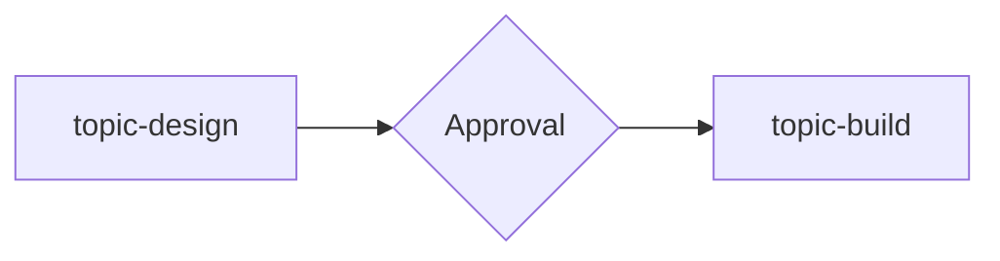

import FlowExplorer from '@site/src/components/FlowExplorer';
import agenticChain from '@site/src/data/flows/agentic-chain.json';

# Cloud Architect & DevOps Guidelines

This repository publishes enterprise architecture guidelines: multi-tenant design, cloud-agnostic design, delivery, database rollback and business continuity. Each guideline is backed by a decision record and, where it applies, by a template that runs.

## Who it is for

- **Architects** who decide: they need the options, the trade-offs and the recorded decision.
- **Delivery teams** who build: they need runnable templates to copy.
- **Stakeholders** who need to understand: they need the problem and the outcome in plain terms.

## Three views of every chapter

Every chapter offers the same three views:

- **Understand**: what the topic is and why it matters.
- **Decide**: the decision matrix and the decision record (ADR).
- **Copy**: the runnable template and how to adopt it.

## How a topic is produced

A topic goes through two agentic workflows with a human approval in between. `topic-design` runs parallel research and produces a design with a decision matrix and a draft ADR. After approval, `topic-build` writes the chapter, draws the diagrams, adds the runnable piece, verifies it, runs an adversarial review and produces the Italian translation.

<FlowExplorer flow={agenticChain} />

English is the canonical source. The Italian version is a translation kept at the same path.
