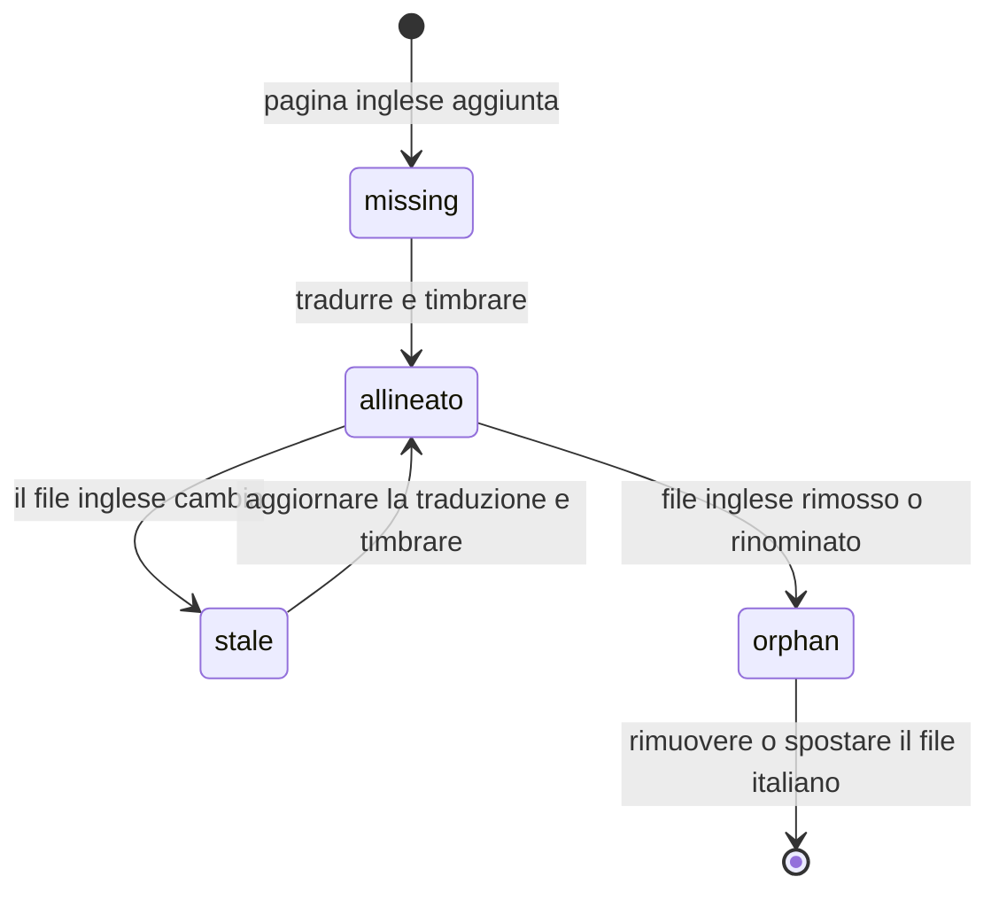

import FlowExplorer from '@site/src/components/FlowExplorer';
import docsAsCodeGates from '@site/src/data/flows/docs-as-code-gates.json';

# Documentazione come codice

## Capire

Queste linee guida sono scritte, riviste e pubblicate come si fa con il software. È questo il significato di "documentazione come codice". La guida della comunità Write the Docs la descrive come ["scrivere la documentazione con gli stessi strumenti del codice"](https://www.writethedocs.org/guide/docs-as-code/): controllo di versione, markup in testo semplice, revisioni del codice e test automatici. Google la mette così: ["La documentazione è spesso così strettamente legata al codice che dovrebbe, per quanto possibile, essere trattata come codice"](https://abseil.io/resources/swe-book/html/ch10.html), il che per Google significa controllo del codice sorgente, responsabilità chiare, revisione di ogni modifica e verifiche periodiche.

**Il problema.** Le linee guida tenute in un wiki o in documenti da ufficio vanno alla deriva. Google descrive il proprio wiki interno: ["Poiché i documenti non avevano veri responsabili, molti sono diventati obsoleti"](https://abseil.io/resources/swe-book/html/ch10.html), e "le persone che potevano correggere i documenti non erano quelle che li usavano". La soluzione è stata portare la documentazione importante sotto controllo del codice sorgente, così che le modifiche "potessero essere gestite con il processo di revisione del codice già esistente"; dopo di che, con le parole di Google, "la documentazione ha cominciato a migliorare in modo netto".

**Perché conta.** DORA, il programma di ricerca di Google Cloud, riporta ["un legame chiaro tra la qualità della documentazione e le prestazioni dell'organizzazione"](https://dora.dev/capabilities/documentation-quality/). La pagina attribuisce i dati allo State of DevOps Report del 2022 e non riporta una data propria.

**Il risultato qui.** Ogni linea guida è un file di testo. Una modifica viene proposta, controllata da gate automatici e trasformata dalla build in un sito web in inglese e in italiano. I termini usati in questo capitolo:

- **Repository**: la cartella di file tenuta sotto controllo di versione con git. Microsoft elenca il versionamento, le revisioni tra pari e una traccia di audit come vantaggi del tenere la documentazione in un [controllo del codice sorgente unificato](https://learn.microsoft.com/azure/well-architected/operational-excellence/principles).
- **Pull request**: una modifica proposta che altre persone possono leggere e commentare prima del merge, cioè prima che entri a far parte della copia principale dei file. Microsoft Learn accoglie [in questo modo](https://learn.microsoft.com/contribute/content/how-to-write-overview) le modifiche alla propria documentazione.
- **Gate**: un controllo automatico che ferma una modifica quando fallisce. Microsoft descrive i quality gate come un modo per ["imporre le buone pratiche per ridurre i rischi"](https://learn.microsoft.com/azure/well-architected/operational-excellence/principles); quel testo riguarda gli artefatti di un workload in generale, non la documentazione in particolare.
- **Build** e **sito statico**: la build trasforma i file di testo in un sito web fatto di file già pronti. Docusaurus, lo strumento usato qui, dichiara che la sua unica responsabilità è ["costruire il sito ed emettere file statici"](https://docusaurus.io/docs/deployment); qualsiasi host web può poi servirli.
- **Locale**: una versione linguistica del sito. Docusaurus costruisce ["un'applicazione a pagina singola per ogni locale"](https://docusaurus.io/docs/i18n/tutorial), cioè una copia autonoma del sito per ogni lingua; qui l'inglese sta alla radice del sito e l'italiano sotto `/it/`.

Due cose non sono ancora in opera, e questo capitolo lo dice ovunque conti: niente sulla forge, il servizio che ospita il repository, impone i gate (girano sulla postazione di lavoro dell'autore e, dal 2026-11-14, a ogni pull request come controllo che riporta un esito ma non ferma un merge), e il sito non è ancora pubblicato.


Il flusso qui sotto segue una modifica dalla scrittura al sito costruito. Ogni passo di gate dice che cosa lo fa fallire.

<FlowExplorer flow={docsAsCodeGates} />

### Una fonte, tre pubblici

Ogni capitolo ha le stesse quattro sezioni, così ogni lettore sa dove guardare: **Capire** per gli stakeholder, **Decidere** per gli architetti, **Copiare** per i team di delivery e **Stato di verifica** per chi vuole sapere che cosa è stato davvero eseguito. Il gate `task content:lint` respinge un capitolo a cui ne manca una (`tools/content-lint.mjs`).

Anche Microsoft indica tre pubblici per i diagrammi di architettura: ["implementatori, revisori della sicurezza e stakeholder di business"](https://learn.microsoft.com/azure/well-architected/architect-role/design-diagrams). Il consiglio di Google è più cauto: per i clienti e i fornitori di un sistema, ["Per quanto possibile, i documenti destinati agli uni dovrebbero essere tenuti separati dai documenti destinati agli altri"](https://abseil.io/resources/swe-book/html/ch10.html). Questo progetto fa l'opposto del tenerli separati: un solo capitolo serve tre pubblici, e a separarli sono soltanto le sue sezioni fisse. Un filone di ricerca, nella propria analisi, lo legge come coerente con il consiglio di Google ma più restrittivo; è la lettura di quel filone, non un riscontro, e niente qui dimostra che le sezioni fisse bastino. È elencato come costo sotto [Limiti noti](#limiti-noti).

### Inglese come fonte, italiano controllato

L'inglese è l'unica fonte; l'italiano ne è una traduzione. La documentazione di Microsoft funziona allo stesso modo: la documentazione di PowerShell dice ["Tutte le traduzioni partono prima dal contenuto in inglese"](https://learn.microsoft.com/powershell/scripting/community/contributing/get-started-writing?view=powershell-7.6), la guida per i contributori di Dynamics 365 accetta pull request ["solo sui file sorgente in inglese (US)"](https://learn.microsoft.com/dynamics365/fin-ops-core/dev-itpro/help/contributor-guide), e Microsoft Learn [ripiega sull'inglese](https://learn.microsoft.com/training/support/integrations-learn-platform-api-catalog-best-practices) quando manca una traduzione.

Docusaurus tiene i file tradotti in una cartella che rispecchia quella inglese, `website/i18n/[locale]/[pluginName]/...` ([introduzione a i18n](https://docusaurus.io/docs/i18n/introduction)). Non controlla che una traduzione sia ancora aggiornata: ["è tua responsabilità mantenere i rispettivi file tradotti"](https://docusaurus.io/docs/i18n/git), e "purtroppo non abbiamo un buon modo per aiutarti a farlo".

Questo repository chiude quella lacuna con un controllo proprio, `tools/i18n-parity.mjs`. Ogni file italiano porta un timbro, `source_sha256`, che è l'impronta (hash SHA-256) del file inglese da cui è stato tradotto. `task i18n:check` confronta le due cartelle e segnala tre problemi:



- `missing`: una pagina inglese non ha un file italiano.
- `stale`: il timbro nel file italiano è diverso dall'impronta del file inglese, oppure il file italiano non ha timbro.
- `orphan`: un file italiano non ha una pagina inglese.

Il controllo copre le pagine Markdown e MDX e nient'altro: `tools/i18n-parity.mjs` legge solo i file `.md` e `.mdx`. Due tipi di testo italiano ne restano fuori:

- **Il testo dentro i file dei flussi interattivi** è controllato solo per la presenza, non per l'aggiornamento (`tools/flows.mjs`).
- **Il testo della cornice del sito**, come le etichette nella barra di navigazione, non sta in nessuna pagina. Docusaurus ha un secondo tipo di file di traduzione per il testo fuori dalle pagine: il suo comando `docusaurus write-translations` è descritto come ["Scrive i file di traduzione JSON che dovrai tradurre"](https://docusaurus.io/docs/cli). Questo repository non ha alcun file JSON sotto `website/i18n/it/`, e il controllo di parità non ne cerca. L'effetto è visibile: nella build locale, l'etichetta di navigazione "Guidelines", impostata in `website/docusaurus.config.ts`, è in inglese nelle pagine italiane (vedi [Stato di verifica](#stato-di-verifica)). Le etichette del tema stesso di Docusaurus sono un caso diverso, perché Docusaurus ne distribuisce [una traduzione italiana](https://github.com/facebook/docusaurus/tree/main/packages/docusaurus-theme-translations/locales). UNVERIFIED: quali testi esattamente contengano i file di traduzione JSON; la ricerca ha solo la frase citata sopra.

La traduzione è più facile quando l'inglese è scritto pensando a essa. La guida di stile di Google chiede [frasi più brevi, lo stesso termine per lo stesso concetto e nessuna espressione idiomatica](https://developers.google.com/style/translation).

### Tre tipi di diagramma

- **I diagrammi di architettura** sono disegnati con draw.io. Il file sorgente sta in `diagrams/` e la sua immagine SVG in `website/static/diagrams/`. Microsoft raccomanda di ["Conservare i file sorgente dei diagrammi nello stesso repository o archivio di documentazione degli altri asset versionati del workload"](https://learn.microsoft.com/azure/well-architected/architect-role/design-diagrams), e la guida di stile di Google dice ["Usa file SVG se possibile, perché gli SVG restano nitidi quando si ingrandisce l'immagine"](https://developers.google.com/style/images). Un SVG di draw.io [può includere i dati del diagramma](https://www.drawio.com/doc/faq/export-diagram), così l'immagine può essere riaperta e modificata. Le etichette restano in inglese in entrambe le lingue, perché una sola immagine serve entrambi i locale e il testo dentro le figure ["aumenta i costi di localizzazione se le figure vengono localizzate"](https://developers.google.com/style/images). La stessa pagina dice che il testo dentro un elemento grafico "danneggia l'accessibilità e la ricercabilità". I diagrammi di architettura qui portano le etichette come testo dentro la figura, quindi quel costo vale per loro.
- **I diagrammi Mermaid** sono scritti come testo dentro la pagina, come quello qui sopra; Docusaurus li renderizza tramite il suo [tema Mermaid](https://docusaurus.io/docs/markdown-features/diagrams).
- **I flussi interattivi** sono diagrammi passo-passo, come quello dopo l'immagine della pipeline. Ciascuno è disegnato da un componente React, un pezzo riutilizzabile di codice di interfaccia (`website/src/components/FlowExplorer/`). Docusaurus può incorporarlo perché le sue pagine sono MDX, un formato che ["permette di scrivere JSX dentro i file Markdown e di renderizzarli come componenti React"](https://docusaurus.io/docs/markdown-features/react); JSX è la notazione in cui tali componenti sono scritti.

Quale tipo serva a quale scopo è una convenzione di questo progetto, non un riscontro della ricerca; è scritta nelle skill del progetto `drawio-diagram` (diagrammi di architettura) e `interactive-diagram` (flussi passo-passo). Nessuna skill dice quando usare Mermaid; usarlo per piccoli diagrammi che cambiano insieme al testo che li circonda è la proposta dell'autore.

## Decidere

### Opzioni

Nove opzioni sono state esaminate rispetto ai criteri. Sette hanno riscontri sufficienti per ricevere un punteggio e un totale. Le altre due, Confluence Cloud e SharePoint Server Subscription Edition, sono esaminate ma non totalizzate: nessun riscontro fissa per loro un livello sulle due lingue, sui controlli automatici o su componenti e diagrammi, e questi tre criteri portano 55 dei 100 punti di peso. La regola è sotto [Quali opzioni ricevono un punteggio](#quali-opzioni-ricevono-un-punteggio). I quattro generatori di siti sono confrontati nel contesto deciso: contenuto in un repository su GitHub Enterprise Cloud e sito costruito pubblicato su GitHub Pages.

- **Docusaurus in git, inglese canonico, italiano tradotto e controllato da un gate di parità, pubblicato su GitHub Pages.** Un generatore di siti statici, [con licenza MIT](https://github.com/facebook/docusaurus/blob/main/LICENSE), alla versione 3.10.2 in `website/package.json`. Due lingue da un solo albero con un percorso per locale ([tutorial i18n](https://docusaurus.io/docs/i18n/tutorial)), componenti React nelle pagine tramite [MDX](https://docusaurus.io/docs/markdown-features/react), Mermaid tramite il [tema ufficiale](https://docusaurus.io/docs/markdown-features/diagrams). Non ha un controllo per le traduzioni obsolete ([i18n con git](https://docusaurus.io/docs/i18n/git)). La versione 3.10 ["sarà l'ultima release della linea v3.x"](https://docusaurus.io/blog). Questo repository lo usa oggi.
- **Hugo con il tema Docsy in git.** Hugo ha release numerate da v0.164.0 a v0.169.0, datate da luglio a ottobre, nella sua [pagina delle release](https://github.com/gohugoio/hugo/releases) (lo strumento di ricerca ha dedotto l'anno 2026). Docsy è un tema Hugo [creato in Google](https://opensource.googleblog.com/2019/07/announcing-docsy-website-theme-for.html), oggi descritto come [progetto della Linux Foundation](https://github.com/google/docsy) con licenza Apache-2.0. Ha una radice dei contenuti per lingua e un [menu delle lingue](https://www.docsy.dev/docs/language/).
- **Antora in git.** Un generatore per [contenuti AsciiDoc tenuti in uno o più repository git](https://docs.antora.org/antora/latest/), con licenza MPL-2.0, con le versioni prese da [branch o tag](https://docs.antora.org/antora/latest/content-source-versioning-methods/). Markdown non è elencato tra gli input.
- **Material for MkDocs in git.** [Con licenza MIT](https://squidfunk.github.io/mkdocs-material/) e [in modalità di manutenzione](https://squidfunk.github.io/mkdocs-material/blog/2025/11/05/zensical/): "Lo sviluppo di nuove funzionalità è terminato", con correzioni critiche "fino al 5 maggio 2027". ["Supporta solo l'impostazione di una lingua canonica per l'intero progetto"](https://squidfunk.github.io/mkdocs-material/setup/changing-the-language/).
- **Markdown renderizzato da GitHub (GitHub Enterprise Cloud), senza build del sito.** GitHub renderizza i file Markdown, e [i diagrammi Mermaid al loro interno](https://docs.github.com/en/get-started/writing-on-github/working-with-advanced-formatting/creating-diagrams), direttamente dal repository.
- **Wiki di Azure DevOps Services pubblicato come codice.** Markdown in un repository; la testa del branch è il wiki pubblicato e ["Non sono coinvolti altri workflow"](https://learn.microsoft.com/azure/devops/project/wiki/publish-repo-to-wiki?view=azure-devops). Sta fuori dalla forge decisa.
- **Confluence Cloud (piano Premium)**, esaminato e non totalizzato. Un wiki modificato nel browser. Il piano è indicato perché le [approvazioni](https://support.atlassian.com/confluence-cloud/docs/request-and-manage-approvals-in-confluence/) esistono solo nei piani Premium ed Enterprise. I prezzi non sono stati verificati.
- **SharePoint Online (pagine e raccolte documenti).** Pagine e documenti modificati nel browser, con [approvazione del contenuto](https://learn.microsoft.com/sharepoint/dev/business-apps/power-automate/guidance/require-doc-approval) e [pagine multilingue](https://support.microsoft.com/office/create-multilingual-communication-sites-pages-and-news-2bb7d610-5453-41c6-a0e8-6f40b3ed750c) tradotte a mano. Non è indicato alcun piano, perché la ricerca non ha riscontri a livello di piano.
- **SharePoint Server Subscription Edition**, esaminato e non totalizzato. Il prodotto on-premises, [senza una fine del supporto pianificata](https://learn.microsoft.com/lifecycle/additional-support-server-modern-lifecycle-policy) e con una prima data possibile al 31 dicembre 2035.

#### Quali opzioni ricevono un punteggio

Un'opzione ha celle nella matrice quando supera tre test:

1. **Può essere adottata.** Questa organizzazione deve poterla acquistare o eseguire oggi.
2. **È una forma a sé.** Una forma che esiste sulla forge decisa riceve il punteggio una volta sola, lì. La stessa forma su un'altra forge non ha una colonna propria.
3. **La ricerca è andata abbastanza a fondo da dire che cosa l'opzione fa con il contenuto, da fonti primarie.** Un'opzione emersa con riscontri solo su chi può aprirla, sull'ambiente che la costruisce o sul markup che accetta, oppure solo da fonti secondarie, non è stata portata attraverso il punteggio cella per cella. Per un'opzione del genere non è stata elaborata alcuna cella, quindi non ha un valore di copertura.

Un'opzione che ha celle riceve i totali solo quando la sua **copertura** è superiore a 50. La copertura è il peso dei criteri la cui cella è ristretta, da un riscontro o da una definizione, al di sotto dell'intervallo completo 1-5. Un totale che poggia per lo più su celle senza riscontro direbbe di più sulle lacune della ricerca che sull'opzione. La soglia di 50 è un giudizio dell'autore, e nessuna opzione le è vicina: le sette opzioni totalizzate hanno una copertura di 80 o più, e le altre due hanno 45 (vedi la riga della copertura di ciascuna tabella qui sotto).

Considerate e senza celle, ciascuna con il test che non supera:

- **Confluence Data Center** (test 1): i nuovi clienti [non possono acquistarlo dal 30 marzo 2026](https://www.atlassian.com/licensing/data-center-end-of-life), e diventa di sola lettura il 28 marzo 2029. Non è stabilito se questa organizzazione abbia mai avuto posti utente Data Center a pagamento, cosa che decide se potrebbe ancora acquistarlo.
- **Markdown semplice in una forge autogestita (GitLab, Forgejo)** (test 2): è la forma del Markdown renderizzato da GitHub, su un'altra forge. GitLab renderizza [documenti Markdown nei repository e Mermaid](https://docs.gitlab.com/user/markdown/). Anche il wiki di Azure DevOps sta fuori dalla forge decisa, ma è una forma diversa (un wiki pubblicato da un branch di un repository), quindi ha una colonna. Una forge autogestita cambia fatti che tre criteri guardano:
  - Revisione (C1): su GitLab, le approvazioni che bloccano un merge sono nei [tier Premium e Ultimate](https://docs.gitlab.com/user/project/merge_requests/approvals/); il tier Free ha solo approvazioni facoltative. La protezione dei branch di Forgejo può bloccare il merge ["a meno che su una pull request non si ottenga un dato numero di approvazioni"](https://forgejo.org/docs/latest/user/protection/).
  - Controlli che fermano un merge (C3): su GitLab, "Pipelines must succeed" è un'[impostazione di progetto](https://docs.gitlab.com/user/project/merge_requests/auto_merge/) in ogni tier. La pagina di Forgejo sulla protezione dei branch non menziona i controlli di stato obbligatori; li descrive solo la [documentazione di Gitea](https://docs.gitea.com/usage/access-control/protected-branches/), e non è confermato che Forgejo si comporti allo stesso modo.
  - Infrastruttura propria (C7): una forge autogestita gira, per definizione, su infrastruttura gestita dall'organizzazione.

  Il caso è esposto per esteso sotto [Quando derogare](#quando-derogare).
- **Markdown semplice costruito da GitHub Pages con Jekyll** (test 3): la documentazione di GitHub descrive l'ambiente di build, che è [Jekyll 3.10.0](https://pages.github.com/versions/) con plugin presi da un elenco fisso; un sito che usa qualsiasi altro plugin [non può essere costruito da GitHub Pages](https://docs.github.com/en/pages/setting-up-a-github-pages-site-with-jekyll/about-github-pages-and-jekyll). Le pagine di GitHub su Jekyll non menzionano più lingue, il controllo dei link durante la build, i file `.mdx` o i componenti JavaScript, e Mermaid su un sito Pages costruito con Jekyll ha solo una fonte secondaria. La documentazione propria di Jekyll non è stata oggetto di ricerca, quindi che cosa lo strumento faccia per lingue, controlli e componenti è ignoto, non assente.
- **Wiki delle forge** (wiki provisioned di Azure DevOps, wiki di GitLab, wiki di GitHub) (test 3): la ricerca copre chi può leggerli e modificarli e quale markup accettano; non ha nulla sulle due lingue né sui controlli automatici. Un wiki di GitHub in un repository privato è visibile [solo a chi ha accesso al repository](https://docs.github.com/en/communities/documenting-your-project-with-wikis/about-wikis); un wiki di GitLab è [un repository Git separato](https://docs.gitlab.com/user/project/wiki/) modificato direttamente, senza che sia descritto un passaggio di merge request; in un progetto privato di Azure DevOps gli Stakeholder [possono leggere il wiki provisioned](https://learn.microsoft.com/azure/devops/project/wiki/manage-readme-wiki-permissions?view=azure-devops) e non possono modificarlo.
- **Azure DevOps Server** (test 3): nessun riscontro copre la pubblicazione di un code wiki sul prodotto Server.
- **Zensical**, il successore di Material for MkDocs (test 3): il suo supporto per lingue e versionamento non è stabilito. **docfx** (test 3): una sola fonte secondaria. **Wiki.js** (test 3): nessuna fonte leggibile.
- **Weblate**: uno strumento di traduzione, non un'opzione di pubblicazione; vedi [Scelte interne alla decisione](#scelte-interne-alla-decisione).

Le opzioni di hosting diverse da GitHub Pages (Azure Static Web Apps, Azure Storage, Cloud Storage, Cloud Run, Firebase Hosting, GitLab Pages, un server web interno) sono state oggetto di ricerca e sono rimandate al successivo capitolo sull'hosting; vedi [Dove viene pubblicato il sito](#dove-viene-pubblicato-il-sito).

### Matrice pesata

La matrice è un confronto, non una classifica: lo strumento è stato scelto dal decisore (vedi [Raccomandazione](#raccomandazione)). Mostra che cosa le evidenze stabiliscono e che cosa lasciano aperto.

**Criteri.** Ciascuno risale a un'esigenza dichiarata nella specifica del progetto (`docs/superpowers/specs/2026-11-10-cloud-architect-devops-design.md`) o nel brief di questo argomento (`docs/superpowers/plans/2026-11-10-phase-0-foundations.md`). I pesi sommano a 100 (15 + 20 + 20 + 15 + 10 + 10 + 5 + 5); la loro entità è un giudizio dell'autore.

| Id | Criterio | Peso | Esigenza a cui risale |
|---|---|---|---|
| C1 | Revisione e traccia di audit per ogni modifica | 15 | Conformità e audit nel nucleo delle linee guida (specifica); l'autore la applica alle modifiche della documentazione |
| C2 | Inglese e italiano da un solo albero, traduzioni obsolete rilevate | 20 | Linee guida bilingui, italiano tradotto e controllato (specifica e brief) |
| C3 | Controlli automatici che possono fermare la pubblicazione | 20 | `task verify` deve passare prima che una fase sia chiusa (specifica); l'autore la applica alla pubblicazione |
| C4 | Componenti interattivi e diagrammi nelle pagine | 15 | draw.io, Mermaid e diagrammi interattivi (brief) |
| C5 | Raggiungibilità per i tre pubblici | 10 | Architetti, team di delivery e stakeholder insieme (specifica) |
| C6 | Continuità e costo di uscita | 10 | Evitare il lock-in (specifica, dichiarato per i cloud provider); l'autore la applica agli strumenti |
| C7 | Infrastruttura propria e uso offline | 5 | Rancher on-prem tra i target, e tutto dimostrabile in locale (specifica) |
| C8 | Versionato: cronologia git e tag | 5 | La definizione di "versionato" data dal decisore, senza selettore di versione pubblicato |

**Regola di punteggio.** Ogni criterio ha due sotto-esigenze, A e B, ciascuna a livello 0, 1 o 2; il punteggio è 1 + A + B, quindi da 1 a 5. C8 ha una sola sotto-esigenza e il suo punteggio è 1 + 2 x A.

- Solo i riscontri della ricerca fissano un livello. Le fonti secondarie, gli elementi non verificati e l'analisi dei compromessi fatta dai ricercatori non ne fissano alcuno.
- Una sotto-esigenza che nessun riscontro definisce conserva ogni livello che i riscontri non escludono, quindi una cella può essere un intervallo. Niente è riempito a giudizio. Una pagina che non menziona una capacità non dice nulla né in un senso né nell'altro.
- Il livello 1 è stabilito solo quando un riscontro documenta il caso parziale e un riscontro dice che il caso completo non è soddisfatto. Quando è documentato solo il caso parziale, la sotto-esigenza resta aperta tra 1 e 2.
- In pochi casi un livello discende da ciò che l'opzione è, e il testo dice "per definizione": il contenuto in git ha la cronologia git; un sito servito dal servizio di un fornitore non sta sull'infrastruttura propria dell'organizzazione.
- La configurazione propria di questo repository (il suo controllo di parità, i suoi task, le sue pagine) non riceve punteggio per nessuna opzione. La colonna Docusaurus è lo strumento pubblicato su GitHub Pages, niente di più.
- Un'opzione combinata (Hugo con Docsy, Material for MkDocs con MkDocs sotto, qualsiasi generatore con GitHub) prende, per ogni sotto-esigenza, la parte più debole.
- Due incognite su GitHub sono condivise da più colonne e contano una volta sola quando si confrontano due di quelle colonne: se una revisione della pull request possa essere resa obbligatoria (C1), e il ciclo di vita di GitHub Enterprise Cloud e di GitHub Pages (C6).

| Criterio | Sotto-esigenza A (il livello 1 è il caso parziale) | Sotto-esigenza B (il livello 1 è il caso parziale) |
|---|---|---|
| C1 | Ogni modifica è registrata con il suo autore e può essere confrontata con lo stato precedente. 1: cronologia per versione, senza l'autore di ogni modifica dentro una versione | La revisione prima della pubblicazione può essere resa obbligatoria. 1: revisione solo facoltativa, oppure obbligatoria per una parte del contenuto |
| C2 | Entrambe le lingue vengono da un solo albero sorgente, ciascuna con il proprio indirizzo. 1: solo come progetti separati, senza un indirizzo per lingua, oppure tramite componenti aggiuntivi | L'opzione stessa rileva una traduzione obsoleta prima della pubblicazione. 1: un segnale ai traduttori, senza un controllo che fermi la pubblicazione |
| C3 | I link interni rotti fermano la pubblicazione, per impostazione predefinita o con un'impostazione documentata. 1: solo alcune forme di link, oppure solo con uno strumento aggiunto | Controlli specifici del progetto girano prima della pubblicazione e la fermano in caso di fallimento. 1: solo controlli sui metadati, oppure controlli che non fermano la pubblicazione |
| C4 | Un componente interattivo può essere incorporato in una pagina di contenuto. 1: elementi costitutivi documentati, incorporamento in una pagina non documentato | I diagrammi Mermaid e le immagini SVG vengono renderizzati nelle pagine. 1: solo uno dei due, oppure Mermaid solo tramite un server di rendering esterno |
| C5 | I lettori che non scrivono contenuti, dentro o fuori dall'organizzazione, possono leggere senza un ruolo o un posto utente sullo strumento di redazione e senza pubblicare per tutti. 1: solo con un ruolo o un posto utente, oppure solo pubblicando per tutti. L'accesso in lettura concesso a una persona su un repository o su un sito è un ruolo, che costi o no una licenza | Chi non usa git può contribuire tramite l'editing proprio dell'opzione, con un passaggio di revisione. 1: solo tramite git e pull request, incluso l'editor web di una forge |
| C6 | Continuità: una release o una modifica di prodotto datata 2026, oppure uno stato attivo esplicito, e nessuna fine annunciata della manutenzione, dello sviluppo di funzionalità o della linea di release in uso. 1: una tale fine è annunciata. 0: la manutenzione è terminata | Un riscontro nomina un altro strumento che legge la fonte dei contenuti così com'è. 1: il contenuto esce solo come file da riscrivere, oppure tramite formati di esportazione |
| C7 | Le linee guida pubblicate possono essere servite da infrastruttura gestita dall'organizzazione. 1: solo con un servizio self-hosted aggiuntivo | La build, dove ce n'è una, e la lettura funzionano senza accesso a Internet. 1: solo una delle due |
| C8 | L'intero insieme ha cronologia git e tag. 1: cronologia per pagina o per documento, oppure un'esportazione dell'intero insieme | (nessuna) |

**Matrice.** Le sette opzioni con una copertura superiore a 50. Un numero singolo è un punteggio stabilito; un intervallo va da ogni punto aperto contato a sfavore dell'opzione a ogni punto aperto contato a suo favore.

| Criterio | Peso | Docusaurus | Hugo + Docsy | Antora | Material for MkDocs | Markdown su GitHub | Code wiki di Azure DevOps | SharePoint Online |
|---|---|---|---|---|---|---|---|---|
| C1 Revisione e traccia di audit | 15 | 4-5 | 4-5 | 4-5 | 4-5 | 4-5 | 5 | 3-5 |
| C2 Due lingue | 20 | 3 | 2-5 | 1-5 | 2-4 | 1-5 | 1-5 | 3-5 |
| C3 Controlli automatici | 20 | 5 | 4-5 | 4-5 | 5 | 4-5 | 4 | 2-5 |
| C4 Componenti e diagrammi | 15 | 4-5 | 3-5 | 2-5 | 2-5 | 2-5 | 2-3 | 1-5 |
| C5 Raggiungibilità | 10 | 3-4 | 3-4 | 3-4 | 3-4 | 3 | 3 | 4-5 |
| C6 Continuità e uscita | 10 | 2-4 | 2-5 | 2-5 | 3-4 | 3-5 | 4-5 | 3-5 |
| C7 Infrastruttura propria, offline | 5 | 1-2 | 1-2 | 1-2 | 1-2 | 1 | 1 | 1 |
| C8 Versionato | 5 | 5 | 5 | 5 | 5 | 5 | 5 | 3 |
| Copertura | | 100 | 100 | 80 | 100 | 80 | 80 | 85 |
| **Totale minimo** | 100 | **360** | **305** | **270** | **320** | **280** | **305** | **250** |
| **Totale massimo** | 100 | **425** | **475** | **475** | **445** | **460** | **410** | **470** |

Una cella 1-5 è una cella senza riscontro. La copertura è 100 meno il peso di quelle celle: Antora, Markdown su GitHub e il code wiki di Azure DevOps non hanno riscontri sulle due lingue (100 - 20 = 80), e SharePoint Online non ne ha su componenti e diagrammi (100 - 15 = 85).

Aritmetica, peso x punteggio nell'ordine da C1 a C8, ricalcolata il 2026-11-14 dai livelli delle sotto-esigenze indicati più sotto.

Totali minimi:

- Docusaurus: 60 + 60 + 100 + 60 + 30 + 20 + 5 + 25 = 360
- Hugo + Docsy: 60 + 40 + 80 + 45 + 30 + 20 + 5 + 25 = 305
- Antora: 60 + 20 + 80 + 30 + 30 + 20 + 5 + 25 = 270
- Material for MkDocs: 60 + 40 + 100 + 30 + 30 + 30 + 5 + 25 = 320
- Markdown su GitHub: 60 + 20 + 80 + 30 + 30 + 30 + 5 + 25 = 280
- Code wiki di Azure DevOps: 75 + 20 + 80 + 30 + 30 + 40 + 5 + 25 = 305
- SharePoint Online: 45 + 60 + 40 + 15 + 40 + 30 + 5 + 15 = 250

Totali massimi:

- Docusaurus: 75 + 60 + 100 + 75 + 40 + 40 + 10 + 25 = 425
- Hugo + Docsy: 75 + 100 + 100 + 75 + 40 + 50 + 10 + 25 = 475
- Antora: 75 + 100 + 100 + 75 + 40 + 50 + 10 + 25 = 475
- Material for MkDocs: 75 + 80 + 100 + 75 + 40 + 40 + 10 + 25 = 445
- Markdown su GitHub: 75 + 100 + 100 + 75 + 30 + 50 + 5 + 25 = 460
- Code wiki di Azure DevOps: 75 + 100 + 80 + 45 + 30 + 50 + 5 + 25 = 410
- SharePoint Online: 75 + 100 + 100 + 75 + 50 + 50 + 5 + 15 = 470

**Esaminati, non totalizzati.** Per Confluence Cloud e SharePoint Server SE nessun riscontro fissa un livello su tre criteri che insieme portano 55 punti ("nessun riscontro" nella tabella), quindi la loro copertura è 100 - 20 - 20 - 15 = 45 e non ricevono totali. Il loro minimo e il loro massimo sarebbero distanti 220 punti su quei soli tre criteri (55 x 1 contro 55 x 5), il che non dice nulla su nessuno dei due prodotti. Le celle che invece hanno riscontri sono riportate qui, e ciascuna è spiegata insieme alle altre più sotto.

| Criterio | Peso | Confluence Cloud (Premium) | SharePoint Server SE |
|---|---|---|---|
| C1 Revisione e traccia di audit | 15 | 3-5 | 3-5 |
| C2 Due lingue | 20 | nessun riscontro | nessun riscontro |
| C3 Controlli automatici | 20 | nessun riscontro | nessun riscontro |
| C4 Componenti e diagrammi | 15 | nessun riscontro | nessun riscontro |
| C5 Raggiungibilità | 10 | 5 | 4-5 |
| C6 Continuità e uscita | 10 | 4-5 | 3-5 |
| C7 Infrastruttura propria, offline | 5 | 1 | 3-5 |
| C8 Versionato | 5 | 3 | 3 |
| Copertura | | 45 | 45 |

#### Perché ogni cella ha quel punteggio

"A2" significa sotto-esigenza A a livello 2; "B 1-2" significa che la sotto-esigenza B è aperta tra i livelli 1 e 2. Le voci coprono entrambe le tabelle qui sopra.

**C1 Revisione e traccia di audit.**

- Docusaurus, Hugo + Docsy, Antora, Material for MkDocs, Markdown su GitHub: 4-5 (A2, B 1-2). Il contenuto è fatto di file in un repository git su GitHub, quindi A è 2 per definizione. Su GitHub il ruolo Read [può fare la revisione delle pull request](https://docs.github.com/en/enterprise-cloud@latest/organizations/managing-user-access-to-your-organizations-repositories/managing-repository-roles/repository-roles-for-an-organization); se una revisione possa essere resa obbligatoria prima del merge non è nella ricerca. Una sola incognita, condivisa dalle cinque opzioni. In questa riga il code wiki di Azure DevOps (5) sta sopra le cinque opzioni su GitHub (4-5) solo perché i revisori obbligatori sono stati oggetto di ricerca per Azure Repos e non per GitHub: lo scarto mostra che cosa la ricerca ha coperto, non una differenza documentata tra le due forge.
- Code wiki di Azure DevOps: 5 (A2, B2). Entrambi i tipi di wiki sono [archiviati in Git](https://learn.microsoft.com/azure/devops/project/wiki/provisioned-vs-published-wiki?view=azure-devops), e un numero minimo di revisori è una [branch policy](https://learn.microsoft.com/azure/devops/repos/git/branch-policies-overview?view=azure-devops), disattivata per impostazione predefinita, sul branch pubblicato.
- Confluence Cloud: 3-5 (A 1-2, B 1-2). La [cronologia della pagina](https://support.atlassian.com/confluence-cloud/docs/use-confluence-for-technical-documentation/) mostra ogni versione con data, autore e commenti; non è stabilito se più autori di modifiche dentro una stessa versione vengano distinti. Un amministratore dello spazio può [richiedere l'approvazione](https://support.atlassian.com/confluence-cloud/docs/request-and-manage-approvals-in-confluence/) prima che le nuove pagine vadano online; l'articolo non dice se ciò copra le modifiche a pagine esistenti.
- SharePoint Online: 3-5 (A 1-2, B 1-2). La [cronologia delle versioni](https://learn.microsoft.com/sharepoint/version-overview) identifica chi ha fatto le modifiche; più coautori dentro una stessa versione non sono descritti. L'[approvazione del contenuto](https://learn.microsoft.com/sharepoint/dev/business-apps/power-automate/guidance/require-doc-approval) tiene invisibile un documento in una raccolta finché non è approvato, il che rende la revisione obbligatoria per una parte del contenuto. Per le pagine, un [flusso di approvazione delle pagine](https://learn.microsoft.com/power-automate/customize-sharepoint-page-approvals) invia in approvazione ogni pagina aggiunta o modificata; se quel flusso richieda una licenza non è stato cercato, e per questa opzione non è indicato alcun piano, quindi il livello 2 non è stabilito.
- SharePoint Server SE: 3-5 (A 1-2, B 1-2). Versioni, commenti di check-in e un passaggio di approvazione del contenuto, in cui una bozza resta in sospeso finché non è approvata, sono nella [guida alla pianificazione](https://learn.microsoft.com/sharepoint/governance/versioning-content-approval-and-check-out-planning). Come per SharePoint Online, quel passaggio riguarda i documenti in una raccolta; nessun riscontro dice che l'approvazione possa essere resa obbligatoria per le pagine, quindi B è aperta allo stesso modo.

**C2 Inglese e italiano.**

- Docusaurus: 3 (A2, B0). I file tradotti stanno in un solo albero e ogni locale ha il proprio percorso ([introduzione a i18n](https://docusaurus.io/docs/i18n/introduction), [tutorial i18n](https://docusaurus.io/docs/i18n/tutorial)). Le traduzioni obsolete non sono rilevate: ["purtroppo non abbiamo un buon modo per aiutarti a farlo"](https://docusaurus.io/docs/i18n/git).
- Hugo + Docsy: 2-5 (A 1-2, B 0-2). Una radice dei contenuti per lingua ([Docsy](https://www.docsy.dev/docs/language/)), con le traduzioni collegate [per percorso, per directory dei contenuti o per una chiave condivisa](https://gohugo.io/content-management/multilingual/); nessun riscontro afferma che ogni lingua abbia un proprio indirizzo, e nessuna delle due pagine tratta le traduzioni non aggiornate.
- Antora: 1-5 (A 0-2, B 0-2). Non è stata trovata alcuna pagina ufficiale di Antora sulla localizzazione; le uniche segnalazioni sono secondarie.
- Material for MkDocs: 2-4 (A1, B 0-2). Un progetto per lingua, collegati dal [selettore di lingua](https://squidfunk.github.io/mkdocs-material/setup/changing-the-language/).
- Markdown su GitHub, code wiki di Azure DevOps: 1-5 (A 0-2, B 0-2). Nessun riscontro definisce l'una o l'altra sotto-esigenza.
- Confluence Cloud, SharePoint Server SE: nessun riscontro fissa un livello. Per Confluence Cloud, due file di ricerca sono in disaccordo sul fatto che l'articolo di Atlassian sulla traduzione del contenuto delle pagine copra Cloud, e una richiesta di [versioni delle pagine per lingua](https://jira.atlassian.com/browse/CONFCLOUD-64788) è irrisolta. Per SharePoint Server, le [varianti](https://learn.microsoft.com/sharepoint/sites/plan-for-multilingual-sites) sono documentate senza nominare un'edizione.
- SharePoint Online: 3-5 (A 1-2, B 1-2). [Pagine multilingue](https://support.microsoft.com/office/create-multilingual-communication-sites-pages-and-news-2bb7d610-5453-41c6-a0e8-6f40b3ed750c) nei siti di comunicazione; i traduttori ricevono un'email quando la pagina predefinita cambia, e ogni pagina di traduzione è aggiornata a mano.
- Un filone di ricerca conclude, nella sua analisi dei compromessi, che nessuno dei generatori che ha esaminato rileva le traduzioni obsolete. È un'analisi di pagine che tacciono sul punto, non un riscontro, quindi non fissa alcun livello. Se ricevesse punteggio, C2 B sarebbe 0 per Hugo + Docsy, Antora e Material for MkDocs, e ciascuno dei loro totali massimi scenderebbe di 40.

**C3 Controlli automatici.**

- B è 2 per le cinque opzioni su GitHub: un controllo di stato obbligatorio che fallisce [impedisce il merge](https://docs.github.com/en/repositories/configuring-branches-and-merges-in-your-repository/managing-protected-branches/about-protected-branches), anche a chi ha accesso in push; i [ruleset](https://docs.github.com/en/repositories/configuring-branches-and-merges-in-your-repository/managing-rulesets/available-rules-for-rulesets) hanno una regola che richiede il superamento dei controlli di stato; e per GitHub Pages GitHub raccomanda una [regola di protezione del deployment](https://docs.github.com/en/pages/getting-started-with-github-pages/configuring-a-publishing-source-for-your-github-pages-site) in modo che solo il branch predefinito possa fare il deployment. È una funzionalità di GitHub, non di un generatore, e in questo repository non è collegata.
- Docusaurus: 5 (A2, B2). `onBrokenLinks` lancia un errore per impostazione predefinita, solo in una build di produzione; `markdown.hooks.onBrokenMarkdownLinks` ha come valore predefinito `warn` e accetta `throw`; `onBrokenAnchors` ha come valore predefinito `warn` ([riferimento della configurazione](https://docusaurus.io/docs/api/docusaurus-config)).
- Hugo + Docsy: 4-5 (A 1-2, B2). I link scritti con `ref` o `relref` [fanno fallire la build per impostazione predefinita](https://gohugo.io/configuration/all/); il [render hook incorporato per i link](https://gohugo.io/render-hooks/links/) non segnala una destinazione che non riesce a risolvere.
- Antora: 4-5 (A 1-2, B2). L'esempio documentato registra nel log un riferimento incrociato non risolto [a livello di errore](https://docs.antora.org/antora/latest/playbook/runtime-log-format/), e un [livello di fallimento](https://docs.antora.org/antora/latest/playbook/runtime-log-failure-level/) fa uscire la build con un codice diverso da zero; il suo valore predefinito è `fatal`, quindi va impostato a `error`.
- Material for MkDocs: 5 (A2, B2). La validazione dei link a livello `warn` è ["pensata per l'uso con `mkdocs build --strict` (dove diventa un errore)"](https://www.mkdocs.org/user-guide/configuration/).
- Markdown su GitHub: 4-5 (A 1-2, B2). Non c'è build; un link checker come [lychee](https://lychee.cli.rs/) può girare come controllo obbligatorio. Il controllo dei link da parte di GitHub stesso non ha riscontri.
- Code wiki di Azure DevOps: 4 (A1, B2). Niente gira tra il merge e la pubblicazione; il controllo dei link integrato gira solo quando una pagina viene [spostata nell'interfaccia del wiki](https://learn.microsoft.com/azure/devops/project/wiki/add-edit-wiki?view=azure-devops). Con una build validation obbligatoria, "La pull request non può essere completata finché la build richiesta non riesce" ([branch policy](https://learn.microsoft.com/azure/devops/repos/git/branch-policies-overview?view=azure-devops), [sicurezza delle pull request](https://learn.microsoft.com/azure/devops/repos/git/secure-repositories-pull-requests?view=azure-devops)).
- SharePoint Online: 2-5 (A 0-2, B 1-2); una [colonna obbligatoria](https://learn.microsoft.com/troubleshoot/sharepoint/lists-and-libraries/upload-file-using-new-experience) è un controllo sui metadati.
- Confluence Cloud: nessun riscontro sui controlli automatici. SharePoint Server SE: nessun riscontro per questa edizione.

**C4 Componenti e diagrammi.**

- Docusaurus: 4-5 (A2, B 1-2). Componenti tramite [MDX](https://docusaurus.io/docs/markdown-features/react) e Mermaid tramite il [tema](https://docusaurus.io/docs/markdown-features/diagrams). Le immagini SVG nelle pagine non hanno riscontri della ricerca; questo repository le incorpora, cosa che non riceve punteggio.
- Hugo + Docsy: 3-5 (A 1-2, B 1-2). Gli [shortcode](https://gohugo.io/content-management/shortcodes/) sono template che generano HTML, e [`js.Build`](https://gohugo.io/functions/js/build/) impacchetta codice React, ma la sua pagina non documenta l'incorporamento di un componente in una pagina Markdown. Docsy renderizza [Mermaid da un blocco di codice](https://www.docsy.dev/docs/content/diagrams-and-formulae/).
- Antora: 2-5 (A 0-2, B 1-2). Mermaid tramite l'[estensione asciidoctor-kroki](https://docs.asciidoctor.org/kroki-extension/latest/), che richiede un server Kroki.
- Material for MkDocs: 2-5 (A 0-2, B 1-2). ["supporto nativo per i diagrammi Mermaid.js"](https://squidfunk.github.io/mkdocs-material/reference/diagrams/); i componenti non sono trattati nelle pagine lette.
- Markdown su GitHub: 2-5 (A 0-2, B 1-2). [Mermaid nei file Markdown](https://docs.github.com/en/get-started/writing-on-github/working-with-advanced-formatting/creating-diagrams).
- Code wiki di Azure DevOps: 2-3 (A0, B 1-2). ["Markdown in Azure DevOps non supporta JavaScript né iframe"](https://learn.microsoft.com/azure/devops/project/wiki/markdown-guidance?view=azure-devops); Mermaid ha un "supporto limitato della sintassi", con la sintassi `flowchart` tra quelle non supportate, e SVG non è tra i formati immagine elencati per gli allegati.
- SharePoint Online: 1-5 (A 0-2, B 0-2). Nessun riscontro su Mermaid, SVG o componenti.
- Confluence Cloud, SharePoint Server SE: nessun riscontro su Mermaid, SVG o componenti.

**C5 Raggiungibilità.**

- Docusaurus, Hugo + Docsy, Antora, Material for MkDocs: 3-4 (A1, B 1-2). Un sito GitHub Pages pubblicato in privato può essere letto solo da chi ha accesso in lettura al repository, e l'accesso in lettura a un repository è un ruolo sullo strumento di redazione; altrimenti il sito è pubblico. Con Enterprise Managed Users, i siti possono essere solo privati e sono accessibili solo ai membri dell'enterprise, che hanno account sulla stessa forge ([pagina di GitHub sui siti privati](https://docs.github.com/en/enterprise-cloud@latest/pages/getting-started-with-github-pages/about-privately-published-github-pages-sites)). Ogni via documentata è il caso di livello 1, e la pagina presenta ciascuna come l'unico modo per entrare, quindi A è stabilita a 1. Non è documentato se quei lettori consumino anche una licenza; la risposta non cambierebbe il livello. Contribuire tramite git e pull request è disponibile per definizione; un editor proprio dello strumento non ha riscontri, quindi B è aperta.
- Markdown su GitHub: 3 (A1, B1). I lettori hanno bisogno di un ruolo sul repository, e i membri dell'organizzazione e i collaboratori esterni su repository privati o interni [consumano una licenza](https://docs.github.com/en/enterprise-cloud@latest/billing/reference/github-license-users); un repository pubblico è aperto a tutti. B è 1 per definizione: GitHub è l'intera opzione, e una modifica fatta nel suo editor web è comunque un commit in git, che la legenda conta come livello 1.
- Code wiki di Azure DevOps: 3 (A1, B1). Nei progetti privati gli utenti Stakeholder gratuiti [non possono leggere i code wiki pubblicati](https://learn.microsoft.com/azure/devops/project/wiki/manage-readme-wiki-permissions?view=azure-devops), e aggiungere o modificare pagine richiede [almeno l'accesso Basic](https://learn.microsoft.com/azure/devops/project/wiki/wiki-create-repo?view=azure-devops).
- Confluence Cloud: 5 (A2, B2). Nel piano Premium, l'accesso anonimo limitato da una allowlist di IP non richiede licenza, secondo un [articolo della knowledge base](https://confluence.atlassian.com/spaces/CONFKB/pages/1381400731/Methods+to+allow+unlicensed+users+to+read+Confluence+Cloud+content) di Atlassian che Atlassian stessa segnala come da correggere. La segnalazione non mette da parte il riscontro, ma la cella vale quanto vale quell'articolo: la ricerca consiglia di ricontrollarlo prima di fare affidamento sull'accesso anonimo, e ha trovato un'affermazione di terze parti, non confermata da alcuna pagina di Atlassian, secondo cui l'accesso anonimo termina dopo il 1 dicembre 2026. Un'affermazione non confermata non fissa alcun livello; se si rivelasse vera, a questa cella andrebbe assegnato di nuovo il punteggio. B2: le pagine si modificano nel browser, e le [approvazioni](https://support.atlassian.com/confluence-cloud/docs/request-and-manage-approvals-in-confluence/) esistono nel piano Premium.
- SharePoint Online: 4-5 (A 1-2, B2). Gli ospiti Microsoft Entra B2B [non hanno bisogno di licenza per la maggior parte delle funzionalità di collaborazione](https://learn.microsoft.com/microsoft-365/enterprise/external-guest-access) e vedono solo ciò che è condiviso con loro. Quel riscontro copre gli ospiti esterni all'organizzazione, e a un ospite va comunque dato l'accesso. Per i lettori interni all'organizzazione la ricerca ha solo una fonte secondaria, una [risposta su Microsoft Q&A](https://learn.microsoft.com/answers/a/12221844) secondo cui devono avere una licenza che includa SharePoint Online, e una fonte secondaria non fissa alcun livello. La lettura con un ruolo o un posto utente è documentata, quindi A è almeno 1; la lettura senza l'uno né l'altro non è né documentata né esclusa, quindi A è aperta. B2: i documenti si modificano nel browser e, con l'approvazione del contenuto, restano invisibili finché non sono approvati.
- SharePoint Server SE: 4-5 (A 1-2, B2). Il contenuto approvato è visibile agli utenti con permesso di lettura ([guida alla pianificazione](https://learn.microsoft.com/sharepoint/governance/versioning-content-approval-and-check-out-planning)); le licenze per i lettori non sono state cercate.

**C6 Continuità e costo di uscita.**

- Per i quattro generatori e per Markdown su GitHub, A è il più debole tra lo strumento e GitHub. La ricerca non ha riscontri sul ciclo di vita di GitHub Enterprise Cloud o di GitHub Pages: una sola incognita (0-2), condivisa dalle cinque opzioni.
- Docusaurus: 2-4 (A 0-1, B 1-2). Lo strumento è a livello 1: la 3.10 ["sarà l'ultima release della linea v3.x, e ti aiuta a prepararti a Docusaurus v4"](https://docusaurus.io/blog). Nessun riscontro nomina un altro strumento che legga le pagine MDX così come sono. Due filoni di ricerca concludono, nella loro analisi dei compromessi, che le pagine con componenti andrebbero riscritte per essere spostate; se ciò ricevesse punteggio, il massimo di Docusaurus scenderebbe di 10, a 415.
- Hugo + Docsy: 2-5 (A 0-2, B 1-2). Hugo ha release datate; per Docsy la ricerca ha una versione e nessuna release datata né uno stato di manutenzione.
- Antora: 2-5 (A 0-2, B 1-2). Antora 3 è indicato come attivo, con la fine vita non fissata, in un [calendario delle release](https://docs.antora.org/antora/latest/project/release-schedule/) le cui date sono stime.
- Material for MkDocs: 3-4 (A 0-1, B2). Modalità di manutenzione, e lo stesso post dice che MkDocs stesso è "non mantenuto da agosto 2024"; il suo successore Zensical ["può leggere nativamente `mkdocs.yml`"](https://squidfunk.github.io/mkdocs-material/blog/2025/11/05/zensical/).
- Markdown su GitHub: 3-5 (A 0-2, B2). GitLab renderizza gli stessi [documenti Markdown e Mermaid](https://docs.gitlab.com/user/markdown/).
- Code wiki di Azure DevOps: 4-5 (A2, B 1-2). Un [aggiornamento del 2026](https://learn.microsoft.com/azure/devops/release-notes/2026/wiki/sprint-274-update) ha aggiunto i blocchi di codice Mermaid standard; i file `.order` e i blocchi `::: mermaid` sono specifici di Azure DevOps.
- Confluence Cloud: 4-5 (A2, B 1-2). Una modifica di prodotto datata maggio 2026 nell'articolo della knowledge base citato sotto C5; il contenuto esce tramite [formati di esportazione](https://support.atlassian.com/confluence-cloud/docs/export-content-to-word-pdf-html-and-xml/) (Word, PDF, CSV, HTML, XML).
- SharePoint Online: 3-5 (A2, B 0-2). Il livello poggia su evidenze deboli, la [rimozione del motore di workflow di SharePoint 2013](https://learn.microsoft.com/troubleshoot/sharepoint/workflows/item-pending-status) dai tenant esistenti il 2026-04-02; nessun riscontro dice come esce il contenuto.
- SharePoint Server SE: 3-5 (A2, B 0-2). [Nessuna fine del supporto pianificata](https://learn.microsoft.com/lifecycle/additional-support-server-modern-lifecycle-policy); nessun riscontro su come esce il contenuto.

**C7 Infrastruttura propria e uso offline.**

- I quattro generatori pubblicati su GitHub Pages: 1-2 (A0, B 0-1). È il servizio di GitHub a servire il sito, quindi per definizione il sito non sta sull'infrastruttura propria dell'organizzazione e non può essere letto senza accesso a Internet. Se la build giri senza accesso a Internet è aperto. Per Docusaurus l'unico riscontro riguarda l'installazione delle dipendenze: con `--offline`, pnpm ["userà solo i pacchetti già disponibili nello store"](https://pnpm.io/cli/install).
- Markdown su GitHub, code wiki di Azure DevOps, Confluence Cloud, SharePoint Online: 1 (A0, B0), per definizione: servizi gestiti dal fornitore, senza una build propria.
- SharePoint Server SE: 3-5 (A2, B 0-2). Software server che l'organizzazione esegue, per definizione; la lettura senza accesso a Internet non ha riscontri.
- L'output di un generatore è fatto di file statici che un altro host potrebbe servire: ["Ora sta a te scegliere come ospitare quei file statici"](https://docusaurus.io/docs/deployment). Per questo il capitolo sull'hosting potrebbe cambiare queste celle; qui non le alza.

**C8 Versionato.**

- Le sei opzioni il cui contenuto è fatto di file in git: 5 (A2), per definizione. DORA conta la documentazione di supporto tra ciò che [va nel controllo di versione](https://dora.dev/capabilities/version-control/).
- Confluence Cloud, SharePoint Online, SharePoint Server SE: 3 (A1). Cronologia per pagina o per documento; il livello 2 è escluso per definizione, perché "versionato" qui significa cronologia git e tag.

#### Cosa mostra la matrice e cosa no

- **Ogni intervallo si sovrappone.** Docusaurus va da 360 a 425, e l'intervallo di ciascuna delle sei alternative totalizzate si sovrappone al suo.
- **Nessuna alternativa totalizzata è separata da Docusaurus.** Ciascuna delle sei è stata anche confrontata con Docusaurus criterio per criterio, su ogni combinazione di livelli che i riscontri lasciano aperta, con ciascuna incognita condivisa su GitHub che assume un solo valore per entrambe le opzioni. Un numero positivo significa Docusaurus più alto:

  | Alternativa | Differenza con i pesi indicati sopra | Differenza con pesi uguali |
  |---|---|---|
  | Hugo + Docsy | da -90 a 105 | da -7 a 8 |
  | Antora | da -90 a 130 | da -7 a 9 |
  | Material for MkDocs | da -60 a 90 | da -5 a 7 |
  | Markdown su GitHub | da -75 a 120 | da -5 a 8 |
  | Code wiki di Azure DevOps | da -50 a 120 | da -4 a 8 |
  | SharePoint Online | da -110 a 175 | da -7 a 13 |

  Ogni differenza va da sotto zero a sopra zero. Su queste evidenze nessuna delle sei risulta migliore di Docusaurus, e nessuna risulta peggiore.
- **Per quattro alternative questo vale per qualsiasi peso.** Per Hugo + Docsy, Antora, Material for MkDocs e Markdown su GitHub, la differenza rispetto a Docusaurus include lo zero su ogni criterio. Su alcuni criteri può andare in una sola direzione: Docusaurus non è più basso di Hugo + Docsy, Antora o Markdown su GitHub sui controlli automatici; non è più basso di Markdown su GitHub sulla raggiungibilità e sull'infrastruttura propria, e non è più alto sulla continuità.
- **Per le altre due, alcuni pesi le separerebbero.** Direzioni stabilite: il code wiki di Azure DevOps è più basso di Docusaurus sui controlli automatici e su componenti e diagrammi; SharePoint Online è più basso sul versionamento. Sulla raggiungibilità SharePoint Online non è più basso di Docusaurus (4-5 contro 3-4), e se sia più alto è aperto.
- **Le due opzioni senza totali possono essere confrontate solo dove hanno riscontri.** Confluence Cloud è più alto di Docusaurus sulla raggiungibilità (5 contro 3-4), un risultato che poggia sull'articolo della knowledge base segnalato come da correggere, e più basso sul versionamento (3 contro 5). SharePoint Server SE è più alto sull'infrastruttura propria (3-5 contro 1-2) e più basso sul versionamento (3 contro 5). Sulle due lingue, sui controlli automatici e su componenti e diagrammi non si può dire nulla di nessuno dei due.
- **Ciò che potrebbe separare un'opzione da Docusaurus sono le sue celle aperte.** Per Docusaurus sono: se una revisione della pull request possa essere resa obbligatoria su GitHub (C1), le immagini SVG nelle pagine (C4), se lo strumento offra un editing proprio (C5), il ciclo di vita di GitHub e se un altro strumento legga le pagine MDX così come sono (C6), e la build senza accesso a Internet (C7).

### Raccomandazione

**Docusaurus in git, inglese canonico, italiano tradotto e controllato da un gate di parità, pubblicato su GitHub Pages.** È la scelta del decisore. La matrice è un confronto; non è la fonte della decisione. Tre ragioni la decidono:

1. **Lo strumento è già in uso.** In questo repository il sito bilingue, comprese le pagine con il componente passo-passo, viene costruito in entrambi i locale (vedi [Stato di verifica](#stato-di-verifica)).
2. **A giudizio del decisore soddisfa le esigenze dichiarate.** Ciò che le evidenze mostrano è più ristretto, e la tabella qui sotto lo dice esigenza per esigenza.
3. **Le alternative sono state esaminate, e le evidenze non separano da Docusaurus nessuna delle sei alternative totalizzate**, in nessuna delle due direzioni. Per Confluence Cloud e SharePoint Server SE le evidenze sono troppo deboli per un totale. Il confronto non depone contro la scelta e non la dimostra.

| Esigenza | Cosa mostrano le evidenze | Punteggio |
|---|---|---|
| C1 Revisione e traccia di audit | La traccia di audit viene da git su GitHub, non da Docusaurus. La revisione obbligatoria è aperta: la revisione delle pull request esiste, se possa essere resa obbligatoria non è stato oggetto di ricerca, e oggi niente impone la revisione | 4-5 |
| C2 Due lingue | Un solo albero con un percorso per locale: soddisfatto dallo strumento. Traduzioni obsolete: non rilevate dallo strumento; il controllo proprio di questo repository è scritto per segnalarle, e i suoi test unitari per il caso della traduzione obsoleta passano (vedi Stato di verifica). Non ha ancora segnalato una pagina obsoleta di questo sito | 3 |
| C3 Controlli automatici | I link interni rotti fanno fallire la build per impostazione predefinita; i link rotti a file Markdown la fanno fallire per un'impostazione che questo repository usa; le ancore danno solo un avviso, e non è documentato se gli URL esterni siano controllati. I controlli che fermano un merge sono una funzionalità di GitHub e oggi non sono collegati | 5 |
| C4 Componenti e diagrammi | Componenti e Mermaid: soddisfatti dallo strumento. Immagini SVG nelle pagine: nessun riscontro della ricerca | 4-5 |
| C5 Raggiungibilità | Soddisfatta in parte. I lettori di un sito GitHub Pages privato hanno bisogno dell'accesso in lettura al repository, che è un ruolo sullo strumento di redazione; altrimenti il sito è pubblico. Questa parte è stabilita, e il capitolo sull'hosting decide tra le due possibilità. Chi contribuisce ha git e le pull request; non è documentata nessun'altra via con un passaggio di revisione | 3-4 |
| C6 Continuità e uscita | Soddisfatta in parte: la fine della linea 3.x è annunciata. Il costo di uscita è aperto nella matrice; due filoni di ricerca concludono che le pagine MDX con componenti andrebbero riscritte | 2-4 |
| C7 Infrastruttura propria, offline | Non soddisfatta sull'host deciso: è GitHub Pages a servire il sito. La build senza accesso a Internet è aperta | 1-2 |
| C8 Versionato | Soddisfatta dalla cronologia git e dai tag, non dallo strumento | 5 |

Il costo di ricostruire il sito esistente su un altro strumento non è stato misurato.

### Quando derogare

- **La maggior parte degli autori non usa git e non aprirà pull request.** Tieni il sito e aggiungi un [Weblate](https://docs.weblate.org/en/latest/formats.html) self-hosted per i traduttori; elenca i file Markdown tra i suoi formati, e se gestisca MDX non è nella ricerca. Se la revisione di ogni modifica in git non è richiesta, usa una piattaforma modificata nel browser (SharePoint Online o Confluence Cloud); entrambe sono servizi gestiti dal fornitore, quindi i controlli basati su file di questo repository non si applicherebbero al loro contenuto.
- **Più di due lingue, oppure traduttori esterni.** Sposta la traduzione su Weblate. UNVERIFIED: il numero di lingue oltre il quale il controllo del timbro smette di bastare; nessun riscontro lo fissa, è un giudizio dell'autore.
- **Una lingua, nessun componente interattivo, poche pagine per ingegneri che hanno tutti accesso al repository.** [Markdown renderizzato da GitHub](https://docs.github.com/en/get-started/writing-on-github/working-with-advanced-formatting/creating-diagrams) basta; su un GitLab autogestito la stessa forma è [Markdown renderizzato da GitLab](https://docs.gitlab.com/user/markdown/).
- **La forge è autogestita, oppure le linee guida devono essere servite dall'infrastruttura propria dell'organizzazione** (questo ribalta la decisione sulla forge, sull'host o su entrambi). L'infrastruttura propria è l'unica esigenza che la tabella sotto [Raccomandazione](#raccomandazione) segna come non soddisfatta (C7). Tieni Docusaurus e cambia ciò che gli sta intorno: l'output della build è fatto di file statici, e ["Ora sta a te scegliere come ospitare quei file statici"](https://docusaurus.io/docs/deployment). Poi assegna di nuovo il punteggio a revisione (C1), controlli che fermano un merge (C3), raggiungibilità (C5), continuità (C6) e infrastruttura propria (C7) per quella forge e quell'host; nessuno di questi ha ricevuto un punteggio lì. Ciò che la ricerca ha trovato per un GitLab autogestito:
  - Revisione: le approvazioni che bloccano un merge richiedono il [tier Premium o Ultimate](https://docs.gitlab.com/user/project/merge_requests/approvals/); il tier Free ha solo approvazioni facoltative.
  - Controlli: "Pipelines must succeed" è un'[impostazione di progetto](https://docs.gitlab.com/user/project/merge_requests/auto_merge/) in ogni tier; la pagina non ne indica il valore predefinito. Imporla a ogni progetto di un gruppo è [Premium e Ultimate](https://docs.gitlab.com/user/group/manage/).
  - Pubblicazione: [GitLab Pages](https://docs.gitlab.com/user/project/pages/) è nel tier Free, e su un'istanza autogestita deve configurarlo un amministratore.
  - Raggiungibilità: il [controllo degli accessi](https://docs.gitlab.com/user/project/pages/pages_access_control/) di Pages è in ogni tier, una volta che un amministratore lo ha abilitato su un'istanza autogestita. Le sue scelte sono "Only Project Members" e "Everyone", quindi un sito che non è aperto a tutti chiede comunque a ogni lettore un ruolo sul progetto.
  - Un'anteprima del sito per ogni merge request (parallel deployments) è [Premium e Ultimate](https://docs.gitlab.com/user/project/pages/parallel_deployments/).

  Per Forgejo la ricerca ha meno: la protezione dei branch può richiedere [un numero di approvazioni](https://forgejo.org/docs/latest/user/protection/), e i controlli di stato obbligatori non sono menzionati nella documentazione propria di Forgejo (vedi [Quali opzioni ricevono un punteggio](#quali-opzioni-ricevono-un-punteggio)). La build senza accesso a Internet non è stabilita per nessun generatore (vedi [Limiti noti](#limiti-noti)).
- **L'organizzazione lascia GitHub Enterprise Cloud, oppure passa a GitHub Enterprise Cloud con data residency.** La pubblicazione privata su GitHub Pages dipende da Enterprise Cloud, e Pages non è menzionato nell'elenco delle funzionalità per la data residency (vedi [Dove viene pubblicato il sito](#dove-viene-pubblicato-il-sito)). Decidi di nuovo l'host.
- **Documentazione assemblata da molti repository, più versioni di prodotto fianco a fianco, una lingua.** Antora, che prende il contenuto da [uno o più repository git](https://docs.antora.org/antora/latest/) e le versioni da [branch o tag](https://docs.antora.org/antora/latest/content-source-versioning-methods/), accettando AsciiDoc come linguaggio dei contenuti.
- **Un selettore di versione pubblicato diventa un requisito** (questo ribalta la decisione sul versionamento). Abilita il versionamento dei docs di Docusaurus, tieni ["il numero delle tue versioni sotto 10"](https://docusaurus.io/docs/versioning), e metti a budget una copia tradotta per versione. UNVERIFIED: la struttura delle cartelle dei docs versionati tradotti.
- **L'organizzazione sposta la propria documentazione su Azure DevOps** (questo ribalta la decisione sulla forge), ogni lettore ha l'accesso Basic, e non servono né componenti interattivi né immagini SVG. Il code wiki pubblicato in un progetto privato, con le [branch policy](https://learn.microsoft.com/azure/devops/repos/git/branch-policies-overview?view=azure-devops) come unico gate.
- **Docusaurus v4 rompe i componenti del sito, oppure il progetto smette di rilasciare.** Riesamina le alternative, partendo dalle loro celle aperte. Hugo + Docsy ha radici dei contenuti per lingua, ma l'incorporamento di un componente nelle sue pagine [non è documentato](https://gohugo.io/functions/js/build/).
- **Un parco esistente di Material for MkDocs.** Pianificane il passaggio a Zensical prima del [5 maggio 2027](https://squidfunk.github.io/mkdocs-material/blog/2025/11/05/zensical/). UNVERIFIED: il supporto di Zensical per lingue e versionamento.
- **Gli stakeholder devono leggere senza un ruolo sul repository e il sito non può essere pubblico.** La [pagina di GitHub sui siti privati](https://docs.github.com/en/enterprise-cloud@latest/pages/getting-started-with-github-pages/about-privately-published-github-pages-sites) non descrive alcun modo per farlo: un sito privato è leggibile solo con l'accesso in lettura al repository. Con Enterprise Managed Users, i siti sono accessibili solo ai membri dell'enterprise, e non è documentato se un membro che non ha accesso in lettura al repository possa aprirne uno. È una questione di hosting, e la decide il capitolo sull'hosting.
- **Il capitolo sull'hosting sceglie un host diverso da GitHub Pages.** Assegna di nuovo il punteggio a raggiungibilità, continuità e infrastruttura propria (C5 A, C6 A, C7) per i generatori su quell'host.
- **La ricerca chiude celle aperte** di Docusaurus o di un'alternativa. Assegna di nuovo il punteggio; il confronto può allora separare le opzioni.

### Registro della decisione

Vedi [ADR 0001](../adr/0001-docs-as-code-with-docusaurus.md). Il suo stato è `proposed`; solo il decisore può accettarlo.

### Scelte interne alla decisione

- **Workflow di traduzione.** Tradurre in git e fare da gate con il timbro dell'hash, come fa questo repository. Docusaurus elenca per il proprio workflow con git i vantaggi ["Facile per iniziare"](https://docusaurus.io/docs/i18n/git) e "Poco attrito", e i limiti "Difficile da mantenere" e "Difficile per chi non è sviluppatore". Le alternative oggetto di ricerca sono un Weblate self-hosted, la cui installazione di produzione raccomandata è [Docker](https://docs.weblate.org/en/latest/admin/install.html) e la cui licenza è [GPL versione 3 o successiva](https://docs.weblate.org/en/latest/contributing/license.html), e la traduzione automatica come prima bozza con Cloud Translation, i cui [formati supportati](https://docs.cloud.google.com/translate/docs/supported-formats) sono testo semplice e HTML per la traduzione di testo, e file da ufficio e PDF (`.doc`, `.docx`, `.pdf`, `.ppt`, `.pptx`, `.xls`, `.xlsx`) per la traduzione di documenti con l'API Advanced; la pagina non menziona Markdown né MDX. Nessuna di queste è stata provata.
- **Versionamento.** Cronologia git e tag. Il versionamento dei docs di Docusaurus resta disattivato (`website/versions.json` non esiste): copia l'intera cartella dei docs per ogni versione, e Docusaurus stesso dice ["Il più delle volte, il versionamento non ti serve"](https://docusaurus.io/docs/versioning).
- **Lacune del controllo dei link.** I link interni fanno fallire una build di produzione per impostazione predefinita, e i link a file Markdown la fanno fallire perché `website/docusaurus.config.ts` imposta `markdown.hooks.onBrokenMarkdownLinks` a `throw`. Restano due lacune. Le ancore rotte (link a un titolo dentro una pagina) danno solo [un avviso per impostazione predefinita](https://docusaurus.io/docs/api/docusaurus-config), e questo repository non imposta `onBrokenAnchors`. URL esterni: non è stabilito se la build li controlli. Il riferimento della configurazione non lo dice; l'unica affermazione trovata è un [commento di un maintainer del 2020](https://github.com/facebook/docusaurus/issues/3303), una fonte secondaria più vecchia della versione 3, secondo cui non lo sono, e una pull request di terze parti, non verificata, afferma il contrario. Qui non è stata costruita alcuna pagina con un URL esterno irraggiungibile per scoprirlo, e nessun task in `Taskfile.yml` controlla gli URL esterni. Questo capitolo tratta quindi i link esterni come non controllati, senza affermare che Docusaurus li salti. Gli URL dei fornitori si spostano davvero: durante la ricerca, un URL della documentazione di Google Cloud [ha risposto con un redirect permanente](https://cloud.google.com/storage/docs/hosting-static-website) verso un nuovo host. Chiudere le lacune (per esempio con `onBrokenAnchors: 'throw'`, un valore che l'impostazione accetta, oppure con un link checker come [lychee](https://lychee.cli.rs/)) è un follow-up separato. UNVERIFIED: la licenza di lychee e se controlli gli URL esterni.
- **Dove girano i gate.** Su una postazione di lavoro, con `task verify`, e, dal 2026-11-14, su GitHub a ogni pull request e a ogni push su `main`: `.github/workflows/verify.yml` esegue ogni gate di `task verify` tranne `doctor`, che richiede gli strumenti del test bed locale. Quel workflow riporta un esito e non ferma un merge, perché non è configurato alcun controllo di stato obbligatorio. L'applicazione sulla forge viene collegata nella fase di delivery. Su GitHub Enterprise Cloud, la forge decisa, la ricerca ha trovato questi elementi costitutivi e questi limiti:
  - un controllo di stato obbligatorio che fallisce impedisce il merge, ma la protezione dei branch [non si applica agli amministratori del repository per impostazione predefinita](https://docs.github.com/en/repositories/configuring-branches-and-merges-in-your-repository/managing-protected-branches/about-protected-branches);
  - un controllo obbligatorio che viene saltato da un filtro sui percorsi [resta in sospeso e blocca il merge](https://docs.github.com/en/pull-requests/collaborating-with-pull-requests/collaborating-on-repositories-with-code-quality-features/troubleshooting-required-status-checks);
  - un ruleset in [modalità evaluate](https://docs.github.com/en/enterprise-cloud@latest/repositories/configuring-branches-and-merges-in-your-repository/managing-rulesets/about-rulesets) non impone nulla;
  - con una merge queue, il workflow deve ascoltare l'[evento `merge_group`](https://docs.github.com/en/repositories/configuring-branches-and-merges-in-your-repository/configuring-pull-request-merges/managing-a-merge-queue);
  - se una revisione della pull request possa essere resa obbligatoria non è stato oggetto di ricerca.

  Per confronto: su Azure Repos una build validation impostata a Required [blocca il completamento della pull request](https://learn.microsoft.com/azure/devops/repos/git/branch-policies?view=azure-devops#set-build-validation); su GitLab, "Pipelines must succeed" è un'[impostazione di progetto](https://docs.gitlab.com/user/project/merge_requests/auto_merge/) in ogni tier, mentre le approvazioni che bloccano un merge richiedono [Premium o Ultimate](https://docs.gitlab.com/user/project/merge_requests/approvals/); il runner locale ufficiale per Google Cloud Build è [archiviato e non più supportato](https://github.com/GoogleCloudPlatform/cloud-build-local), quindi una pipeline Cloud Build non può essere provata in locale con uno strumento supportato.
- **Pubblicazione su GitHub Pages.** Vedi [Dove viene pubblicato il sito](#dove-viene-pubblicato-il-sito).
- **Toolchain dei diagrammi.** draw.io Desktop ["è progettato per essere completamente isolato da Internet, a parte il processo di aggiornamento"](https://github.com/jgraph/drawio-desktop) ed è distribuito con licenza [GPL v3](https://github.com/jgraph/drawio-desktop/blob/dev/LICENSE). Un SVG esportato può portare con sé il proprio sorgente modificabile, anche se ["Alcuni strumenti di terze parti rimuovono i metadati XML incorporati"](https://www.drawio.com/docs/manual/export/export-diagram/). UNVERIFIED: i flag da riga di comando `--export`, `--format`, `--border`, `--theme` e `--output` che `tools/diagrams.mjs` passa a draw.io non hanno una pagina di riferimento ufficiale nella ricerca; dei flag usati dallo script, il testo ufficiale mostra solo `--embed-diagram`. Microsoft [consente l'uso delle icone Azure](https://learn.microsoft.com/azure/architecture/icons/) "in diagrammi di architettura, materiali di formazione o documentazione". UNVERIFIED: le condizioni d'uso delle icone di Google Cloud. Mermaid ha [licenza MIT](https://github.com/mermaid-js/mermaid/blob/develop/LICENSE). React Flow, su cui è costruito il componente passo-passo, ha licenza MIT, e il suo marchio di attribuzione può essere rimosso [solo con un abbonamento Pro](https://reactflow.dev/learn/troubleshooting/remove-attribution).
- **Ricerca nel sito.** Non ne è configurata alcuna; è lavoro successivo. Le vie che Docusaurus documenta sono Algolia DocSearch (un servizio ospitato), Typesense DocSearch (self-hosted o cloud) e i plugin di ricerca locale ([ricerca](https://docusaurus.io/docs/search)).

## Copiare

Per questo argomento non c'è un pezzo eseguibile sotto `reference/`: il piano del progetto lo imposta a nessuno (`docs/superpowers/plans/2026-11-10-phase-0-foundations.md`), perché l'esempio funzionante è questo stesso repository.

Le parti da copiare sono nella tabella qui sotto. Non girano così come vengono copiate: ciascuna ha bisogno di ciò che dice la sua seconda colonna, e `task verify`, com'è scritto in questo repository, esegue anche due passi che appartengono a questo progetto e non alla documentazione (`doctor` e `agentic:lint`). La tabella è stata fatta leggendo i file. Copiarli in un secondo repository ed eseguirli lì non è stato provato (vedi [Stato di verifica](#stato-di-verifica)).

| Copia | Di cosa ha bisogno prima di girare |
|---|---|
| `Taskfile.yml` | Il comando `task`. Tieni i task `test:tools`, `content:lint`, `i18n:check`, `diagrams:check`, `diagrams:export`, `flows:check`, `site:build`, `site:dev` e `verify`, ed elimina i task `testbed:*` e `machine:*`, che appartengono al test bed di questo progetto. In `verify`, elimina i passi `doctor` e `agentic:lint`, oppure tieni `doctor` dopo la modifica della riga successiva |
| `tools/doctor.mjs` con `tools/toolchain.json` (facoltativo) | Solo Node.js. `tools/toolchain.json` segna `docker`, `minikube`, `kubectl`, `helm` e `drawio` come obbligatori, quindi `task doctor` esce con 1 su una macchina predisposta solo per la documentazione, e `task verify` si ferma al suo primo passo. Riduci l'elenco a `node`, `pnpm` e `task`, più `drawio` se la macchina esporta diagrammi |
| `tools/agentic-lint.mjs` (da non copiare) | Controlla la cartella `.claude/` di questo progetto. Elimina il task `agentic:lint` insieme al suo passo in `verify` |
| `tools/content-lint.mjs` con il suo test, e `templates/` | Il pacchetto npm `gray-matter`, che lo script importa; qui è una dipendenza di sviluppo nel `package.json` della radice (versione 4.0.3). Il test legge i file in `templates/`. Le due cartelle dei contenuti sono costanti in cima allo script |
| `tools/i18n-parity.mjs` con il suo test | Solo Node.js. Le stesse due costanti di cartella |
| `tools/diagrams.mjs` con il suo test | Per `task diagrams:export`: un comando `drawio` nel `PATH`; questo repository lo ottiene da draw.io Desktop, installato con il comando indicato in `tools/toolchain.json`. Per `task diagrams:check`: il file `diagrams/manifest.json`, che l'export scrive; senza di esso ogni diagramma esportato è segnalato come `stale` |
| `tools/flows.mjs` con `website/src/components/FlowExplorer/` | Lo script importa `flow-schema.mjs` dalla cartella del componente, quindi i due vanno insieme. Il componente ha bisogno del pacchetto npm `@xyflow/react` in `website/package.json` (qui versione 12.12.1). Lasciali fuori entrambi se non ti servono diagrammi passo-passo, ed elimina `flows:check` |
| `website/docusaurus.config.ts`, `website/sidebars.ts`, `website/package.json` | `pnpm`, e un `pnpm-workspace.yaml` nella radice che elenchi `website`: `task site:build` esegue `pnpm --filter website build` |

In questo repository, un solo comando esegue ogni gate in ordine e si ferma al primo fallimento:

```bash
task verify
```

### I gate

| Gate | Task | Cosa lo fa fallire | Dove è definito |
|---|---|---|---|
| Forma del contenuto | `task content:lint` | Un capitolo senza `owner`, uno `status` valido, una data `last_reviewed` o una delle sue quattro sezioni; un registro della decisione senza `status`, `date`, `deciders` o una delle sue tre sezioni obbligatorie, oppure fuori da `adr/` | `tools/content-lint.mjs` |
| Parità della traduzione | `task i18n:check` | Una pagina italiana `missing`, `orphan` o `stale` rispetto alla sua fonte inglese | `tools/i18n-parity.mjs` |
| Aggiornamento dei diagrammi | `task diagrams:check` | Un sorgente draw.io senza export SVG (`missing`), il cui export non corrisponde al sorgente attuale (`stale`) o con più di una pagina (`multipage`); un SVG senza sorgente (`orphan`) | `tools/diagrams.mjs`, `diagrams/manifest.json` |
| Controllo dei flussi | `task flows:check` | Un file di flusso che non è JSON valido o viola lo schema dei flussi; ogni testo deve esserci sia in inglese sia in italiano | `tools/flows.mjs`, `website/src/components/FlowExplorer/flow-schema.mjs` |
| Build del sito | `task site:build` | Un errore di build in uno dei due locale, un link interno rotto o un link rotto a un file Markdown | `website/docusaurus.config.ts` |

`task verify` esegue anche `doctor` (gli strumenti obbligatori sono installati), `test:tools` (i test unitari degli script dei gate) e `agentic:lint` (le skill, gli agenti e i workflow del progetto sono ben formati).

Dopo aver tradotto una pagina, timbrala, così che il gate di parità sappia a quale versione inglese corrisponde. Il percorso è relativo a `website/docs/`:

```bash
node tools/i18n-parity.mjs stamp 00-foundations/docs-as-code.mdx
```

### Checklist di adozione

Questi passi sono ricavati dai file di questo repository; nessun riscontro della ricerca li prescrive. Non sono stati eseguiti in un secondo repository, quindi tratta l'elenco come un punto di partenza e aspettati di correggerlo.

- [ ] Metti il contenuto in un repository git. Crea un sito Docusaurus in una cartella `website/` con due locale, con la lingua sorgente come predefinita (`i18n` in `website/docusaurus.config.ts`), e aggiungi nella radice un `pnpm-workspace.yaml` che elenchi `website`.
- [ ] Imposta `onBrokenLinks` e `markdown.hooks.onBrokenMarkdownLinks` a `throw`, e decidi se impostare a `throw` anche `onBrokenAnchors` (vedi le lacune del controllo dei link qui sopra).
- [ ] Abilita Mermaid: aggiungi il tema `@docusaurus/theme-mermaid` e imposta `markdown.mermaid` a `true`.
- [ ] Copia `templates/` e `tools/content-lint.mjs` con il suo test, aggiungi `gray-matter` al `package.json` della radice, e adatta i campi e le sezioni obbligatori ai tuoi tipi di documento.
- [ ] Copia `tools/i18n-parity.mjs` con il suo test e adatta le due costanti di cartella in cima al file.
- [ ] Decidi che cosa fare del testo della cornice del sito (etichette di navigazione, titolo del sito): il gate di parità non lo copre (vedi [Inglese come fonte, italiano controllato](#inglese-come-fonte-italiano-controllato)).
- [ ] Copia `tools/diagrams.mjs` con il suo test, rendi disponibile un comando `drawio` su ogni macchina che esporta diagrammi, ed esegui `task diagrams:export` una volta, così che `diagrams/manifest.json` esista.
- [ ] Se ti servono diagrammi passo-passo, copia `website/src/components/FlowExplorer/` insieme a `tools/flows.mjs`, e aggiungi `@xyflow/react` a `website/package.json`.
- [ ] Copia `Taskfile.yml` e rimuovi ciò che appartiene a questo progetto: i task `testbed:*` e `machine:*`, il task `agentic:lint` e il suo passo in `verify`, e il passo `doctor`, a meno che tu non copi anche `tools/doctor.mjs` e non riduca `tools/toolchain.json` agli strumenti che ti servono.
- [ ] Usa una linea di Node.js supportata: `tools/toolchain.json` richiede la 22 o successiva, e Node.js 20, il [minimo che Docusaurus documenta](https://docusaurus.io/docs/installation), è [a fine vita](https://nodejs.org/en/about/previous-releases).
- [ ] Installa le dipendenze con `pnpm install`, esegui `task verify` e registra il risultato.
- [ ] Nella fase di delivery, rendi gli stessi task controlli obbligatori sulla forge e configura la pubblicazione (sezione successiva).

## Dove viene pubblicato il sito

La destinazione decisa è GitHub Pages. Niente è ancora pubblicato: `website/docusaurus.config.ts` ha ancora un `url` segnaposto, e il repository non ha alcun workflow di deployment.

Un sito GitHub Pages pubblicato in privato richiede GitHub Enterprise Cloud ([visibilità](https://docs.github.com/en/pages/getting-started-with-github-pages/changing-the-visibility-of-your-github-pages-site)) e può essere letto solo da chi ha accesso in lettura al repository; altrimenti il sito è pubblico su Internet ([siti privati](https://docs.github.com/en/enterprise-cloud@latest/pages/getting-started-with-github-pages/about-privately-published-github-pages-sites)). Chi possa leggere il sito, se i limiti qui sotto siano accettabili e quali siano le alternative su Azure, Google Cloud e on-prem si decide in un successivo capitolo sull'hosting con un proprio registro della decisione. Poiché la build produce file statici, e ["Ora sta a te scegliere come ospitare quei file statici"](https://docusaurus.io/docs/deployment), quel capitolo può cambiare ciò che questo dice sull'infrastruttura propria e sulla lettura offline.

Ciò che la ricerca registra sull'host deciso, a parte l'accesso dei lettori. Niente di questo è stato provato:

- **Costo di uscita.** La pubblicazione privata esiste solo con GitHub Enterprise Cloud. Dopo che un'organizzazione lascia Enterprise Cloud, i suoi siti privati esistenti restano privati, non possono essere resi pubblici, e non si può creare alcun nuovo sito privato ([siti privati](https://docs.github.com/en/enterprise-cloud@latest/pages/getting-started-with-github-pages/about-privately-published-github-pages-sites)). Il sito in sé è fatto di file statici che un altro host può servire; secondo l'analisi del filone di ricerca, ciò che lo lega a Pages è il workflow di deployment e il suo environment, che andrebbero riscritti per un altro host.
- **Residenza dei dati.** La [panoramica delle funzionalità di GitHub Enterprise Cloud con data residency](https://docs.github.com/en/enterprise-cloud@latest/admin/data-residency/feature-overview-for-github-enterprise-cloud-with-data-residency) di GitHub non menziona GitHub Pages in nessuna delle sue tabelle, né come disponibile né come non disponibile. Quel silenzio non conferma nulla: non è stabilito se Pages possa essere usato lì.
- **Nessuna anteprima per pull request.** Le pagine di GitHub Pages lette ([limiti](https://docs.github.com/en/pages/getting-started-with-github-pages/github-pages-limits), [workflow personalizzati](https://docs.github.com/en/pages/getting-started-with-github-pages/using-custom-workflows-with-github-pages), [sorgente di pubblicazione](https://docs.github.com/en/pages/getting-started-with-github-pages/configuring-a-publishing-source-for-your-github-pages-site)) non descrivono alcun deployment di anteprima per pull request, e non è stato trovato alcun annuncio ufficiale al riguardo. Per come è documentato, Pages non dà a un revisore una vista renderizzata di una modifica prima del merge; il revisore legge il sorgente, oppure costruisce il branch in locale con `task site:build` o `task site:dev`. Le action di terze parti per le anteprime sono note solo da fonti secondarie.
- **Limiti pubblicati.** Un sito pubblicato non può superare 1 GB, c'è un limite flessibile di banda di 100 GB al mese, e un deployment va in timeout dopo 10 minuti ([limiti](https://docs.github.com/en/pages/getting-started-with-github-pages/github-pages-limits)). La pagina indica anche un limite flessibile di 10 build all'ora; i due file di ricerca che l'hanno letta sono in disaccordo sul fatto che si applichi a un sito distribuito da un workflow personalizzato. Per dare una misura, la build locale di questo sito del 2026-11-14 è registrata sotto [Stato di verifica](#stato-di-verifica).

Lavoro della fase di delivery indicato dalla ricerca, niente di esso provato:

- Imposta `url` e `baseUrl` per l'indirizzo di Pages, e imposta `trailingSlash` in modo esplicito, come la [guida al deployment di Docusaurus](https://docusaurus.io/docs/deployment) raccomanda per GitHub Pages. Il workflow di esempio della guida configura Node.js 20, che è a fine vita; questo repository richiede la 22.
- Abilita i workflow personalizzati come sorgente di pubblicazione di Pages. Il job di deploy ha bisogno dei permessi `pages: write` e `id-token: write` e di un environment ([workflow personalizzati](https://docs.github.com/en/pages/getting-started-with-github-pages/using-custom-workflows-with-github-pages)).
- Aggiungi una regola di protezione del deployment in modo che solo il branch predefinito possa fare il deployment ([sorgente di pubblicazione](https://docs.github.com/en/pages/getting-started-with-github-pages/configuring-a-publishing-source-for-your-github-pages-site)).

## Limiti noti

Coperti da una decisione del decisore:

- `task i18n:check` segnala una pagina come mancante finché non esiste la sua traduzione italiana. Il decisore lo ha accettato per l'ADR 0001 durante il pilota. Il 2026-11-14, prima che l'uno o l'altro fossero tradotti, ha segnalato l'ADR 0001 e questo capitolo.
- Il controllo dei link è parziale: le ancore rotte danno solo un avviso, e gli URL esterni sono trattati come non controllati, perché non è stabilito se la build li controlli (vedi [Scelte interne alla decisione](#scelte-interne-alla-decisione)). Una correzione è un follow-up separato.
- Oggi niente sulla forge impone i gate: girano su una postazione di lavoro e, come controllo che non ferma un merge, a ogni pull request; l'applicazione lato forge viene collegata nella fase di delivery.
- Il sito non ha una ricerca fino al successivo lavoro sulla ricerca nel sito.

Punti aperti per il capitolo sull'hosting, non accettati qui:

- **Accesso dei lettori.** Senza Enterprise Managed Users, gli stakeholder che non hanno un ruolo sul repository possono leggere un sito GitHub Pages solo se è pubblico. Con Enterprise Managed Users un sito non può essere pubblico e possono leggerlo solo i membri dell'enterprise; non è documentato se un membro senza accesso in lettura al repository possa aprirlo. Nelle pagine lette non è documentato se i lettori di un sito privato consumino una licenza.
- **Limiti pubblicati di GitHub Pages**: 1 GB per sito, un limite flessibile di 100 GB di banda al mese, 10 minuti per deployment (vedi [Dove viene pubblicato il sito](#dove-viene-pubblicato-il-sito)).
- **Infrastruttura propria e lettura offline.** Così come è pubblicato su GitHub Pages, il sito è servito dal servizio di GitHub.

Conseguenze che nessuna decisione copre; il decisore le accetta solo accettando l'ADR:

- **Il rilevamento delle traduzioni obsolete è codice proprio di questo progetto**, da possedere e da testare. Copre le pagine Markdown e MDX; il testo italiano dentro i file dei flussi è controllato solo per la presenza.
- **Il testo della cornice del sito è fuori dal gate di parità.** Il gate non legge file di traduzione JSON, e questo repository non ne ha: l'etichetta di navigazione "Guidelines" è in inglese nelle pagine italiane.
- **Una pagina senza file italiano viene comunque costruita sotto `/it/`, con il suo testo inglese.** Lo si è osservato il 2026-11-14 per questo capitolo e per l'ADR 0001, prima che l'uno o l'altro avessero un file italiano (vedi [Stato di verifica](#stato-di-verifica)). `task i18n:check` è il controllo che segnala un file italiano mancante.
- **Lasciare GitHub Enterprise Cloud ha un costo per un sito privato**: i siti privati esistenti restano privati e non possono essere resi pubblici, e non si può creare alcun nuovo sito privato (vedi [Dove viene pubblicato il sito](#dove-viene-pubblicato-il-sito)).
- **GitHub Pages sotto GitHub Enterprise Cloud con data residency non è documentato**, né come disponibile né come non disponibile.
- **L'host deciso non ha un'anteprima documentata per pull request.** Un revisore vede la modifica renderizzata solo costruendo il branch in locale.
- **Le pagine con componenti sono MDX**, dove ["tutto ciò che sembra HTML è in realtà JSX"](https://docusaurus.io/docs/markdown-features/react) e il formato ["è piuttosto rigido"](https://docusaurus.io/docs/markdown-features/react). Due filoni di ricerca concludono, nella loro analisi, che tali pagine andrebbero riscritte per passare a un altro generatore. Questo capitolo è una di quelle pagine.
- **Su GitHub, gli amministratori sono esenti dalla protezione dei branch per impostazione predefinita**, e se una revisione della pull request possa essere resa obbligatoria non è stato oggetto di ricerca.
- **C'è una migrazione in vista.** Docusaurus 3.10 è l'ultima release della linea 3.x; la ricerca non ha una data per la v4 e non dice per quanto tempo la 3.10 riceva correzioni. `website/package.json` ammette ancora Node.js 20 (`>=20.0`), mentre `tools/toolchain.json` richiede la 22.
- **La build senza accesso a Internet non è stabilita.** Installare le dipendenze offline richiede uno store dei pacchetti già riempito. UNVERIFIED: se il sito costruito faccia richieste a Internet quando viene letto.
- **Chi contribuisce ha bisogno di git e delle pull request.** La ricerca non nomina nessun'altra via di contribuzione con un passaggio di revisione, e Docusaurus definisce il proprio workflow di traduzione con git "Difficile per chi non è sviluppatore".
- **Le etichette dei diagrammi sono in inglese in entrambe le lingue, e sono testo dentro le figure**, cosa che secondo la guida di stile di Google ["danneggia l'accessibilità e la ricercabilità"](https://developers.google.com/style/images).
- **Un solo capitolo serve tre pubblici**, mentre Google consiglia di tenere i documenti per i clienti di un sistema separati da quelli per i suoi fornitori. Si affida alle sezioni fisse, e niente qui dimostra che bastino (vedi [Una fonte, tre pubblici](#una-fonte-tre-pubblici)).
- **Le parti sotto Copiare non sono state provate in un secondo repository.**
- **Il costo di ricostruire il sito su un altro strumento, se la scelta dovesse cambiare, non è stato misurato.**

## Stato di verifica

- **Provato dal vivo in locale:** questi comandi sono stati eseguiti il 2026-11-14 su una postazione di lavoro, nella radice del repository, con questo capitolo, il suo diagramma e il suo flusso al loro posto, e, tranne l'ultima voce, prima che questo capitolo e l'ADR 0001 avessero un file italiano. Ciò che dicono sulle traduzioni mancanti descrive quel giorno. Nessuno richiede un container, un cluster o un account cloud.
  - `task content:lint`: ha stampato `content lint OK`; exit 0.
  - `task test:tools`: 59 test, 59 passati, 0 falliti; exit 0. Tra questi ci sono i test unitari del controllo di parità, compresi "IT file with no source_sha256 is stale" e "editing EN after stamp makes the pair stale again". Questi test girano su file temporanei, non sulle pagine di questo sito.
  - `task i18n:check`: ha stampato `missing 00-foundations/docs-as-code.mdx` e `missing adr/0001-docs-as-code-with-docusaurus.md`; exit 201 (il task è fallito, come atteso quel giorno, quando nessuna delle due pagine aveva un file italiano). Mostra il gate che segnala `missing` su pagine reali; in questa registrazione non ha segnalato una pagina `stale` o `orphan` di questo sito.
  - `task diagrams:check`: ha stampato `diagrams OK`; exit 0.
  - `task flows:check`: ha stampato `flows OK (2)`; exit 0.
  - `task site:build`: ha stampato `[SUCCESS] Generated static files in "build".` e `[SUCCESS] Generated static files in "build/it".`; exit 0. L'output non contiene alcun warning di Docusaurus; il suo unico warning è un `ExperimentalWarning` di Node.js su `localStorage`.
  - Ispezione dell'output di quella build, con ogni comando eseguito dalla radice del repository. Nell'elenco, pagina EN sta per `website/build/foundations/docs-as-code/index.html`, pagina IT per `website/build/it/foundations/docs-as-code/index.html` e registro IT per `website/build/it/adr/docs-as-code-with-docusaurus/index.html`.
    - `test -f` sulla pagina EN, sulla pagina IT, sul registro IT e su `website/build/diagrams/00-foundations/docs-as-code-pipeline.svg`: exit 0 ogni volta, quindi i quattro file esistono.
    - `grep -c ']*src="/diagrams/00-foundations/docs-as-code-pipeline.svg"'` sulla pagina EN e sulla pagina IT: ha stampato `1` per ciascuna, quindi entrambe le pagine hanno un elemento immagine che punta all'immagine della pipeline.
    - `grep -c '<html lang="it"'` sulla pagina IT e sul registro IT: ha stampato `1` per ciascuno.
    - `grep -c '<h2[^>]*>Known limits<'` sulla pagina IT: ha stampato `1`. `grep -c '<h2[^>]*>Context and Problem Statement<'` sul registro IT: ha stampato `1`. Entrambe le pagine sotto `/it/` portano i loro titoli inglesi, perché nessuna delle due aveva un file italiano.
    - `grep -c '>Guidelines<'` sulla pagina IT: ha stampato `1`. L'etichetta di navigazione è in inglese su una pagina italiana.
    - `find website/i18n -name '*.json'`: non ha stampato nulla. Il repository non ha alcun file di traduzione JSON.
    - `du -sh website/build`: ha stampato `14M` per l'intero sito in entrambe le lingue.
  - `task verify`, eseguito il 2026-11-14 dopo che questo capitolo e l'ADR 0001 hanno avuto i loro file italiani: exit 0. I suoi otto passi sono stati eseguiti in ordine: `doctor` ha stampato `ok` per 14 strumenti e `warn missing` per `argocd` e `kubeconform`; `test:tools` ha riportato 59 test, 59 passati, 0 falliti; poi `content lint OK`, `i18n parity OK`, `diagrams OK`, `flows OK (2)`, `agentic lint OK`, e la build del sito ha stampato `[SUCCESS] Generated static files in "build".` e `[SUCCESS] Generated static files in "build/it".`. È l'unica esecuzione di questo elenco fatta con i file italiani al loro posto.
- **Provato su GitHub** (un runner ospitato; nessuna risorsa cloud di questo progetto): [run 43624258863](https://github.com/massimilianolapuma/cloud-architect-devops/actions/runs/43624258863) di `.github/workflows/verify.yml`, il 2026-11-14, per il commit `a3105a7`, avviato da una pull request: conclusione `success`. I suoi sette gate sono passati: `test:tools`, `content:lint`, `i18n:check`, `diagrams:check`, `flows:check`, `agentic:lint` e `site:build`. `doctor` non fa parte di quel workflow. Il run è stato eseguito prima che questa voce e le frasi sul workflow fossero aggiunte a questo capitolo.
- **Non provato:**
  - Le pagine in un browser: che l'immagine SVG sia visualizzata, che il diagramma Mermaid venga renderizzato e che il flusso passo-passo risponda. La build li compila; nessuno li ha guardati per questa registrazione.
  - Le parti elencate sotto Copiare e la checklist di adozione in un secondo repository. Sono state lette, non eseguite altrove.
  - Se la build di Docusaurus controlli gli URL esterni: non è stata costruita alcuna pagina con un URL esterno irraggiungibile.
  - `docusaurus write-translations` e i file di traduzione JSON per la cornice del sito.
  - La pubblicazione su GitHub Pages, privata o pubblica, e tutto ciò che sta in [Dove viene pubblicato il sito](#dove-viene-pubblicato-il-sito).
  - Qualsiasi applicazione lato forge dei gate: controlli di stato obbligatori, ruleset, regole di protezione del deployment, revisioni obbligatorie.
  - Ogni opzione alternativa nella matrice, e ogni alternativa di hosting.
  - Weblate e la traduzione automatica.
  - Una build senza accesso a Internet.
