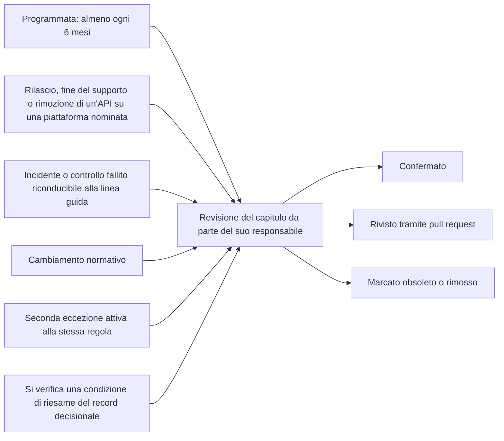

# Governare le linee guida

## Capire

Una **linea guida** è un capitolo di questo sito che dice ai team come progettare, costruire o gestire i sistemi. Una **regola** è una singola affermazione dentro un capitolo che i team devono seguire. Governare le linee guida significa rispondere a quattro domande: chi possiede ogni capitolo, come un team chiede un'eccezione quando non può seguire una regola, dove questa eccezione è registrata e quando finisce, e con quale frequenza un capitolo viene controllato per capire se è ancora corretto.

**Il problema.** I documenti che nessuno possiede si degradano. Il libro di ingegneria di Google lo dice chiaramente: ["Documents without owners become stale and difficult to maintain"](https://abseil.io/resources/swe-book/html/ch10.html). Anche le eccezioni si degradano: un'eccezione senza data di fine resta in vigore finché qualcuno non si ricorda di rimuoverla. Su Azure Policy la data di scadenza di un'esenzione è [facoltativa](https://learn.microsoft.com/azure/governance/policy/concepts/exemption-structure), e le pagine lette per l'[Organization Policy](https://docs.cloud.google.com/organization-policy/overview) di Google Cloud non documentano alcuna scadenza per un override (un'assenza nelle pagine lette, non un fatto confermato).

**Perché conta.** La specifica del progetto mette al centro conformità e audit, e nomina già una regola che ammette una deviazione solo come eccezione approvata e registrata: il ripristino puntuale (point-in-time restore) dei dati di un singolo tenant, che comporta perdita di dati (`docs/superpowers/specs/2026-11-10-cloud-architect-devops-design.md`, sezione C). Un auditor chiederà chi ha consentito una deviazione, perché, fino a quando e che cosa la compensa.

**Il risultato qui.** Ogni capitolo ha un solo responsabile con nome e cognome. Un'eccezione è un breve file in questo repository, richiesto e approvato tramite pull request, con una data di fine obbligatoria. Ogni capitolo viene rivisto almeno ogni 6 mesi, e prima quando qualcosa cambia. Questo repository è pubblico e su GitHub ["Public repositories are accessible to everyone on the internet"](https://docs.github.com/en/enterprise-cloud@latest/repositories/creating-and-managing-repositories/about-repositories): un record contiene quindi solo ciò che può essere pubblico; tutto il resto va in un repository privato.

Due cose non sono in atto al 2026-11-18, e questo capitolo lo dice ovunque conti. Nessun controllo legge una data di scadenza né confronta una data di revisione con la data di oggi (`tools/content-lint.mjs`). E nessuna regola sul forge, il servizio che ospita il repository (qui GitHub), è stata impostata per richiedere una revisione o un controllo superato prima di un merge: l'[ADR 0001](/adr/0001-docs-as-code-with-docusaurus.md) registra che non è configurato alcun required status check e che l'applicazione sul forge è collegata nella fase di delivery, e `.github/workflows/verify.yml` esegue i gate a ogni pull request e dice che blocca un merge solo se una branch protection rende il suo job un required status check. Le impostazioni del forge non sono state lette per questo capitolo. Il lavoro che chiude entrambe le lacune è elencato nella [Checklist di adozione](#checklist-di-adozione).

I termini usati in questo capitolo:

- **Pull request**: una modifica proposta al repository che altri possono leggere, commentare e approvare prima che venga integrata (merge) nella versione principale.
- **Lint** e **gate**: controlli automatici dei file del repository. Il lint verifica che ogni documento abbia i campi e le sezioni richiesti; i gate sono l'insieme completo dei controlli eseguiti da `task verify`, di cui il lint fa parte.
- **Responsabile (owner)**: la persona, o il ruolo, che risponde di un capitolo. Microsoft Learn definisce il responsabile di un articolo come colui che è ["responsible for decisions about the content of the article"](https://learn.microsoft.com/contribute/content/metadata).
- **Record decisionale (ADR)**: un breve documento che registra una decisione, le opzioni considerate e le ragioni. I suoi **decisori** (`deciders`) sono le persone indicate al suo interno che hanno preso la decisione.
- **Eccezione**: permesso, limitato nell'ambito e nel tempo, di non seguire una regola. Defender for Cloud di Microsoft tiene separate due azioni: [rimuovere una regola](https://learn.microsoft.com/azure/defender-for-cloud/exempt-resource) significa che il controllo non dovrebbe mai applicarsi; un'esenzione significa che il controllo resta valido e la rimediazione è temporaneamente non richiesta. Chiedere che una regola smetta di valere per tutti è quindi una modifica alla linea guida, non un'eccezione.
- **Waiver** e **mitigation**: le due categorie di un'esenzione di Azure Policy. Mitigated: ["the policy intent is met through another method"](https://learn.microsoft.com/azure/governance/policy/concepts/exemption-structure). Waiver: "the non-compliance state of the resource is temporarily accepted".
- **Controllo compensativo**: una misura che riduce, con altri mezzi, il rischio a cui la regola rispondeva. Il blueprint delle enterprise foundations di Google dice che chi concede un'eccezione dovrebbe poter [valutare il caso e decidere se servono controlli compensativi](https://docs.cloud.google.com/architecture/blueprints/security-foundations/operation-best-practices).
- **Scadenza**: la data dopo la quale un'eccezione non si applica più.
- **Registro**: l'elenco di tutte le eccezioni, attive o no.
- **Revisione**: un controllo di un capitolo da parte del suo responsabile, a scadenza fissa o perché è accaduto qualcosa.
- **Code owner**: su GitHub, una persona o un team indicato per un percorso in un file chiamato `CODEOWNERS`. I code owner sono [richiesti automaticamente come revisori](https://docs.github.com/en/enterprise-cloud@latest/repositories/managing-your-repositorys-settings-and-features/customizing-your-repository/about-code-owners) nelle pull request che toccano i loro file.
- **Ruleset** e **branch protection**: due funzioni di GitHub che fissano condizioni per un merge, come una pull request, una revisione approvata o un controllo superato ([ruleset](https://docs.github.com/en/enterprise-cloud@latest/repositories/configuring-branches-and-merges-in-your-repository/managing-rulesets/about-rulesets)).
- **Required status check**: un controllo automatico che deve passare prima di un merge; senza questa impostazione, un controllo si limita a segnalare.
- **Bypass**: un permesso di fare merge o push oltre una regola che vale per tutti gli altri.
- **Oggetto di piattaforma**: l'oggetto che un motore di policy usa per esentare qualcosa, come un'esenzione di Azure Policy o un `PolicyException` di Kyverno. È l'applicazione di un'eccezione su quella piattaforma; il record in questo repository è la decisione.

### Chi possiede cosa

| Ruolo | Chi | Risponde di |
|---|---|---|
| Responsabile del capitolo | La persona indicata nel campo `owner` del capitolo | Il contenuto del capitolo; la sua revisione a scadenza; la decisione sulle eccezioni alle sue regole; mantenere vero il suo Stato di verifica |
| Sostituto | Una seconda persona con accesso in scrittura al repository, nominata quando le regole del forge vengono collegate nella fase di delivery | Approvare le eccezioni che il responsabile richiede per i propri capitoli |
| Decisori | Le persone indicate nel campo `deciders` del record decisionale del capitolo | Risolvere un'eccezione contestata; decidere un secondo rinnovo della stessa eccezione; nominare un nuovo responsabile quando uno se ne va |
| Richiedente | Il team che non può seguire una regola | Aprire la pull request con il record e rispettarne ambito e data di fine |
| Approvatore | Il responsabile, o il sostituto quando il responsabile è il richiedente | Approvare o respingere la richiesta nella pull request |
| Team di piattaforma | Chi gestisce il motore che applica la regola (Azure Policy, Organization Policy, l'admission controller di un cluster) | Creare l'oggetto di piattaforma di un'eccezione approvata e rimuoverlo quando l'eccezione finisce |

Perché un solo responsabile e non un elenco: il catalogo software di Backstage dice ["There will always be one ultimate owner"](https://backstage.io/docs/features/software-catalog/descriptor-format/), e il Cloud Adoption Framework assegna a ogni rischio un [unico responsabile primario](https://learn.microsoft.com/azure/cloud-adoption-framework/govern/assess-cloud-risks), un "individual or role". I decisori sono il punto di escalation, come lo è lo sponsor esecutivo nel [Cloud Adoption Framework](https://learn.microsoft.com/azure/cloud-adoption-framework/govern/build-cloud-governance-team) e il CTO nell'[esempio di error budget policy](https://sre.google/workbook/error-budget-policy/) di Google. La matrice RACI di esempio del framework rende i team di piattaforma cloud e i team dei workload responsabili di [applicare le policy e monitorare la conformità](https://learn.microsoft.com/azure/cloud-adoption-framework/govern/build-cloud-governance-team).

**Quando un responsabile se ne va** o smette di fare revisioni, i decisori nominano un nuovo responsabile tramite pull request, e ogni revisione di un capitolo conferma che il suo responsabile sia ancora attivo. Kubernetes tiene aggiornate le proprie liste di owner allo stesso modo: gli approver inattivi vengono spostati in [`emeritus_approvers`](https://www.kubernetes.dev/docs/guide/owners/), e i lead di un gruppo irraggiungibili per oltre un mese [dovrebbero essere rimossi](https://github.com/kubernetes/community/blob/master/committee-steering/governance/sig-governance.md).

**Una persona, tutti i ruoli.** Al 2026-11-18 una sola persona possiede ogni capitolo ed è il decisore di ogni record decisionale, e non è nominato alcun sostituto. Su GitHub ["Pull request authors cannot approve their own pull requests"](https://docs.github.com/en/enterprise-cloud@latest/pull-requests/collaborating-with-pull-requests/reviewing-changes-in-pull-requests/approving-a-pull-request-with-required-reviews), quindi il responsabile non può approvare un'eccezione che richiede per un proprio capitolo. Finché il sostituto non è nominato, un'eccezione di questo tipo viene integrata dal responsabile senza un'approvazione indipendente; il suo record lo indica sia come richiedente sia come approvatore, il che la rende visibile; il report datato (vedi [Impostazioni del forge che la applicano](#impostazioni-del-forge-che-la-applicano)) elenca ogni record di questo tipo ancora attivo; e il sostituto, una volta nominato, conferma ciascuno con una pull request che il sostituto approva, oppure lo chiude.

### La vita di un'eccezione

1. **Richiesta.** Il richiedente apre una pull request che aggiunge un record con `status: proposed`, e la segna come pronta per la revisione: ["Code owners are not automatically requested to review draft pull requests"](https://docs.github.com/en/enterprise-cloud@latest/repositories/managing-your-repositorys-settings-and-features/customizing-your-repository/about-code-owners).
2. **Decisione.** Decide il responsabile del capitolo, o il sostituto quando il responsabile è il richiedente. L'approvatore prima fa il push del commit che imposta `status: approved` o `rejected` e compila `approved_by` e `approved_on`, e solo dopo approva la revisione. Una richiesta respinta viene integrata come record respinto, così che il registro mostri che cosa è stato rifiutato; una richiesta che il richiedente abbandona viene integrata come `withdrawn`.
3. **Attiva.** Il team di piattaforma crea l'oggetto di piattaforma, che porta l'identificatore del record e, dove la piattaforma ne ha una, la stessa data di scadenza (vedi [Eccezioni che una piattaforma applica](#eccezioni-che-una-piattaforma-applica)).
4. **Avviso.** Da 30 giorni prima della data di scadenza, il report datato elenca il record.
5. **Fine**, in uno di tre modi:
   - **Scaduta.** La data è passata. Nessuno modifica il record: "scaduta" si legge dalla data, e il record resta nel repository, come Azure conserva un'esenzione scaduta: ["The object is preserved for record-keeping, but the exemption is no longer honored"](https://learn.microsoft.com/azure/governance/policy/concepts/exemption-structure). Dove la piattaforma non documenta alcuna scadenza, il team di piattaforma rimuove a mano l'oggetto di piattaforma.
   - **Rinnovata.** Un nuovo record che indica quello che sostituisce (`replaces`); lo stato del vecchio record diventa `replaced`. Il responsabile decide un primo rinnovo; un secondo rinnovo della stessa eccezione va ai decisori e fa scattare una revisione della regola.
   - **Chiusa in anticipo.** Il richiedente si adegua prima della data; lo stato del record diventa `closed`, e il team di piattaforma rimuove a mano l'oggetto di piattaforma, perché la sua scadenza, dove la piattaforma ne ha una, è ancora nel futuro.

Un'eccezione dura al massimo 6 mesi dalla sua approvazione.


### Quando si rivedono le linee guida

Ogni capitolo viene rivisto almeno ogni 6 mesi, e prima quando si verifica uno di questi eventi:

- un rilascio minore, una fine del supporto o la rimozione di un'API su una piattaforma che il capitolo nomina: Kubernetes pubblica [circa tre rilasci minori all'anno](https://kubernetes.io/releases/release/), mantiene [i tre rilasci minori più recenti](https://kubernetes.io/releases/) e rimuove le API beta secondo una [policy pubblicata](https://kubernetes.io/docs/reference/using-api/deprecation-policy/); SUSE pubblica le [date del ciclo di vita di Rancher e RKE2](https://www.suse.com/lifecycle/);
- un incidente o un controllo fallito riconducibile alla linea guida, o un cambiamento normativo: il Cloud Adoption Framework raccomanda revisioni basate su eventi ["such as a failed governance policy, technology change, or regulatory compliance change"](https://learn.microsoft.com/azure/cloud-adoption-framework/govern/document-cloud-governance-policies) accanto a quelle programmate;
- una seconda eccezione attiva alla stessa regola: un innesco fissato dal decisore; nessun risultato della ricerca lo nomina (il consiglio più vicino del framework, ["adjust policies and enforcement mechanisms"](https://learn.microsoft.com/azure/cloud-adoption-framework/govern/monitor-cloud-governance), riguarda violazioni a basso rischio sotto un'applicazione audit-first, non eccezioni ricorrenti);
- una condizione di riesame del record decisionale del capitolo che diventa vera.



Una revisione copre accuratezza, chiarezza per il pubblico e coerenza di scrittura, i tre tipi di revisione del [libro di ingegneria di Google](https://abseil.io/resources/swe-book/html/ch10.html), e anche le fonti, lo Stato di verifica, il responsabile e le eccezioni aperte con i loro oggetti di piattaforma. Il suo esito è uno di tre: confermato; rivisto tramite pull request; oppure, per un capitolo che non serve più a nulla, ["either remove it or identify it as obsolete"](https://abseil.io/resources/swe-book/html/ch10.html). Come si marca un capitolo come obsoleto non è ancora progettato: i valori di `status` del capitolo sono `draft`, `reviewed` e `approved` (`tools/content-lint.mjs`).

Gli intervalli documentati vanno da tre mesi a un anno: un promemoria quando un documento ["hasn't been touched in, for example, three months"](https://abseil.io/resources/swe-book/html/ch10.html), ["every four months"](https://learn.microsoft.com/azure/well-architected/design-guides/implementing-recommendations) per una Well-Architected Review, ["quarterly, biannually, or yearly"](https://learn.microsoft.com/azure/cloud-adoption-framework/govern/assess-cloud-risks) per una revisione dei rischi, e una [data di riesame](https://sre.google/workbook/error-budget-policy/) circa un anno dopo l'approvazione. Sei mesi è la scelta del decisore dentro questo intervallo.

`last_reviewed` cambia solo dopo una revisione vera, non dopo la correzione di un refuso, come fa la documentazione .NET per il proprio campo data ([guida della documentazione .NET](https://learn.microsoft.com/contribute/content/dotnet/dotnet-style-guide)), e solo il responsabile lo cambia. I record decisionali non hanno una data di revisione propria: un record accettato non si modifica (["Don't go back and edit accepted records"](https://learn.microsoft.com/azure/well-architected/architect-role/architecture-decision-record)), e le sue condizioni di riesame si controllano a ogni revisione del capitolo che sostiene.

## Decidere

Ciò che è già fissato in ogni opzione qui sotto: i capitoli vivono in questo repository e cambiano tramite pull request ([ADR 0001](/adr/0001-docs-as-code-with-docusaurus.md)), e ogni capitolo ha un `owner` e una data `last_reviewed` che `task content:lint` richiede. Ciò che è aperto: dove un'eccezione viene richiesta e registrata, che cosa la fa scadere, come il responsabile della linea guida partecipa alla decisione, con quale frequenza si rivede un capitolo e, poiché il repository è pubblico, che cosa un record qui può contenere.

Il decisore ha scelto la prima opzione qui sotto. La matrice confronta le opzioni sulle evidenze; non è una graduatoria che decide. Per ogni opzione, [Cosa mostra il confronto](#cosa-mostra-il-confronto) dice dove le evidenze la separano dall'opzione scelta e dove no.

### Opzioni

- **A. Record di governance nel repository delle linee guida.** Un'eccezione è un file con campi fissi in una cartella del capitolo che allenta, richiesta e approvata tramite pull request, con una data di scadenza obbligatoria. Anche il layout [Azure Policy as Code](https://learn.microsoft.com/azure/governance/policy/concepts/policy-as-code) di Microsoft tiene ogni file di esenzione nel controllo di versione accanto all'assegnazione che allenta, rilasciato solo dopo la revisione. Sul forge: la revisione del code owner richiesta da un ruleset, i gate resi un required status check, e un workflow pianificato che segnala i record scaduti.
- **B. Oggetti di esenzione nativi della piattaforma come registro.** Ogni piattaforma tiene il proprio record: [esenzioni](https://learn.microsoft.com/azure/governance/policy/concepts/exemption-structure) e [attestazioni](https://learn.microsoft.com/azure/governance/policy/concepts/attestation-structure) di Azure Policy, [esenzioni](https://learn.microsoft.com/azure/defender-for-cloud/exempt-resource) di Defender for Cloud; override di Organization Policy di Google Cloud a [livello di cartella o progetto](https://docs.cloud.google.com/architecture/security-foundations/preventative-controls) e [condizioni su tag](https://docs.cloud.google.com/organization-policy/scope-policies), [esenzioni di namespace](https://docs.cloud.google.com/kubernetes-engine/policy-controller/docs/how-to/policy-controller-exclude-namespaces) di Policy Controller; su un cluster, [`PolicyException`](https://kyverno.io/docs/exceptions/) di Kyverno, esclusioni di namespace di [Gatekeeper](https://open-policy-agent.github.io/gatekeeper/website/docs/exempt-namespaces/) e [Kubewarden](https://documentation.suse.com/cloudnative/admission-controller/1.38/en/howtos/policies.html), ed esenzioni di [Pod Security Admission](https://kubernetes.io/docs/concepts/security/pod-security-admission/). Non esiste alcun registro fuori dalle piattaforme.
- **C. Organo di governance e tracker.** Le richieste sono ticket decisi da un gruppo nominato, e il tracker è il registro, come nel [processo di eccezione di rilascio](https://github.com/kubernetes/sig-release/blob/master/releases/EXCEPTIONS.md) di Kubernetes. Sono stati ricercati tre tracker, e un fatto su uno non si usa per un altro:
  - **C1. GitHub Issues e Projects**, con le issue in questo repository.
  - **C2. Azure Boards** (Azure DevOps Services), con un tipo di work item personalizzato.
  - **C3. Jira Cloud**, in uno spazio company-managed su un piano a pagamento.

  Jira Service Management, che la ricerca elenca come opzione a sé, non è valutato da solo: le sue approvazioni sono state lette nelle sue pagine ([configurazione](https://support.atlassian.com/jira-service-management-cloud/docs/set-up-approvals/), [`approval.exclude`](https://support.atlassian.com/jira/kb/jira-service-management-cloud-approval-workflow-properties/)), ma la sua cronologia per approvatore poggia su una voce del tracker pubblico di Atlassian, [JSDCLOUD-6264](https://jira.atlassian.com/browse/JSDCLOUD-6264) ("History should be set when each approver approves a transition", chiusa come risolta), non su una pagina di prodotto, e i suoi campi e il suo audit log non sono stati letti. È nominato in [Quando derogare](#quando-derogare).
- **D. Solo record decisionali.** Ogni eccezione è un record decisionale nella cartella `adr/` esistente, con il contratto esistente, denominato per capitolo così che una riga `CODEOWNERS` per capitolo possa corrispondervi. Il Well-Architected Framework tiene i record decisionali [sotto controllo di versione](https://learn.microsoft.com/azure/well-architected/operational-excellence/tools-processes) e rende il log [append-only](https://learn.microsoft.com/azure/well-architected/architect-role/architecture-decision-record), con uno stato.

### Matrice pesata

#### Come si valutano le opzioni

Ogni opzione è valutata **come progettata**: con i meccanismi che la sua documentazione descrive, configurati come l'opzione li richiede, nessuno dei quali provato. Per l'opzione scelta questo comprende un nuovo tipo di documento e la sua regola di lint, un report datato e impostazioni del forge che non sono in atto; per un tracker, la configurazione di quel prodotto. Le celle che poggiano su questo lavoro sono segnate †. Solo record decisionali (D) è valutata con il contratto esistente, che non ha un campo di scadenza; D con il contratto esteso è valutata a parte, in [Analisi di sensibilità](#analisi-di-sensibilità).

Tre regole valgono per ogni opzione:

- **I punti non verificati non sono accreditati.** Una proprietà che sarebbe sostenuta solo da un punto non verificato vale come non soddisfatta; il caso migliore compare solo nell'analisi di sensibilità.
- **Le vie di aggiramento dimezzano una proprietà.** Una via di aggiramento conta quando la ricerca la documenta e funziona mentre la configurazione resta come progettata: un ruolo o un permesso che salta la regola, una cancellazione, o il prodotto che non applica la regola (un'esecuzione ritardata, scartata o disattivata; un revisore richiesto silenziosamente non assegnato). Modificare o disattivare la configurazione stessa è alla portata degli amministratori di ogni opzione e non conta per nessuna.
- **Proprietà, non impressioni.** Per scadenza, evidenze per l'audit e ruolo del responsabile, ogni proprietà vale 2 se soddisfatta, 1 se soddisfatta con una via di aggiramento documentata, 0 se non soddisfatta. Una regola scritta vale 0, e così un controllo o una revisione non richiesti: segnalano e non rifiutano nulla. La scadenza ha due proprietà, e il suo livello è 1 + punti. Evidenze per l'audit e ruolo del responsabile hanno tre proprietà (da 0 a 6 punti), convertite in un livello come 0 → 1, 1 → 2, 2 → 2, 3 → 3, 4 → 4, 5 → 4, 6 → 5.

#### Criteri e livelli

Il decisore ha fissato i pesi il 2026-11-18.

| Id | Criterio | Peso | Livelli |
|---|---|---|---|
| K1 | Un solo registro per ogni piattaforma, e per le regole che nessun motore applica | 15 | 5: un formato in un posto per le eccezioni a regole applicate su Azure, su Google Cloud, su un cluster, e a regole di processo. 3: tutti e quattro possono essere registrati, in più di un formato o posto. 2: ogni piattaforma ha il proprio formato e posto, e una regola di processo può essere registrata su una sola piattaforma. 1: solo le regole applicate dal motore di una piattaforma possono avere un record |
| K2 | Scadenza che non si può saltare | 25 | Proprietà: (p) il sistema rifiuta un record senza una data di scadenza valida prima che il record sia accettato; (q) i record scaduti e in scadenza sono segnalati secondo una pianificazione che nessuno deve avviare. Livello = 1 + punti |
| K3 | Evidenze per un audit | 20 | Proprietà: (a) richiedente, approvatore, data di approvazione, motivo e controllo compensativo sono parti nominate del record; (b) l'approvazione è registrata dal sistema che ospita il record, non solo digitata al suo interno; (c) un record scaduto, chiuso o respinto resta leggibile con la sua cronologia |
| K4 | Il responsabile della linea guida è coinvolto | 15 | Proprietà: (r1) il sistema interpella il responsabile della linea guida interessata, non un gruppo fisso né chi indica il richiedente; (r2) il sistema richiede un'approvazione prima che il record sia accettato; (r3) il richiedente non può approvare la propria richiesta (contata solo quando (r2) conta) |
| K5 | Costo di gestione, e verificabile in locale | 15 | 5: nulla di nuovo. 4: nuovi controlli negli strumenti del repository, eseguibili offline, e impostazioni sul forge esistente; nessun nuovo prodotto, licenza o account. 3: nessun nuovo prodotto, ma i record vivono in un servizio che non si può eseguire né testare in locale. 2: un prodotto separato da scegliere, licenziare, configurare e mantenere, non verificabile in locale. 1: un vero tenant, organizzazione o cluster per piattaforma da creare e da cui leggere ogni record |
| K6 | Costo di uscita | 10 | 5: record, cronologia e approvazioni registrate dal sistema escono come file semplici, nulla da ricostruire. 4: record e cronologia escono come file semplici; le approvazioni restano sul forge e vanno lette tramite la sua API; l'applicazione va ricostruita. 3: un export documentato con i soli valori correnti; la cronologia richiede un secondo meccanismo; il workflow va ricostruito. 2: solo un export limitato, e non è documentato che la cronologia esca. 1: record sparsi su più piattaforme, ciascuna letta separatamente con un vero tenant, organizzazione o cluster |

K1 viene dall'ambito delle linee guida (Azure, Google Cloud, on-prem, e regole di processo come la regola di ripristino sopra); K2 e K4 dalle domande a cui risponde questo capitolo; K3 dalla specifica, che mette al centro conformità e audit; K5 dal suo requisito che tutto sia dimostrabile in locale a costo cloud zero all'inizio, e il Cloud Adoption Framework raccomanda di tenere [piccolo](https://learn.microsoft.com/azure/cloud-adoption-framework/govern/build-cloud-governance-team) il team di governance; K6 dal suo obiettivo di evitare il lock-in.

Non sono criteri, e perché:

- **Il ciclo di revisione**: in ogni opzione i capitoli restano nel repository con una data `last_reviewed`, quindi non separa le opzioni.
- **L'effetto dell'eccezione sulla piattaforma.** In ogni opzione che tiene un registro (A, C1, C2, C3, D), l'eccezione ha effetto quando il suo oggetto di piattaforma viene creato, il che non aspetta il record: chi ha i permessi Azure può [creare un'esenzione](https://learn.microsoft.com/azure/governance/policy/concepts/exemption-structure), chi può associare un tag concede un'[eccezione basata su tag](https://docs.cloud.google.com/resource-manager/docs/tags/tags-overview), e un'eccezione Kyverno è accettata dal suo [namespace configurato](https://kyverno.io/docs/installation/customization/). In B il record è l'oggetto, e dove è impostata una data alcune piattaforme terminano l'eccezione da sole: un'esenzione Azure non è più onorata dopo la sua data, e un'eccezione Kyverno può essere eliminata da una [`DeletingPolicy`](https://kyverno.io/docs/policy-types/deleting-policy/). Su questo punto B è davanti a ogni opzione con registro. Non è valutato, ed è dichiarato come limite della decisione.
- **Chi può leggere un record**: il suo effetto sulle evidenze per l'audit è valutato in K3 (a), e ciò che può essere pubblico è una regola della raccomandazione.

#### Matrice

| Criterio | Peso | A. Record nel repository | B. Oggetti nativi della piattaforma | C1. GitHub Issues e Projects | C2. Azure Boards | C3. Jira Cloud | D. Solo record decisionali |
|---|---|---|---|---|---|---|---|
| K1 Un registro | 15 | 5 | 2 | 5 | 5 | 5 | 5 |
| K2 Scadenza | 25 | 3 † | 2 | 2 † | 3 † | 2 † | 1 |
| K3 Evidenze per l'audit | 20 | 4 † | 2 | 2 † | 3 † | 3 † | 3 † |
| K4 Responsabile coinvolto | 15 | 4 † | 1 | 2 † | 2 † | 4 † | 4 † |
| K5 Costo, locale | 15 | 4 | 1 | 3 | 2 | 2 | 4 |
| K6 Costo di uscita | 10 | 4 | 1 | 2 | 3 | 2 | 4 |
| **Totale** | 100 | **390** | **160** | **260** | **300** | **295** | **320** |

Aritmetica (peso x livello):

- A: 15x5 + 25x3 + 20x4 + 15x4 + 15x4 + 10x4 = 75 + 75 + 80 + 60 + 60 + 40 = 390
- B: 15x2 + 25x2 + 20x2 + 15x1 + 15x1 + 10x1 = 30 + 50 + 40 + 15 + 15 + 10 = 160
- C1: 15x5 + 25x2 + 20x2 + 15x2 + 15x3 + 10x2 = 75 + 50 + 40 + 30 + 45 + 20 = 260
- C2: 15x5 + 25x3 + 20x3 + 15x2 + 15x2 + 10x3 = 75 + 75 + 60 + 30 + 30 + 30 = 300
- C3: 15x5 + 25x2 + 20x3 + 15x4 + 15x2 + 10x2 = 75 + 50 + 60 + 60 + 30 + 20 = 295
- D: 15x5 + 25x1 + 20x3 + 15x4 + 15x4 + 10x4 = 75 + 25 + 60 + 60 + 60 + 40 = 320

I totali si confrontano; non fanno graduatoria. C2 (300) e C3 (295) distano 5 punti, e con altri pesi il loro ordine si inverte (S7): le evidenze non li ordinano.

#### Perché ogni cella ha quel punteggio

**K1 Un registro.** A, C1, C2, C3 e D valgono 5 per definizione: un file o un ticket non è legato ad alcuna piattaforma. Per A, il dettaglio tenuto nel repository privato non crea un secondo registro; ogni eccezione ha qui il suo record, in un solo formato. B vale 2: ogni meccanismo esenta solo dal proprio motore. Un'esenzione di Azure Policy ha come bersaglio un'[assegnazione di policy](https://learn.microsoft.com/azure/governance/policy/concepts/exemption-structure), un override di Organization Policy allenta un vincolo su una [cartella o un progetto](https://docs.cloud.google.com/organization-policy/overview), e un'eccezione Kyverno lascia che le risorse aggirino [una data policy e regola](https://kyverno.io/docs/exceptions/). Una regola che nessun motore applica ha un oggetto di piattaforma solo su Azure, come [attestazione](https://learn.microsoft.com/azure/governance/policy/concepts/attestation-structure) per una policy con effetto `manual`.

**K2 Scadenza** (proprietà (p) e (q)):

- **A: 3 †** (1 + 2 punti). (p) 1: una regola di lint per i record di eccezione dentro `task content:lint`, resa un required status check; i controlli richiesti ["must pass before the pull request can be merged"](https://docs.github.com/en/enterprise-cloud@latest/pull-requests/collaborating-with-pull-requests/collaborating-on-repositories-with-code-quality-features/about-status-checks). Via di aggiramento: a meno che un'app sia fissata come fonte attesa del controllo, uno stato con lo stesso nome impostato da un'altra persona o integrazione lo soddisfa; con il pinning, ["If the status is set by any other person or integration, merging won't be allowed"](https://docs.github.com/en/enterprise-cloud@latest/repositories/configuring-branches-and-merges-in-your-repository/managing-rulesets/available-rules-for-rulesets). Se l'app GitHub Actions, che esegue i gate, possa essere fissata non è nella ricerca, quindi la via di aggiramento conta. Una trappola che richiede una modifica al file del workflow, e quindi non è contata: un job richiesto saltato riporta "Success" e non impedisce un merge ([status check](https://docs.github.com/en/enterprise-cloud@latest/pull-requests/collaborating-with-pull-requests/collaborating-on-repositories-with-code-quality-features/about-status-checks)); la protezione è un code owner su `.github/` e nessuna condizione sul job. (q) 1: un workflow pianificato che [apre una issue](https://docs.github.com/en/enterprise-cloud@latest/actions/tutorials/manage-your-work/schedule-issue-creation). Vie di aggiramento: le esecuzioni pianificate possono essere [ritardate o scartate](https://docs.github.com/en/enterprise-cloud@latest/actions/reference/workflows-and-actions/events-that-trigger-workflows) sotto carico, e in un repository pubblico vengono [disattivate](https://docs.github.com/en/enterprise-cloud@latest/actions/how-tos/manage-workflow-runs/disable-and-enable-workflows) dopo 60 giorni senza attività nel repository.
- **B: 2** (1 punto). (p) 1, solo su alcune piattaforme: il portale Defender, in Public Preview, rende la [scadenza obbligatoria](https://learn.microsoft.com/azure/defender-for-cloud/exempt-resource); su Azure Policy è [facoltativa](https://learn.microsoft.com/azure/governance/policy/concepts/exemption-structure), e lo è anche nel portale Azure di Defender for Cloud; nessuna scadenza è documentata nelle pagine lette per Organization Policy, l'[eccezione Kyverno](https://kyverno.io/docs/exceptions/), [Gatekeeper](https://open-policy-agent.github.io/gatekeeper/website/docs/exempt-namespaces/) o [Kubewarden](https://documentation.suse.com/cloudnative/admission-controller/1.38/en/howtos/policies.html); le esenzioni di Pod Security Admission sono [configurate staticamente](https://kubernetes.io/docs/concepts/security/pod-security-admission/). (q) 0: la ricerca non ha trovato alcuna notifica automatica alla scadenza di un'esenzione Azure; Microsoft pubblica una [query di esempio](https://learn.microsoft.com/azure/governance/policy/samples/resource-graph-samples) per le esenzioni in scadenza entro 90 giorni, che qualcuno deve eseguire.
- **C1: 2 †** (1 punto). (p) 0: i form delle issue non hanno [alcun elemento data](https://docs.github.com/en/communities/using-templates-to-encourage-useful-issues-and-pull-requests/syntax-for-githubs-form-schema); gli [issue field](https://docs.github.com/en/enterprise-cloud@latest/issues/tracking-your-work-with-issues/using-issues/managing-issue-fields-in-your-organization) di organizzazione hanno un tipo Date ma sono in public preview per organizzazioni selezionate e [non si possono impostare dai template](https://docs.github.com/en/issues/tracking-your-work-with-issues/using-issues/adding-and-managing-issue-fields), e se possano essere resi obbligatori non è documentato. (q) 1: un workflow pianificato, con le vie di aggiramento di A.
- **C2: 3 †** (2 punti). (p) 0: un campo personalizzato [può essere reso obbligatorio](https://learn.microsoft.com/azure/devops/organizations/settings/work/add-custom-field?view=azure-devops), e le regole sono [applicate anche tramite l'API](https://learn.microsoft.com/en-us/azure/devops/organizations/settings/work/rule-reference?view=azure-devops), ma se un campo obbligatorio possa essere una data non è nella ricerca. (q) 2: le notifiche sono [solo guidate da eventi](https://learn.microsoft.com/azure/devops/organizations/notifications/about-notifications?view=azure-devops), quindi una [pipeline pianificata](https://learn.microsoft.com/azure/devops/pipelines/process/scheduled-triggers?view=azure-devops) segnala gli elementi scaduti; i suoi limiti limitano le esecuzioni e non le saltano. UNVERIFIED: se una pipeline pianificata per impostazione predefinita giri solo quando il sorgente è cambiato, e se un'impostazione la faccia girare sempre; la ricerca non copre né l'uno né l'altro. Qui la valutazione è asimmetrica: la (q) di A è dimezzata perché GitHub documenta che le sue esecuzioni pianificate possono essere ritardate, scartate o disattivate, mentre la (q) di C2 è accreditata per intero solo perché la ricerca non ha trovato alcun limite simile per le pipeline pianificate, un'assenza nelle pagine lette, non un fatto confermato. Se una pipeline pianificata salta le esecuzioni su un sorgente invariato, la (q) di C2 scende a 1, K2 a 2, e C2 totalizza 275.
- **C3: 2 †** (1 punto). (p) 0: i campi [possono essere resi obbligatori](https://support.atlassian.com/jira/kb/cant-create-issues-because-of-required-fields-in-jira-cloud/), ma se il campo possa essere una data non è nella ricerca. (q) 1: un'[automazione pianificata](https://support.atlassian.com/jira-software-cloud/docs/automation-triggers/) agisce sui work item che una query restituisce. Vie di aggiramento: un flusso pianificato che fallisce 10 volte di fila si disattiva da solo, e i flussi si fermano al 100% della [quota mensile](https://support.atlassian.com/cloud-automation/docs/how-is-my-usage-calculated/) a meno che sia abilitato l'uso extra.
- **D: 1** (0 punti). Il contratto del record decisionale ha `status`, `date` e `deciders` e nessun campo di scadenza (`tools/content-lint.mjs`). Una regola scritta che chiede una data nel testo vale 0.

**K3 Evidenze per l'audit** (proprietà (a), (b) e (c)):

- **A: 4 †** (1 + 1 + 2 = 4 punti). (a) 1: i campi del record, controllati dalla regola di lint nel controllo richiesto; contato 1 perché il controllo ha la via di aggiramento sopra, e perché un record in un repository pubblico tiene parte del suo contenuto nel repository privato. (b) 1: l'approvazione è la revisione del code owner, richiesta da un ruleset; GitHub restituisce ogni revisione con il suo [`user`, `state`, `submitted_at` e il `commit_id`](https://docs.github.com/en/enterprise-cloud@latest/rest/pulls/reviews) a cui si applica, e una revisione respinta (dismissed) resta come commento con una [spiegazione obbligatoria](https://docs.github.com/en/enterprise-cloud@latest/pull-requests/collaborating-with-pull-requests/reviewing-changes-in-pull-requests/dismissing-a-pull-request-review). Vie di aggiramento: ["Repository owners and administrators can merge a pull request even if it hasn't received an approving review"](https://docs.github.com/en/enterprise-cloud@latest/pull-requests/collaborating-with-pull-requests/reviewing-changes-in-pull-requests/approving-a-pull-request-with-required-reviews), e i [bypass actor](https://docs.github.com/en/enterprise-cloud@latest/repositories/configuring-branches-and-merges-in-your-repository/managing-rulesets/creating-rulesets-for-a-repository) di un ruleset possono fare merge oltre le regole. (c) 2: il file resta nel repository dopo che è scaduto, e git ne conserva la cronologia. Se la cronologia del branch predefinito possa essere riscritta non è coperto dalla ricerca: un limite, nominato e non contato.
- **B: 2** (1 punto). (a) 0: su Azure, `requestedBy`, `approvedBy`, `approvedOn` e `ticketRef` sono [esempi in metadata libero](https://learn.microsoft.com/azure/governance/policy/concepts/exemption-structure), non obbligatori; nessuna piattaforma indica richiedente e approvatore come parti del record. (b) 0: che la piattaforma registri chi ha creato un'esenzione non è nella ricerca per Azure Policy né per Organization Policy. (c) 1, solo su alcune piattaforme: Azure conserva l'oggetto scaduto, ma la sua guida consente di eliminare le esenzioni scadute a un riesame; un'eccezione Kyverno eliminata da una `DeletingPolicy` non c'è più.
- **C1: 2 †** (2 punti). (a) 1: un form di issue nomina i campi, e i suoi campi obbligatori sono [applicati solo nei repository pubblici](https://docs.github.com/en/communities/using-templates-to-encourage-useful-issues-and-pull-requests/syntax-for-githubs-form-schema); via di aggiramento: ["Contributors can edit their issues"](https://docs.github.com/en/communities/using-templates-to-encourage-useful-issues-and-pull-requests/syntax-for-issue-forms). (b) 0: le issue non hanno un passo di approvazione; la regola contro l'approvare il proprio lavoro che la ricerca ha trovato vale per le pull request. (c) 1: una issue chiusa resta; via di aggiramento: gli amministratori possono [eliminare una issue](https://docs.github.com/en/enterprise-cloud@latest/issues/tracking-your-work-with-issues/administering-issues/deleting-an-issue) in modo permanente una volta che l'organizzazione lo consente, e i collaboratori non ricevono notifica.
- **C2: 3 †** (3 punti). (a) 1: un tipo di work item personalizzato con campi obbligatori; via di aggiramento: chi ha il permesso "Bypass rules on work item updates" può [salvare i work item senza valutazione delle regole](https://learn.microsoft.com/en-us/azure/devops/organizations/settings/work/rule-reference?view=azure-devops). (b) 1: la transizione ad approved [limitata a un gruppo di approvatori](https://learn.microsoft.com/azure/devops/release-notes/2020/sprint-172-update#azure-boards), marcata con l'utente e l'ora correnti, e ogni revisione registra [chi, quando e quali campi sono cambiati](https://learn.microsoft.com/azure/devops/boards/queries/history-and-auditing?view=azure-devops); stessa via di aggiramento. (c) 1: eliminare un work item [crea una revisione e lo conserva](https://learn.microsoft.com/en-us/azure/devops/boards/backlogs/remove-delete-work-items?view=azure-devops); via di aggiramento: un work item distrutto non può essere ripristinato.
- **C3: 3 †** (3 punti). (a) 2: campi obbligatori, nessuna via di aggiramento documentata. (b) 0: esiste un [passo di approvazione](https://support.atlassian.com/jira-software-cloud/docs/set-up-approval-steps/), ma cosa registri su ciascun approvatore non è documentato in una pagina di Jira. (c) 1: un [work item archiviato](https://support.atlassian.com/jira-software-cloud/docs/archive-an-issue/) può essere ripristinato; via di aggiramento: i work item eliminati ["are permanently deleted"](https://support.atlassian.com/jira/kb/how-to-mass-delete-issues-in-jira/).
- **D: 3 †** (3 punti). (a) 0: richiedente, ambito e controllo compensativo non sono parti di un record decisionale. (b) 1: come A. (c) 2: come A.

**K4 Responsabile coinvolto** (proprietà (r1), (r2) e (r3)):

- **A: 4 †** (1 + 1 + 2 = 4 punti). (r1) 1: una riga `CODEOWNERS` per capitolo, che corrisponde al file del capitolo e alla sua cartella di record, richiede automaticamente il responsabile di quel capitolo; via di aggiramento: ["If you specify a user or team that doesn't exist or has insufficient access, a code owner will not be assigned"](https://docs.github.com/en/enterprise-cloud@latest/repositories/managing-your-repositorys-settings-and-features/customizing-your-repository/about-code-owners). (r2) 1: con la revisione del code owner richiesta, ["any pull request that modifies content with a code owner must be approved by that code owner before the pull request can be merged"](https://docs.github.com/en/enterprise-cloud@latest/repositories/configuring-branches-and-merges-in-your-repository/managing-rulesets/available-rules-for-rulesets); vie di aggiramento: merge dell'amministratore e bypass actor. (r3) 2: gli [autori non possono approvare le proprie pull request](https://docs.github.com/en/enterprise-cloud@latest/pull-requests/collaborating-with-pull-requests/reviewing-changes-in-pull-requests/approving-a-pull-request-with-required-reviews).
- **B: 1** (0 punti). Chi ha i permessi di esenzione sull'ambito può [creare un'esenzione Azure](https://learn.microsoft.com/azure/governance/policy/concepts/exemption-structure); chi può associare un [tag](https://docs.cloud.google.com/resource-manager/docs/tags/tags-overview) concede un'eccezione basata su tag; un'eccezione Kyverno è accettata dal [namespace configurato](https://kyverno.io/docs/installation/customization/); le esenzioni di Pod Security Admission su RKE2 sono un [file sul nodo](https://docs.rke2.io/security/pod_security_standards). Il responsabile della linea guida non fa parte di nessuna di esse.
- **C1: 2 †** (2 punti). (r1) 2: un form di issue può impostare [`assignees`](https://docs.github.com/en/communities/using-templates-to-encourage-useful-issues-and-pull-requests/syntax-for-issue-forms), quindi un form per capitolo assegna il suo responsabile. (r2) 0: nulla richiede un'approvazione su una issue. (r3) 0.
- **C2: 2 †** (1 punto). (r1) 0: gli approvatori sono un gruppo fisso. (r2) 1: la transizione limitata, con il permesso di bypass come via di aggiramento. (r3) 0: il processo ereditato non supporta [`NOTSAMEAS`](https://learn.microsoft.com/en-us/azure/devops/organizations/settings/work/rule-reference?view=azure-devops), e non è stata trovata alcuna regola contro l'auto-approvazione.
- **C3: 4 †** (4 punti). (r1) 0: gli approvatori vengono da campi compilati per ogni richiesta. (r2) 2: un [passo di approvazione](https://support.atlassian.com/jira-software-cloud/docs/set-up-approval-steps/) è richiesto nel workflow; se esista su ogni piano non è documentato, un limite nominato e non contato. (r3) 2: "Exclude approvers from" impedisce al reporter di approvare.
- **D: 4 †** (4 punti). (r1) 1: i pattern di `CODEOWNERS` seguono ["most of the same rules used in gitignore files"](https://docs.github.com/en/enterprise-cloud@latest/repositories/managing-your-repositorys-settings-and-features/customizing-your-repository/about-code-owners), e sono esclusi solo l'escaping `\#`, la negazione `!` e gli intervalli `[ ]`, quindi una riga per capitolo può corrispondere a un pattern di nome file per i record di eccezione di quel capitolo dentro `adr/`; stessa via di aggiramento di A. (r2) 1 e (r3) 2: come A.

**K5 Costo, locale:**

- **A: 4.** Un nuovo tipo di documento, una regola di lint e uno script di report in `tools/`, verificabili offline con `node --test`, e impostazioni sul forge esistente che non richiedono alcun account cloud. Code owner, branch protetti e ruleset sono disponibili per un repository pubblico su ogni piano, GitHub Free per le organizzazioni compreso ([code owner](https://raw.githubusercontent.com/github/docs/main/data/reusables/gated-features/code-owners.md), [branch protetti](https://raw.githubusercontent.com/github/docs/main/data/reusables/gated-features/protected-branches.md), [ruleset](https://raw.githubusercontent.com/github/docs/main/data/reusables/gated-features/repo-rules.md)). Ogni record pubblicato richiede anche una traduzione italiana (`tools/i18n-parity.mjs`).
- **B: 1.** Creare o leggere i record richiede un vero tenant Azure o un'organizzazione Google Cloud; su Google Cloud, più di 20 query al giorno di [Policy Analyzer](https://docs.cloud.google.com/policy-intelligence/docs/analyze-organization-policies) per organizzazione richiedono un livello a pagamento di Security Command Center.
- **C1: 3.** Nessun nuovo prodotto, ma i record vivono nelle issue, fuori da git, e nulla di tutto ciò gira in locale.
- **C2: 2.** Un prodotto separato. I richiedenti possono usare l'[accesso Stakeholder](https://learn.microsoft.com/en-us/azure/devops/organizations/security/stakeholder-access?view=azure-devops) gratuito; l'[audit log](https://learn.microsoft.com/en-us/azure/devops/organizations/audit/azure-devops-auditing?view=azure-devops) dell'organizzazione è in public preview, richiede Microsoft Entra ID, è disattivato per impostazione predefinita e conserva gli eventi per 90 giorni.
- **C3: 2.** Un prodotto separato; l'[audit log](https://support.atlassian.com/jira-cloud-administration/docs/audit-activities-in-jira-applications/) non è disponibile sul piano Free; l'automazione gira su una quota mensile di passi, [fatturata oltre](https://support.atlassian.com/cloud-automation/docs/how-is-my-usage-calculated/) dal 2026-12-03.
- **D: 4.** Il template, la sua regola di lint e la pull request esistono; la revisione che K3 e K4 accreditano richiede le stesse impostazioni del forge di A.

**K6 Costo di uscita:**

- **A: 4.** I file dei record e la loro cronologia si spostano con il repository. L'approvazione ufficiale è una revisione sul forge, restituita dalla sua [REST API](https://docs.github.com/en/enterprise-cloud@latest/rest/pulls/reviews), quindi va letta prima di andarsene; `approved_by` e `approved_on` digitati viaggiano con il file. `CODEOWNERS` è un file semplice; i ruleset vanno riespressi su un altro forge, e ["The bypass list of a ruleset is excluded from the exported JSON file"](https://docs.github.com/en/enterprise-cloud@latest/repositories/configuring-branches-and-merges-in-your-repository/managing-rulesets/managing-rulesets-for-a-repository).
- **B: 1.** Ogni piattaforma si legge separatamente, con un vero tenant, organizzazione o cluster.
- **C1: 2.** Una vista di Projects si [esporta come TSV](https://docs.github.com/en/enterprise-cloud@latest/issues/planning-and-tracking-with-projects/managing-your-project/exporting-your-projects-data); un [archivio di migrazione](https://docs.github.com/en/enterprise-cloud@latest/migrations/using-ghe-migrator/exporting-migration-data-from-githubcom) richiede una preview API, viene eliminato dopo sette giorni e deve restare sotto i 20 GB; Projects non è nei [dati migrati](https://docs.github.com/en/enterprise-server@3.19/migrations/using-ghe-migrator/about-ghe-migrator). La ricerca si contraddice sul fatto che la cronologia delle issue migri; se migra, la cella sta tra 2 e 3, e a 3 C1 totalizza 270.
- **C2: 3.** L'[export in CSV](https://learn.microsoft.com/en-us/azure/devops/boards/queries/import-work-items-from-csv?view=azure-devops) contiene i valori correnti; la cronologia richiede le [API di revisione](https://learn.microsoft.com/rest/api/azure/devops/wit/?view=azure-devops-rest-7.1); un progetto si sposta in un'altra organizzazione ["but not without losing data"](https://learn.microsoft.com/en-us/azure/devops/organizations/projects/about-projects?view=azure-devops).
- **C3: 2.** L'[export CSV](https://support.atlassian.com/jira/kb/export-over-10-000-work-items-in-jira-cloud/) contiene al massimo 10.000 work item per export; il [backup](https://support.atlassian.com/jira-cloud-administration/docs/export-issues/) esclude i flussi di automazione e non dice se includa la cronologia delle modifiche.
- **D: 4.** Come A.

#### Analisi di sensibilità

- **S1. Pesi uguali** (ogni criterio 100/6). A 400, D 350, C2 300, C3 300, C1 266,7, B 150. C2 e C3 sono pari.
- **S2. A e D come saranno quando questo capitolo e il suo record decisionale sono scritti**, senza nuovo tipo di documento, regola di lint, report né impostazione del forge. A: K2 1 (solo una regola scritta), K3 2 (solo (c): un record potrebbe essere archiviato solo come pagina che il lint non controlla), K4 1, K5 5, K6 5: 75 + 25 + 40 + 15 + 75 + 50 = 280. D: gli stessi livelli, 280. In questo stato A e D non sono separate. Il 320 di D nella matrice principale poggia sulle stesse impostazioni del forge di A (K5 D), quindi senza regole del forge collegate D resta anch'esso a 280; le opzioni che totalizzano più di entrambe sono i tracker configurati come progettati, C2 (300) e C3 (295), ciascuno un prodotto separato da scegliere e configurare.
- **S3. Caso migliore per ogni tracker**: ogni punto non verificato risolto a suo favore, e il prodotto già licenziato (K5 3). C3: K2 4, K3 4, K4 4, K5 3, K6 3: 75 + 100 + 80 + 60 + 45 + 30 = 390, pari ad A: un livello avanti sulla scadenza, un livello indietro su costo e uscita. C2: K2 4, K3 3, K4 3, K5 3, K6 3: 75 + 100 + 60 + 45 + 45 + 30 = 355. C1: K2 4, K3 2, K4 2, K5 3, K6 2: 75 + 100 + 40 + 30 + 45 + 20 = 310.
- **S4. D esteso**: un campo `expires` e sezioni per richiedente, ambito e controllo compensativo aggiunti al contratto del record decisionale e al suo lint, con il report e le impostazioni del forge di A. K2 3, K3 4, K4 4, K5 4, K6 4: 75 + 75 + 80 + 60 + 60 + 40 = 390. Pari ad A su ogni criterio.
- **S5. A con ogni record in una sola cartella**, instradato da un pattern di nome file per capitolo: K4 resta 4, totale 390. La cartella per capitolo non porta punteggio; è una scelta di layout.
- **S6. A con i record in un repository privato dell'organizzazione.** Su GitHub Team o GitHub Enterprise Cloud, ogni cella come A: 390. Su un piano gratuito, code owner, branch protetti e ruleset non sono disponibili per un repository privato, quindi nulla è richiesto: K2 2, K3 2, K4 1, K5 4, K6 5: 75 + 50 + 40 + 15 + 60 + 50 = 290. Il piano dell'organizzazione non è stato osservato. Un'organizzazione posseduta da un'enterprise con Enterprise Managed Users è forzata in questo caso: lì, ["only private and internal repositories can be created"](https://docs.github.com/en/enterprise-cloud@latest/admin/managing-iam/understanding-iam-for-enterprises/abilities-and-restrictions-of-managed-user-accounts), quindi il repository pubblico gratuito che K5 accredita non è disponibile.
- **S7. I pesi di una bozza precedente** (K1 25, K2 25, K3 20, K4 15, K5 15, nessun K6). A 400, D 330, C3 325, C2 320, C1 290, B 170. Rispetto alla matrice principale, spostare 10 punti da K1 a K6 cambia l'ordine di C2 e C3 e nient'altro.
- **S8. A dopo il lavoro di follow-up della fase 0** (il tipo di documento eccezione e la sua regola di lint, il report come task, `CODEOWNERS` con l'handle del responsabile; nessun ruleset, nessun workflow pianificato, nessun sostituto). K2 1 (il lint gira a ogni pull request ma non è un controllo richiesto, e il report gira solo quando qualcuno lo esegue), K3 2, K4 2 (il responsabile è interpellato automaticamente, ma nessuna approvazione è richiesta), K5 4, K6 5: 75 + 25 + 40 + 30 + 60 + 50 = 280. Ciò che la fase 0 aggiunge è che i record possono essere archiviati e controllati, e il responsabile è interpellato; i controlli valutati arrivano con i ruleset della fase di delivery.

#### Cosa mostra il confronto

Per ogni opzione, dove le evidenze la separano da A e dove no. Il margine è il totale di A meno il totale dell'opzione.

- **D. Solo record decisionali** (320; margine 70 = K2 50 + K3 20). Separata sulla scadenza, perché un record decisionale non ha un campo di scadenza, e sulle evidenze per l'audit, perché richiedente, ambito e controllo compensativo non ne sono parti. Non separata su un solo registro, ruolo del responsabile, costo o uscita. **D esteso** (S4, 390) non è separato da A su alcun criterio. Il decisore sceglie A rispetto a D esteso per una ragione che i punteggi non portano (vedi [Raccomandazione](#raccomandazione)).
- **C3. Jira Cloud** (295; margine 95 = K2 25 + K3 20 + K5 30 + K6 20). Separata su scadenza (nessun campo data nella ricerca), evidenze per l'audit (cosa registri un'approvazione non è documentato), costo (un prodotto separato, non verificabile in locale) e uscita (un export limitato, un backup che non dichiara la cronologia). Non separata su un solo registro, né sul ruolo del responsabile, dove il suo passo di approvazione che esclude il reporter equivale ad A. Nel suo caso migliore (S3, 390) non è separata da A.
- **C2. Azure Boards** (300; margine 90 = K3 20 + K4 30 + K5 30 + K6 10). Separata su evidenze per l'audit e ruolo del responsabile, per il suo permesso di bypass e un gruppo fisso di approvatori senza regola contro l'auto-approvazione, e su costo e uscita. Non separata su un solo registro e scadenza. Nel suo caso migliore (S3, 355) è ancora separata su K3-K6.
- **C1. GitHub Issues e Projects** (260; margine 130 = K2 25 + K3 40 + K4 30 + K5 15 + K6 20). Separata su ogni criterio tranne un solo registro: i form non hanno un elemento data, le issue non hanno un passo di approvazione, i record vivono fuori da git, e l'export è limitato.
- **B. Oggetti nativi della piattaforma** (160; margine 230 = K1 45 + K2 25 + K3 40 + K4 45 + K5 45 + K6 30). Separata su ogni criterio, nella matrice principale e in ogni caso di sensibilità. Non valutato, e a favore di B: il record non può divergere dall'applicazione, e su alcune piattaforme l'eccezione termina da sola alla sua data.
- **Su cosa poggia il vantaggio di A.** Senza il lavoro di follow-up (S2), o con la sola parte della fase 0 (S8), A totalizza 280, e così D, la cui revisione accreditata richiede le stesse impostazioni del forge: le due non sono separate. Solo i tracker configurati come progettati, C2 (300) e C3 (295), totalizzano più di loro, e ciascuno è un prodotto separato. I controlli valutati di A e D arrivano con i ruleset e il workflow pianificato della fase di delivery.
- **Pesi.** Con pesi uguali (S1) e con i pesi precedenti (S7) le separazioni sopra reggono; cambia solo l'ordine di C2 e C3.

### Raccomandazione

**A. Record di governance nel repository delle linee guida**, scelta dal decisore, con il lavoro di follow-up elencato nella [Checklist di adozione](#checklist-di-adozione), un sostituto, e la regola su [cosa può contenere un record](#contenuto-ammesso-in-un-record). Come progettata, l'evidenza separa A da tutte le altre cinque opzioni, Jira Cloud compreso (margine 95); in ogni caso, casi migliori compresi, separa comunque A da B, C1 e C2; non separa A da D esteso (S4) né da Jira Cloud nel suo caso migliore (S3). Le ragioni della scelta:

1. **Un'eccezione non è una decisione sulla linea guida.** Microsoft separa il [rimuovere una regola](https://learn.microsoft.com/azure/defender-for-cloud/exempt-resource), che significa che il controllo non dovrebbe mai applicarsi, dall'esentare, che significa che il controllo resta valido e la rimediazione è differita. Un record decisionale è [sostituito e mai modificato](https://learn.microsoft.com/azure/well-architected/architect-role/architecture-decision-record); un'eccezione termina a una data. Tenere separate le due cose mantiene breve il log delle decisioni e relativo a decisioni durature. Questa è la ragione che decide A rispetto a D esteso; i punteggi no.
2. **Un solo registro, legato ad alcuna piattaforma, che esce come file semplici.** I meccanismi di piattaforma sono specifici di ogni cloud o motore ([Azure Policy](https://learn.microsoft.com/azure/governance/policy/concepts/exemption-structure), [Organization Policy](https://docs.cloud.google.com/organization-policy/overview), [Kyverno](https://kyverno.io/docs/exceptions/)), e una regola di processo come quella di ripristino ha un oggetto di piattaforma solo su Azure, come [attestazione](https://learn.microsoft.com/azure/governance/policy/concepts/attestation-structure). Anche i tracker danno un registro unico, ma i record di GitHub Projects e Jira Cloud escono solo tramite export limitati, e quelli di Azure Boards tramite un CSV di valori correnti più le API di revisione; i record di A e la loro cronologia escono con il repository (K6 4 contro 2, 2 e 3).
3. **Scadenza e approvazione del responsabile sono applicate con gli strumenti del repository e il forge già in uso, senza nuovo prodotto.** Una regola di lint resa required status check rifiuta un record senza una data valida, con una via di aggiramento documentata finché la sua fonte non è fissata; una riga `CODEOWNERS` per capitolo con la revisione del code owner richiesta instrada ogni richiesta al responsabile del capitolo che allenta; e il richiedente non può approvare la propria pull request. La revisione richiesta e il controllo richiesto sono disponibili per questo repository pubblico su ogni piano. Il report pianificato è best effort, quindi un'esecuzione a mano lo affianca.

Ciò che la raccomandazione non afferma: nulla controlla una scadenza o una data di revisione al 2026-11-18; i gate girano a ogni pull request, ma nulla sul forge li richiede, né richiede una revisione; finché la fonte del controllo richiesto non è fissata, uno stato con lo stesso nome impostato da un'altra persona o integrazione lo soddisfa; una persona detiene ogni ruolo, e finché il sostituto non è nominato le sue richieste non hanno un'approvazione indipendente; le opzioni di ruleset che questo disegno usa e la loro traccia dipendono dal piano dell'organizzazione, che non è stato osservato; il repository è pubblico, quindi un record non può contenere dettagli che non possono essere pubblici, e un record ammesso rivela comunque quale regola è derogata fino a quando, e chi l'ha chiesto; e il record non controlla quando un'eccezione ha effetto su una piattaforma, quindi un record può scadere mentre il suo oggetto di piattaforma resta in vigore. Finché il lavoro di follow-up non esiste, le date si controllano a mano a ogni revisione.

### Quando derogare

- **L'organizzazione impone un tracker per le approvazioni, e i richiedenti non usano git.** Nessun tracker è imposto al 2026-11-18. Prendere richieste e approvazioni lì, e tenere nel repository una riga per eccezione che rimanda al ticket. Jira Cloud su un piano a pagamento ha [campi obbligatori](https://support.atlassian.com/jira/kb/cant-create-issues-because-of-required-fields-in-jira-cloud/), [passi di approvazione che possono escludere il reporter](https://support.atlassian.com/jira-software-cloud/docs/set-up-approval-steps/) e [automazione pianificata](https://support.atlassian.com/jira-software-cloud/docs/automation-triggers/); Azure Boards ha campi obbligatori, [approvazione da parte di un gruppo](https://learn.microsoft.com/azure/devops/release-notes/2020/sprint-172-update#azure-boards), [cronologia completa](https://learn.microsoft.com/azure/devops/boards/queries/history-and-auditing?view=azure-devops), e progetti privati che [richiedono l'accesso](https://learn.microsoft.com/en-us/azure/devops/organizations/projects/about-projects?view=azure-devops). Prima chiudere i punti aperti di quel prodotto: se un campo obbligatorio possa essere una data (entrambi); una regola che impedisca l'auto-approvazione (Azure Boards); cosa registri un'approvazione e su quali piani esistano i passi di approvazione (Jira Cloud). Jira Service Management aggiunge approvazioni con [`approval.exclude`](https://support.atlassian.com/jira/kb/jira-service-management-cloud-approval-workflow-properties/) e clienti gratuiti che inviano richieste, [licenziato per agente](https://support.atlassian.com/jira-service-management-cloud/docs/overview-of-jira-cloud-products/); la sua cronologia per approvatore poggia su una voce di un tracker pubblico ([JSDCLOUD-6264](https://jira.atlassian.com/browse/JSDCLOUD-6264), chiusa come risolta) e non su una pagina di prodotto, e i suoi campi e il suo audit log non sono stati ricercati. GitHub Issues non va bene: i form non hanno un elemento data e le issue non hanno un passo di approvazione.
- **Le regole del forge della fase di delivery non possono essere collegate**, per esempio perché l'organizzazione non vuole impostare ruleset su questo repository. Senza i ruleset e il workflow pianificato, A totalizza 280 (S2, S8), e così D, la cui revisione poggia sulle stesse impostazioni: i record decisionali non sono una via d'uscita. Solo un tracker configurato come progettato totalizza di più, Azure Boards (300) o Jira Cloud (295), e ciascuno è un nuovo prodotto: seguire la via del tracker del primo punto, chiudendo prima i suoi punti aperti. Se le regole sono solo in ritardo, mantenere A, e date e approvazioni si controllano a mano a ogni revisione finché non sono collegate.
- **La ricerca mostra che GitHub Actions può essere fissato come fonte del controllo richiesto.** La scadenza di A sale al livello 4, e A e D esteso totalizzano entrambi 415; aggiornare il confronto.
- **La maggior parte delle eccezioni risulta richiedere dettagli che non possono essere pubblici.** Tenere il registro, con lo stesso formato, gli stessi controlli e le stesse regole del forge, in un repository privato dell'organizzazione, e tenere qui solo la linea guida e le sue regole (S6). Ciò richiede un piano che offra code owner e ruleset per i repository privati: sui piani gratuiti per i repository privati [non sono disponibili](https://raw.githubusercontent.com/github/docs/main/data/reusables/gated-features/repo-rules.md). Il registro smette allora di essere leggibile dal pubblico delle linee guida, e il capitolo deve dire come chiedere l'accesso. Lo stesso vale quando l'organizzazione passa a un'enterprise con Enterprise Managed Users, dove [non si può creare alcun repository pubblico](https://docs.github.com/en/enterprise-cloud@latest/admin/managing-iam/understanding-iam-for-enterprises/abilities-and-restrictions-of-managed-user-accounts). All'interno di un'enterprise, un repository interno è una terza sede, non valutata qui: ["Internal repositories are accessible to all enterprise members"](https://docs.github.com/en/enterprise-cloud@latest/repositories/creating-and-managing-repositories/about-repositories) e non visibile all'esterno.
- **Ogni workload è su Azure e ogni regola che conta è un'assegnazione di Azure Policy.** Tenere i file di esenzione del layout [Azure Policy as Code](https://learn.microsoft.com/azure/governance/policy/concepts/policy-as-code) come registro, con `expiresOn` richiesto in revisione e la [query di esempio](https://learn.microsoft.com/azure/governance/policy/samples/resource-graph-samples) di Microsoft per le esenzioni in scadenza entro 90 giorni eseguita a intervalli pianificati. Questo non si trasferisce a Organization Policy, Gatekeeper, Kubewarden o Pod Security Admission, dove nessuna scadenza è documentata nelle pagine lette.
- **La deviazione è permanente per progetto**, per esempio una linea di prodotto che non seguirà mai una regola. Quella è una decisione, non un'eccezione: registrarla come record decisionale in quel progetto, o cambiare la linea guida perché la regola dichiari il suo ambito, come il formato di policy del Cloud Adoption Framework chiede che l'ambito ["Specify any exceptions to ensure there's no ambiguity"](https://learn.microsoft.com/azure/cloud-adoption-framework/govern/document-cloud-governance-policies).
- **L'organizzazione ha bisogno di un evento di audit log per gli override, o il suo piano non ha la modalità di bypass dei ruleset.** Usare la classica branch protection con "Do not allow bypassing" al posto dei ruleset, e lasciare vuota la sua lista di bypass. Questa impostazione applica le restrizioni ["to admins"](https://docs.github.com/en/enterprise-cloud@latest/repositories/configuring-branches-and-merges-in-your-repository/managing-protected-branches/about-protected-branches) anch'essi, quindi serve a prevenire gli override, non a registrarli. L'audit log dell'enterprise ha un evento per l'override di un amministratore, [`protected_branch.policy_override`](https://docs.github.com/en/enterprise-cloud@latest/admin/monitoring-activity-in-your-enterprise/reviewing-audit-logs-for-your-enterprise/audit-log-events-for-your-enterprise), che questa organizzazione potrebbe non avere; se un amministratore possa comunque fare override sotto "Do not allow bypassing" non è documentato, quindi se quell'evento possa verificarsi lì è aperto. Gli attori nella lista di bypass della branch protection fanno push [senza una pull request](https://docs.github.com/en/enterprise-cloud@latest/repositories/configuring-branches-and-merges-in-your-repository/managing-protected-branches/managing-a-branch-protection-rule), e nessuno degli eventi di branch protection letti registra un tale push uno per uno; da qui la lista vuota. Mettere il sostituto su ogni riga `CODEOWNERS`, così che non serva alcun bypass per le modifiche del responsabile ai propri capitoli.
- **Più di un responsabile, o un'organizzazione in cui il responsabile non può essere il punto di escalation.** Aggiungere il [team di governance, lo sponsor esecutivo e la matrice RACI](https://learn.microsoft.com/azure/cloud-adoption-framework/govern/build-cloud-governance-team) del Cloud Adoption Framework, almeno due persone per ruolo come Kubernetes richiede per i [lead dei suoi gruppi](https://github.com/kubernetes/community/blob/master/committee-steering/governance/sig-governance.md), e la distinzione tra [reviewer e approver](https://www.kubernetes.dev/docs/guide/owners/). Con dei team come code owner, il team deve essere [visibile e avere accesso in scrittura](https://docs.github.com/en/enterprise-cloud@latest/repositories/managing-your-repositorys-settings-and-features/customizing-your-repository/about-code-owners).
- **Il forge passa on-premises.** Su [GitHub Enterprise Server](https://docs.github.com/en/enterprise-server@latest/admin/overview/about-github-enterprise-server), [code owner](https://raw.githubusercontent.com/github/docs/main/data/reusables/gated-features/code-owners.md) e [branch protetti](https://raw.githubusercontent.com/github/docs/main/data/reusables/gated-features/protected-branches.md) sono elencati nelle dichiarazioni dei piani, e i ruleset [non sono nominati](https://raw.githubusercontent.com/github/docs/main/data/reusables/gated-features/repo-rules.md): ricontrollare le impostazioni del forge qui sotto per quell'edizione prima di passare.
- **Intervallo di revisione.** Accorciarlo a tre o quattro mesi per i capitoli che nominano piattaforme in rapida evoluzione ([ciclo di rilascio di Kubernetes](https://kubernetes.io/releases/release/)); allungarlo a dodici mesi per i capitoli di processo senza versioni di piattaforma al loro interno, in linea con una [revisione dei rischi](https://learn.microsoft.com/azure/cloud-adoption-framework/govern/assess-cloud-risks) annuale. Il valore predefinito è 6 mesi.

### Registro della decisione

L'[ADR 0002](/adr/0002-guideline-governance-in-the-repository.md) registra questa decisione, con stato `proposed` al 2026-11-18. L'[ADR 0001](/adr/0001-docs-as-code-with-docusaurus.md) fissa che le linee guida sono file in questo repository, modificati tramite pull request.

### Scelte interne alla decisione

Decise dal decisore il 2026-11-18:

- **Le eccezioni sono record a sé**, non record decisionali (ragione 1 della raccomandazione).
- **Un responsabile per capitolo**, indicato in `owner`; i decisori del record decisionale del capitolo sono il punto di escalation.
- **Un sostituto** approva le eccezioni che il responsabile richiede per i propri capitoli, nominato quando le regole del forge vengono collegate.
- **Scadenza**: al massimo 6 mesi dopo l'approvazione; un rinnovo deciso dal responsabile, un secondo dai decisori insieme a una revisione della regola; un avviso da 30 giorni prima della scadenza.
- **Ciclo di revisione**: almeno ogni 6 mesi, e prima per gli eventi elencati in [Quando si rivedono le linee guida](#quando-si-rivedono-le-linee-guida).
- **Dove vivono i record**: un file per eccezione in `website/docs/exceptions/`, in una cartella per sezione e capitolo, pubblicato con le linee guida, con tipo di documento `exception` e una traduzione italiana ciascuno.
- **I dettagli non pubblici** vanno in un repository privato della stessa organizzazione, un file per record con lo stesso identificatore.
- **Formulazione delle regole**: da ora i capitoli marcano le regole "must" o "should", come il Cloud Adoption Framework scrive le dichiarazioni di policy [in definitive language](https://learn.microsoft.com/azure/cloud-adoption-framework/govern/document-cloud-governance-policies). Per un "must" o "must not" serve un'eccezione. Un team che si discosta da uno "should" registra il perché nel record decisionale del proprio progetto. Gli identificatori stabili delle regole si decidono con il primo capitolo che enuncia regole, nella fase 1.
- **L'esecuzione a mano del report datato**: almeno ogni 28 giorni, lo stesso giorno della settimana ogni quattro settimane, così che nessun intervallo tra due esecuzioni sia più lungo della finestra di avviso di 30 giorni. Le esecuzioni in mesi di calendario consecutivi possono distare fino a 61 giorni, ed è per questo che "mensile" non bastava.
- **Nessun tracker** è usato per le eccezioni.

Proposte con il disegno e approvate con esso il 2026-11-18:

- **Una migrazione che tocca molti workload** può portare l'applicazione di una regola a una modalità di monitoraggio invece di archiviare un gruppo di eccezioni. Policy Controller raccomanda `warn` o `dryrun` ["when testing new constraints or performing migration actions"](https://docs.cloud.google.com/kubernetes-engine/policy-controller/docs/how-to/auditing-constraints); il [dry-run](https://docs.cloud.google.com/organization-policy/test-policies) di Organization Policy registra le violazioni senza negarle, ma solo per i vincoli personalizzati, i vincoli gestiti e quattro vincoli gestiti legacy, e con la fatturazione abilitata sul progetto; il Cloud Adoption Framework dice ["Don't block actions unless you understand them first"](https://learn.microsoft.com/azure/cloud-adoption-framework/govern/enforce-cloud-governance-policies). Questo allenta la regola per tutti, quindi è una modifica all'applicazione della linea guida, fatta tramite pull request con una data di fine nel capitolo, non un'eccezione.
- **Nessuna pagina di changelog.** Google pubblica una pagina ["What's new"](https://docs.cloud.google.com/architecture/framework/whats-new) per il proprio framework; qui la storia di un capitolo è il suo git log. Una pagina di changelog è l'alternativa se i lettori chiedono cosa è cambiato tra due date.
- **Le impostazioni del forge** descritte in [Impostazioni del forge che la applicano](#impostazioni-del-forge-che-la-applicano): ruleset anziché classica branch protection, approvazioni obsolete respinte, la fonte del controllo richiesto fissata, il bypass del responsabile dato a un team di una persona, e l'ordine di approvazione.

## Copiare

Per questo argomento non c'è alcun pezzo eseguibile sotto `reference/`. Nulla qui gira su un cluster o un database: sono ruoli, record e date. Il lavoro di follow-up cambia `tools/`, `templates/`, `CLAUDE.md`, `.github/` e le impostazioni sul forge, ed è elencato nella [Checklist di adozione](#checklist-di-adozione) con la sua tempistica. Dal 2026-11-18 un team può registrare un record e seguire i passi della richiesta, e un responsabile può usare la checklist di revisione; ciò che li impone sul forge deve ancora arrivare (vedi [Checklist di adozione](#checklist-di-adozione)).

### Contenuto ammesso in un record

Il repository è pubblico, quindi tutto ciò che vi si mette è pubblico dal momento in cui viene pubblicato con il push: il file del record, che il sito lo mostri o no; la pull request che lo aggiunge, con titolo, descrizione, commit, messaggi di commit, commenti e revisione; la issue che il report datato apre; e i log del suo workflow. Un file eliminato in seguito resta nella cronologia di git. Nessun risultato della ricerca copre quali dettagli di un'eccezione siano sicuri da pubblicare; l'elenco qui sotto è la regola del decisore.

Un record contiene solo:

- il suo identificatore e il titolo;
- la linea guida e la regola;
- la categoria (`waiver` o `mitigated`) e lo stato;
- le date;
- i nomi di richiedente e approvatore;
- l'ambito, scritto come classe di sistema, per esempio "il livello database di un workload";
- il motivo e il controllo compensativo, al livello della linea guida;
- il tipo di ogni oggetto di piattaforma e i passi generici per rimuoverlo;
- `restricted_ref`: l'identificatore del record stesso nel repository privato, mai un URL.

Un record non contiene mai: il nome, l'indirizzo o l'identificatore di un sistema, tenant, cliente, ambiente, host, subscription, progetto, namespace o risorsa; una chiave o un URL di ticket; un link a evidenze; un comando che elenca o nomina oggetti di piattaforma; come la debolezza potrebbe essere sfruttata; segreti, chiavi, token o credenziali; termini contrattuali o commerciali; dati personali oltre i nomi di richiedente e approvatore. Questi vanno nel repository privato, in un file con lo stesso identificatore.

Lo stesso elenco vale per titolo e descrizione della pull request, i messaggi di commit, i commenti di revisione e la issue del report. In un repository pubblico ["Anyone with read access can review and comment"](https://docs.github.com/en/enterprise-cloud@latest/pull-requests/collaborating-with-pull-requests/reviewing-changes-in-pull-requests/about-pull-request-reviews), quindi un esterno o un richiedente può pubblicare dettagli che il record non può contenere. I contributori fanno commit con un'identità che accettano di pubblicare. UNVERIFIED: se l'identità pubblicata di un commit includa un indirizzo email, come un contributore lo tenga privato, e se un intero commento possa essere nascosto o eliminato; la ricerca copre solo che l'autore di un commento o chiunque abbia accesso in scrittura [può eliminare una revisione](https://docs.github.com/en/enterprise-cloud@latest/communities/moderating-comments-and-conversations/tracking-changes-in-a-comment) di un commento. Un dettaglio una volta pubblicato resta nella cronologia di git; rimuoverlo significa riscrivere la cronologia, cosa che questo capitolo non propone.

Cosa rivela comunque un record ammesso: che una regola nominata è derogata o mitigata fino a una data, e chi l'ha chiesto. Il nome di un richiedente può indicare un team, e quindi i sistemi che quel team gestisce.

### Modello del record di eccezione

Il percorso è `website/docs/exceptions/SECTION/CHAPTER/ID.md`, dove `SECTION/CHAPTER` è il percorso del capitolo la cui regola è allentata, per esempio `website/docs/exceptions/00-foundations/docs-as-code/`. Si parte da `templates/exception.en.md` e `templates/exception.it.md`. L'identificatore è `exc-` seguito da quattro cifre, unico fra tutti i record, e il file prende il suo nome. `task content:lint` controlla il record senza leggere la data di oggi: ogni campo presente, date reali, `expires` non oltre 6 mesi dopo `approved_on`, la cartella coerente con `guideline` e con un capitolo esistente, `replaces` che nomina un record esistente, `restricted_ref` che non è un URL.

```markdown
---
doc_type: exception
id: ID                    # the identifier scheme comes with the lint rule
title: Short description of the deviation
guideline: SECTION/CHAPTER and the rule, quoted until rules have identifiers
scope: A class of system, for example "the database tier of one workload"
category: waiver          # waiver or mitigated
status: proposed          # proposed, approved, rejected, withdrawn, closed, replaced
requested_by: Name of the requester
requested_on: YYYY-MM-DD
approved_by:              # filled in by the approver
approved_on:              # filled in by the approver
expires: YYYY-MM-DD       # mandatory; at most 6 months after approved_on
replaces:                 # for a renewal: the id of the record it replaces
restricted_ref:           # optional: this record's id in the private repository, never a URL
---

## Reason

Why the rule cannot be met, at the level of the guideline.

## Risk

The risk of granting the exception, and the risk of refusing it.

## Compensating control

What reduces the risk while the exception is active.

## Plan to comply

What will be done to meet the rule before the expiry date.

## Platform objects

The kind of each platform object that enforces this exception, and the generic steps to remove it. No identifiers.
```

Da dove vengono i campi: la categoria e il richiedente, l'approvatore e la data di approvazione seguono l'[esempio di metadata di esenzione](https://learn.microsoft.com/azure/governance/policy/concepts/exemption-structure) di Microsoft, il cui riferimento al ticket va qui nel repository privato; l'ambito e il controllo compensativo seguono il [consiglio di Google sulle richieste di eccezione](https://docs.cloud.google.com/architecture/blueprints/security-foundations/operation-best-practices), che dice di modificare il vincolo ["as narrowly as possible"](https://docs.cloud.google.com/architecture/blueprints/security-foundations/operation-best-practices); il motivo e i due rischi seguono la [richiesta di eccezione di rilascio](https://github.com/kubernetes/sig-release/blob/master/releases/EXCEPTIONS.md) di Kubernetes; l'elenco degli stati e `replaces` seguono i [metadata dei KEP](https://github.com/kubernetes/enhancements/blob/master/keps/NNNN-kep-template/kep.yaml) di Kubernetes; il piano per adeguarsi segue le [rimediazioni a tempo](https://learn.microsoft.com/azure/cloud-adoption-framework/govern/document-cloud-governance-policies) del Cloud Adoption Framework. "Scaduta" non è uno stato: si legge da `expires`, quindi un record scade senza una modifica.

### Richiedere un'eccezione, passo per passo

1. Verificare che la regola sia un "must" o "must not". Per uno "should", registrare la deviazione nel record decisionale del proprio progetto. Se la regola dovrebbe smettere di valere per tutti, proporre invece una modifica al capitolo.
2. Copiare il modello nella cartella dei record del capitolo e compilarlo entro i limiti di [cosa può contenere un record](#contenuto-ammesso-in-un-record). Mettere i dettagli che non possono essere pubblici nel repository privato, in un file con lo stesso identificatore, e impostare `restricted_ref`.
3. Aprire una pull request con il record e nient'altro, e segnarla come pronta per la revisione: i code owner non sono richiesti sulle bozze.
4. L'approvatore (il responsabile, o il sostituto quando il responsabile è il richiedente) controlla il record e il testo della pull request rispetto all'elenco di cosa può contenere un record. Un record che lo viola non viene integrato.
5. L'approvatore fa il push di un commit che imposta `status: approved` o `rejected` e compila `approved_by` e `approved_on`, e solo dopo approva la revisione. Con le approvazioni obsolete respinte, qualunque push successivo respinge l'approvazione e la pull request ["cannot be merged until someone approves the work again"](https://docs.github.com/en/enterprise-cloud@latest/repositories/configuring-branches-and-merges-in-your-repository/managing-rulesets/available-rules-for-rulesets).
6. La pull request viene integrata qualunque sia la decisione. Un richiedente che rinuncia imposta `status: withdrawn`, e anche quello viene integrato.
7. Dopo un'approvazione, il team di piattaforma crea l'oggetto di piattaforma con l'identificatore del record e, dove la piattaforma ne ha una, la stessa data di scadenza.
8. Prima della data: adeguarsi e impostare `status: closed`, dopo di che il team di piattaforma rimuove l'oggetto di piattaforma; oppure richiedere un rinnovo con un nuovo record il cui `replaces` nomina questo; il merge del rinnovo imposta questo record a `replaced`.

**Utilizzabile dal 2026-11-18, senza imposizione sul forge.** Il record è controllato da `task content:lint` e richiede il suo file italiano per superare `task i18n:check`. Poiché il forge non richiede ancora i gate, una pull request che li fallisce potrebbe comunque essere integrata e lasciare `main` in errore: esegui `task verify` prima dell'integrazione.

Finché le regole del forge della fase di delivery non sono collegate, nulla sul forge richiede il passo 4 o 5: poggiano sul revisore. Finché il sostituto non è nominato, un'eccezione che il responsabile richiede per un proprio capitolo viene integrata da lui, con il suo nome come richiedente e approvatore (vedi [Chi possiede cosa](#chi-possiede-cosa)).

### Checklist di revisione per il responsabile di un capitolo

A ogni revisione programmata o guidata da eventi di un capitolo:

- [ ] Il responsabile è ancora attivo; se no, i decisori ne nominano uno nuovo tramite pull request.
- [ ] I fatti sono ancora corretti: ogni fonte dice ancora ciò che il capitolo cita, e le piattaforme che nomina non hanno avuto un rilascio, una fine del supporto o una rimozione di API che cambia una regola.
- [ ] Il capitolo è chiaro per il suo pubblico e coerente nella scrittura.
- [ ] Lo Stato di verifica elenca solo ciò che è stato eseguito, con le date.
- [ ] Le condizioni di riesame del record decisionale del capitolo sono controllate.
- [ ] Ogni eccezione aperta al capitolo è confrontata con ciò che ogni piattaforma riporta come esentato: su Azure, le risorse nello stato di conformità [Exempt](https://learn.microsoft.com/azure/governance/policy/concepts/exemption-structure); su Google Cloud, [Policy Analyzer](https://docs.cloud.google.com/policy-intelligence/docs/analyze-organization-policies) o [`gcloud asset analyze-org-policies`](https://docs.cloud.google.com/sdk/gcloud/reference/asset/analyze-org-policies); su Kyverno, i risultati `skip` nei suoi [policy report](https://kyverno.io/docs/policy-reports/); Gatekeeper e Policy Controller continuano a fare [audit](https://open-policy-agent.github.io/gatekeeper/website/docs/exempt-namespaces/) di un namespace esentato con flag e label, ma un'esenzione `Config` di Gatekeeper i cui `processes` includono `audit` o `*` lo rimuove anche dall'audit, quindi lì l'esenzione si legge dalla `Config` stessa. Un oggetto di piattaforma il cui record è scaduto o chiuso viene rimosso sulla piattaforma.
- [ ] Il team che detiene il bypass del ruleset del responsabile, una volta che esiste, ha ancora il responsabile come unico membro: la sua composizione cambia nelle impostazioni dell'organizzazione, fuori da qualsiasi pull request.
- [ ] Gli errori che GitHub riporta per `CODEOWNERS`, mostrati quando il file viene aperto sul forge, sono vuoti.
- [ ] I record approvati dal loro stesso richiedente sono elencati, e confermati dal sostituto una volta nominato.
- [ ] Una seconda eccezione attiva alla stessa regola fa scattare una revisione della regola.
- [ ] Il report datato è stato eseguito a mano almeno ogni 28 giorni, e il workflow pianificato, una volta esistente, è abilitato. Finché il report non esiste, le date di scadenza si controllano a mano.
- [ ] Esito registrato: confermato, rivisto tramite pull request, o marcato obsoleto o rimosso. `last_reviewed` cambia solo dopo una revisione vera, e solo il responsabile lo cambia.

### Checklist di adozione

Lavoro di follow-up e relativa tempistica, deciso il 2026-11-18. Le voci della fase 0 sono state aggiunte lo stesso giorno, dopo la prima stesura di questo capitolo: `task content:lint` (record di eccezione, `owner_handle`), `task codeowners:check` (un gate di `task verify` e del workflow delle pull request), `task governance:report` (mai un gate) e `.github/CODEOWNERS`. Le voci della fase di delivery non esistono ancora.

Fase 0, ora:

- [x] Aggiungere il tipo di documento `exception` a `tools/content-lint.mjs`, con test e template in inglese e in italiano in `templates/`, e la riga corrispondente in `CLAUDE.md`.
- [x] Aggiungere una regola di lint per i record di eccezione che non dipenda dal giorno in cui gira: ogni campo presente, date reali, `expires` non oltre 6 mesi dopo `approved_on`, la cartella del record che corrisponde al suo `guideline`, `restricted_ref` un identificatore e non un URL.
- [x] Aggiungere il report datato come task, con test `node --test`: eccezioni scadute o in scadenza entro 30 giorni, record scaduti o chiusi che nominano oggetti di piattaforma, record attivi il cui approvatore è il loro richiedente, e capitoli oltre il loro intervallo di revisione. Non deve mai far fallire un merge, perché un controllo che dipende dalla data di oggi rende rosso oggi un commit che ieri passava, senza alcuna modifica.
- [x] Aggiungere `.github/CODEOWNERS` con un responsabile per il file stesso, una riga per `.github/workflows/` così che una modifica al workflow dei gate richieda la revisione del responsabile, una riga per cartella di sezione, e una riga per file di capitolo e per cartella di record del capitolo.
- [x] Aggiungere un campo `owner_handle` al template del capitolo (lo username GitHub del responsabile o il team dell'organizzazione), richiesto dal lint, e un controllo che corrisponda alla riga `CODEOWNERS` del capitolo. Il campo `owner` contiene il nome di una persona, che `CODEOWNERS` non può usare.

Fase di delivery, con l'altra applicazione sul forge:

- [ ] Nominare il sostituto, dargli accesso in scrittura e aggiungerlo alle righe `CODEOWNERS` delle cartelle dei record di eccezione.
- [ ] Creare i ruleset descritti in [Impostazioni del forge che la applicano](#impostazioni-del-forge-che-la-applicano).
- [ ] Aggiungere il workflow pianificato del report datato, che apre una issue contenente solo identificatori di record, capitoli e date.

## Eccezioni che una piattaforma applica

Dove una regola è applicata da un motore di policy, l'oggetto di piattaforma è l'applicazione del record, non il record. L'oggetto porta l'identificatore del record e, dove la piattaforma ne ha una, la stessa data di scadenza. Le corsie di ricerca per Google Cloud e on-prem concludono lo stesso nella loro analisi: una linea guida cloud-agnostic tiene il record nel repository e tratta ogni motore come l'applicazione per-cloud. La meccanica di ciascun motore appartiene a capitoli di piattaforma successivi; questa tabella proviene solo dalla ricerca, e nulla di essa è stato provato.

| Meccanismo di piattaforma | Scadenza sull'oggetto | Dove può andare l'identificatore del record | Cosa lo rimuove | Come elencare ciò che è esentato | Trappole |
|---|---|---|---|---|---|
| Esenzione di Azure Policy | `expiresOn`, facoltativa; dopo di essa ["the exemption is no longer honored"](https://learn.microsoft.com/azure/governance/policy/concepts/exemption-structure), e l'oggetto viene conservato | `metadata` libero; `description` è limitata a 512 caratteri | La scadenza ne termina l'effetto; eliminarlo è un passo separato | Stato di conformità Exempt, con un sottostato che mostra lo stato senza l'esenzione; una [query di esempio](https://learn.microsoft.com/azure/governance/policy/samples/resource-graph-samples) per le esenzioni in scadenza entro 90 giorni | La data è facoltativa; al massimo [1000 esenzioni per ambito](https://learn.microsoft.com/azure/governance/policy/overview) |
| Attestazione di Azure Policy, per una policy con effetto `manual` | `expiresOn`, la data in cui lo stato attestato [dovrebbe tornare indietro](https://learn.microsoft.com/azure/governance/policy/concepts/attestation-structure) | `comments`; i suoi link `evidence` vanno nel repository privato | La scadenza ripristina lo stato | Non nella ricerca | Richiede un tenant Azure |
| Esenzione di Defender for Cloud | Facoltativa nel portale Azure; obbligatoria nel portale Defender, che è in [Public Preview](https://learn.microsoft.com/azure/defender-for-cloud/exempt-resource) | Descrizione, giustificazione | Scadenza; la guida di Microsoft conserva le regole scadute come evidenza storica | Non nella ricerca | Scadenza obbligatoria solo in una funzione in preview |
| Override di Organization Policy di Google Cloud a livello di cartella o progetto, o una [condizione su tag](https://docs.cloud.google.com/organization-policy/scope-policies) | Nessuna documentata nelle pagine lette | Non nella ricerca | Qualcuno lo rimuove | [Policy Analyzer](https://docs.cloud.google.com/policy-intelligence/docs/analyze-organization-policies), più di 20 query al giorno solo su un livello a pagamento | Chi può associare il [tag](https://docs.cloud.google.com/resource-manager/docs/tags/tags-overview) concede l'eccezione; la maggior parte delle organization policy è [valutata alla creazione o all'aggiornamento](https://docs.cloud.google.com/organization-policy/scope-policies), quindi rimuovere un tag non corregge le risorse già esistenti |
| Accesso e finding di Google Cloud: [IAM Conditions](https://docs.cloud.google.com/iam/docs/configuring-temporary-access), [Privileged Access Manager](https://docs.cloud.google.com/iam/docs/pam-overview), [mute rule](https://docs.cloud.google.com/security-command-center/docs/how-to-mute-findings) dinamiche | Nativa: un'ora di scadenza, una durata massima di concessione, una scadenza sulla regola | Non nella ricerca | Scadenza | Non nella ricerca | Si applicano ad accesso e finding, non ai vincoli di organization policy; i finding silenziati restano nei report di conformità |
| Esenzione di namespace di Policy Controller (GKE) | Nessuna documentata | Non nella ricerca | Rimuovere il namespace dalla lista degli esentati | I namespace esentati sono [ancora sottoposti ad audit](https://docs.cloud.google.com/kubernetes-engine/policy-controller/docs/how-to/policy-controller-exclude-namespaces) | Rimuovere il namespace dalla lista lascia al suo posto la label `admission.gatekeeper.sh/ignore`; solo sui cluster Standard |
| `PolicyException` di Kyverno | Nessun campo di scadenza sull'[eccezione](https://kyverno.io/docs/exceptions/) | Non nella ricerca | Una [`DeletingPolicy`](https://kyverno.io/docs/policy-types/deleting-policy/) pianificata; la label `cleanup.kyverno.io/ttl` è documentata solo nelle [pagine di Kyverno 1.18](https://release-1-18-0.kyverno.io/docs/policy-types/cleanup-policy/), e il suo supporto nelle versioni correnti non è confermato | Risultato `skip` nei [policy report](https://kyverno.io/docs/policy-reports/) | Le eccezioni sono disattivate per impostazione predefinita e accettate solo dal [namespace configurato](https://kyverno.io/docs/installation/customization/) |
| Esenzione di namespace di OPA Gatekeeper | Nessuna documentata | Il valore della label `admission.gatekeeper.sh/ignore` è ignorato ["so it can record the reason"](https://open-policy-agent.github.io/gatekeeper/website/docs/exempt-namespaces/) | Qualcuno lo rimuove | I namespace esentati sulla via flag-e-label sono ancora sottoposti ad audit | La via `Config` è alpha |
| Kubewarden (SUSE Security Admission Controller) | Nessuna documentata | Non nella ricerca | Modificare il `namespaceSelector` della policy | Non nella ricerca | La pagina [non documenta alcun oggetto di eccezione](https://documentation.suse.com/cloudnative/admission-controller/1.38/en/howtos/policies.html) |
| Pod Security Admission | Nessuna: le esenzioni sono [configurate staticamente](https://kubernetes.io/docs/concepts/security/pod-security-admission/) per utente, runtime class o namespace | Non nella ricerca | Modificare la configurazione di admission | Non nella ricerca | Su RKE2 la configurazione è un [file sul nodo](https://docs.rke2.io/security/pod_security_standards), un'operazione sul cluster |

**La scadenza del record non rimuove l'oggetto di piattaforma.** Dove la piattaforma non documenta alcuna scadenza, l'oggetto resta in vigore finché qualcuno non lo rimuove, e un'eccezione chiusa nel registro può restare attiva sulla piattaforma. Per questo ogni record nomina il tipo di ogni oggetto di piattaforma e come rimuoverlo, il repository privato tiene i loro identificatori, il report datato elenca i record scaduti che nominano oggetti di piattaforma, e ogni revisione confronta i record aperti con ciò che la piattaforma riporta come esentato.

## Impostazioni del forge che la applicano

Nessuna di queste impostazioni esiste al 2026-11-18, e nessuna è stata provata. Vengono collegate nella fase di delivery.

**`CODEOWNERS` e l'handle del responsabile.** Il file va in `.github/`: GitHub cerca in `.github/`, nella radice e in `docs/`, in quest'ordine, e usa il [primo che trova](https://docs.github.com/en/enterprise-cloud@latest/repositories/managing-your-repositorys-settings-and-features/customizing-your-repository/about-code-owners); ["The most secure method is to define a CODEOWNERS file in the `.github` directory"](https://docs.github.com/en/enterprise-cloud@latest/repositories/managing-your-repositorys-settings-and-features/customizing-your-repository/about-code-owners), e il file ha bisogno di un responsabile suo. Possedere il file non copre i file di workflow, quindi una riga separata per `.github/workflows/` li mette sotto la revisione del responsabile; le righe seguono ["most of the same rules used in gitignore files"](https://docs.github.com/en/enterprise-cloud@latest/repositories/managing-your-repositorys-settings-and-features/customizing-your-repository/about-code-owners). Una riga per cartella di sezione dà un responsabile predefinito, come fa il [default a livello di cartella](https://learn.microsoft.com/contribute/content/docs-authoring/metadata-updates) di Microsoft Learn; una riga per file di capitolo e per cartella di record del capitolo lo sostituisce, perché ["the last matching pattern takes the most precedence"](https://docs.github.com/en/enterprise-cloud@latest/repositories/managing-your-repositorys-settings-and-features/customizing-your-repository/about-code-owners). Più responsabili dello stesso pattern devono stare su una sola riga, e uno qualsiasi basta per approvare. Il file fallisce in modo permissivo (fail open): ["If any line in your CODEOWNERS file contains invalid syntax, that line will be skipped"](https://docs.github.com/en/enterprise-cloud@latest/repositories/managing-your-repositorys-settings-and-features/customizing-your-repository/about-code-owners), e un responsabile senza accesso in scrittura esplicito non viene assegnato. Il controllo tra `owner_handle` e `CODEOWNERS` gira offline sui due file; non può vedere se GitHub ha accettato una riga. GitHub mostra gli errori che trova quando il file viene aperto sul forge e [tramite la sua API](https://docs.github.com/en/enterprise-cloud@latest/repositories/managing-your-repositorys-settings-and-features/customizing-your-repository/about-code-owners), quindi il responsabile li legge a ogni revisione (vedi la [checklist di revisione](#checklist-di-revisione-per-il-responsabile-di-un-capitolo)).

**Ruleset anziché classica branch protection.** Il bypass di un ruleset può essere limitato a "For pull requests only": ["The selected actor is now required to open a pull request to make changes to a repository"](https://docs.github.com/en/enterprise-cloud@latest/repositories/configuring-branches-and-merges-in-your-repository/managing-rulesets/creating-rulesets-for-a-repository). La lista di bypass della branch protection lascia invece che gli attori facciano push [senza creare pull request](https://docs.github.com/en/enterprise-cloud@latest/repositories/configuring-branches-and-merges-in-your-repository/managing-protected-branches/managing-a-branch-protection-rule). Ruleset e branch protection ["work alongside each other, and all applicable rules are enforced"](https://docs.github.com/en/enterprise-cloud@latest/repositories/configuring-branches-and-merges-in-your-repository/managing-rulesets/about-rulesets). L'assetto, sul branch predefinito:

1. Un ruleset con il job `gates` come required status check, la sua fonte fissata e nessun bypass actor.
2. Un ruleset che richiede una pull request con la revisione del code owner e respinge le approvazioni obsolete, con un bypass nella modalità "For pull requests only", così che le modifiche del responsabile ai propri capitoli possano essere integrate tramite una pull request. L'opzione per cui il push più recente deve essere approvato da qualcuno diverso da chi l'ha fatto resta disattivata, perché l'approvatore fa il push del commit di decisione e poi approva.
3. Dove il piano lo offre, la [regola di revisore basata sul percorso](https://docs.github.com/en/enterprise-cloud@latest/repositories/configuring-branches-and-merges-in-your-repository/managing-rulesets/available-rules-for-rulesets) su `website/docs/exceptions/`, che richiede un team del responsabile e del sostituto, senza bypass actor, così che il bypass del responsabile in 2 non gli permetta di saltare il sostituto sulle proprie richieste di eccezione.

I bypass actor dei ruleset sono [ruoli, team e app](https://docs.github.com/en/enterprise-cloud@latest/repositories/configuring-branches-and-merges-in-your-repository/managing-rulesets/creating-rulesets-for-a-repository), non singoli utenti. Quindi il bypass di 2 va a un team il cui unico membro è il responsabile, e ogni membro di quel team può ["bypass any branch protections and merge that pull request"](https://docs.github.com/en/enterprise-cloud@latest/repositories/configuring-branches-and-merges-in-your-repository/managing-rulesets/creating-rulesets-for-a-repository). La composizione del team cambia nelle impostazioni dell'organizzazione, non tramite una pull request a questo repository, quindi nessuna revisione qui la copre: chi può gestire il team può allargare il bypass senza traccia in questo repository. UNVERIFIED: chi possa cambiare la composizione di un team dell'organizzazione e quale traccia la modifica lasci; la ricerca non lo copre. La regola di questo disegno secondo cui un membro si aggiunge solo dopo una pull request rivista che ne registra il motivo è una regola scritta, che nulla sul forge applica; ogni revisione di un capitolo controlla che il responsabile sia ancora l'unico membro (vedi la [checklist di revisione](#checklist-di-revisione-per-il-responsabile-di-un-capitolo)). Un ruolo darebbe il bypass a ogni suo titolare, qualsiasi amministratore successivo compreso. Dove il piano lo offre, un ruleset può partire in Evaluate, che non applica nulla e mostra quali azioni [sarebbero fallite](https://docs.github.com/en/enterprise-cloud@latest/repositories/configuring-branches-and-merges-in-your-repository/managing-rulesets/managing-rulesets-for-a-repository); il ruleset di revisione parte lì per un mese, altrimenti Active fin dall'inizio.

**Il required status check e la sua fonte.** Senza una fonte fissata, uno stato con lo stesso nome impostato da un'altra persona o integrazione soddisfa il controllo. Fissare un'app come fonte attesa lo impedisce: ["If the status is set by any other person or integration, merging won't be allowed"](https://docs.github.com/en/enterprise-cloud@latest/repositories/configuring-branches-and-merges-in-your-repository/managing-rulesets/available-rules-for-rulesets). Se l'app GitHub Actions possa essere fissata come quella fonte non è nella ricerca.

**Il report pianificato e il suo limite di 60 giorni.** Un workflow pianificato sul branch predefinito, settimanale, esegue il report e apre una issue con `gh issue create` e il permesso `issues: write`, come nel [tutorial](https://docs.github.com/en/enterprise-cloud@latest/actions/tutorials/manage-your-work/schedule-issue-creation) di GitHub. La issue e il log del workflow sono pubblici, quindi la issue contiene solo identificatori di record, capitoli e date, e non dice quali record scaduti hanno ancora oggetti di piattaforma; quell'elenco è stampato solo dall'esecuzione a mano. La pianificazione è best effort: le esecuzioni ["can be delayed during periods of high loads"](https://docs.github.com/en/enterprise-cloud@latest/actions/reference/workflows-and-actions/events-that-trigger-workflows) e alcune possono essere scartate; e ["In a public repository, scheduled workflows are automatically disabled when no repository activity has occurred in 60 days"](https://docs.github.com/en/enterprise-cloud@latest/actions/how-tos/manage-workflow-runs/disable-and-enable-workflows). Un repository di linee guida può restare 60 giorni senza un commit, e le eccezioni scadono con il tempo, non con i commit; cosa conti come attività non è definito, quindi non è progettato alcun keep-alive. Invece il responsabile esegue il report a mano almeno ogni 28 giorni, e a ogni esecuzione controlla nella scheda Actions che il workflow sia abilitato, riattivandolo con "Enable workflow" o `gh workflow enable` se non lo è; gli avvisi di fallimento vanno poi [all'utente che l'ha riabilitato](https://docs.github.com/en/enterprise-cloud@latest/actions/concepts/workflows-and-actions/notifications-for-workflow-runs). Una issue aperta con `GITHUB_TOKEN` [non avvia alcun altro workflow](https://docs.github.com/en/enterprise-cloud@latest/actions/concepts/security/github_token).

**Cosa dipende dal piano dell'organizzazione.** Il repository è pubblico e il suo proprietario, `massimilianolapuma`, è un'organizzazione: una chiamata di sola lettura, `gh api repos/massimilianolapuma/cloud-architect-devops`, eseguita il 2026-11-18 durante la progettazione di questo argomento e non dall'autore, ha restituito visibilità pubblica e tipo di proprietario `Organization`. Molto di ciò che segue dipende da questo: le liste di bypass ["only when the repository belongs to an organization"](https://docs.github.com/en/enterprise-cloud@latest/repositories/configuring-branches-and-merges-in-your-repository/managing-protected-branches/about-protected-branches), la regola di revisore basata sul percorso [non è disponibile sui repository di proprietà di un utente](https://docs.github.com/en/enterprise-cloud@latest/repositories/configuring-branches-and-merges-in-your-repository/managing-rulesets/available-rules-for-rulesets), e ["only organization teams can be code owners"](https://docs.github.com/en/enterprise-cloud@latest/repositories/managing-your-repositorys-settings-and-features/customizing-your-repository/about-code-owners). Rieseguire quella chiamata prima di collegare le regole. Il piano, e se l'organizzazione appartenga a un'enterprise, non sono stati osservati. La revisione richiesta e il required status check sono disponibili per un repository pubblico [su ogni piano](https://raw.githubusercontent.com/github/docs/main/data/reusables/gated-features/repo-rules.md). Le liste di bypass e la regola di revisore basata sul percorso richiedono un repository che appartenga a un'organizzazione, cosa che questo fa; è una condizione necessaria, e la modalità di bypass "For pull requests only", la regola di revisore basata sul percorso, Evaluate e l'elenco dei bypass nei rule insights sono documentati solo nelle pagine di GitHub Enterprise Cloud. La dashboard dei rule insights è [disponibile per GitHub Team e GitHub Enterprise Cloud](https://docs.github.com/en/enterprise-cloud@latest/repositories/configuring-branches-and-merges-in-your-repository/managing-rulesets/managing-rulesets-for-a-repository). Se il piano non ha la modalità di bypass, il sostituto va su ogni riga `CODEOWNERS` e non serve alcun bypass; se non ha la regola basata sul percorso, la regola 3 cade e il bypass del responsabile può saltare il sostituto.

**La traccia di audit.** I rule insights elencano ogni bypass con il suo attore e possono essere [filtrati per attore](https://docs.github.com/en/enterprise-cloud@latest/repositories/configuring-branches-and-merges-in-your-repository/managing-rulesets/managing-rulesets-for-a-repository), dove il piano li offre; la loro conservazione non è documentata, e la ricerca non ha trovato alcun evento di audit log che nomini un bypass di ruleset. Le modifiche a un ruleset sono elencate nella sua cronologia per 180 giorni. L'[audit log dell'enterprise](https://docs.github.com/en/enterprise-cloud@latest/admin/monitoring-activity-in-your-enterprise/reviewing-audit-logs-for-your-enterprise/about-the-audit-log-for-your-enterprise) conserva gli eventi per 180 giorni a meno che siano trasmessi in streaming, ed esiste solo per un'enterprise. Un bypass è una traccia, non un'approvazione.

**Costo di uscita.** `CODEOWNERS` è un file semplice e si sposta con il repository; la sua applicazione no. Ruleset, rule insights e nomi degli eventi di audit log sono specifici di GitHub e vanno riespressi su un altro forge, e un ruleset esportato lascia fuori la sua lista di bypass. [Kubernetes](https://www.kubernetes.dev/docs/guide/owners/) e [Google](https://abseil.io/resources/swe-book/html/ch09.html) usano file `OWNERS` con la stessa ereditarietà lungo l'albero, e Azure Repos lo fa con i [revisori inclusi automaticamente](https://learn.microsoft.com/azure/devops/repos/git/branch-policies?view=azure-devops) impostati su Required.

## Limiti noti

- **Una persona detiene ogni ruolo** al 2026-11-18, e non può approvare la propria pull request. Finché il sostituto non è nominato, le sue eccezioni non hanno un'approvazione indipendente. Dopo, uno qualsiasi tra più code owner basta, quindi il sostituto può anche approvare richieste di altri al posto del responsabile, e dove il piano non ha la regola di revisore basata sul percorso, il bypass del responsabile gli permette di saltare il sostituto.
- **Il team di bypass è governato fuori dal repository.** La sua composizione cambia nelle impostazioni dell'organizzazione, non tramite pull request, quindi chi può gestire il team può allargare il bypass del responsabile, e solo il controllo a ogni revisione se ne accorgerebbe.
- **Nulla controlla le date di scadenza o di revisione** al 2026-11-18. Finché il lavoro della fase 0 non esiste, le date si controllano a mano a ogni revisione; fino alla fase di delivery, il lint e il report mostrano problemi senza fermare nulla.
- **I gate girano a ogni pull request, ma il forge non richiede né essi né alcuna revisione** al 2026-11-18. Gli amministratori possono fare merge senza una revisione approvata.
- **Un controllo richiesto può essere soddisfatto da uno stato con lo stesso nome** impostato da un'altra persona o integrazione, a meno che un'app sia fissata come sua fonte, e se GitHub Actions possa essere fissato non è nella ricerca.
- **Il repository è pubblico.** I dettagli che non possono essere pubblici vivono in un repository privato, con il proprio controllo degli accessi e la propria traccia. Un record ammesso dice comunque a un esterno quale regola è derogata fino a quando, e chi l'ha chiesto. Anche pull request, commit e commenti sono pubblici, e un dettaglio una volta pubblicato resta nella cronologia di git.
- **Il report pianificato è best effort**: le esecuzioni possono essere ritardate o scartate, e viene disattivato dopo 60 giorni senza attività. Durante un periodo tranquillo, e finché il workflow pianificato non esiste, solo l'esecuzione a mano segnala una scadenza.
- **Il record non controlla la piattaforma.** Un'eccezione ha effetto su una piattaforma quando il suo oggetto viene creato, qualunque cosa dica il record, e un record può scadere mentre il suo oggetto resta in vigore dove la piattaforma non documenta alcuna scadenza.
- **L'applicazione sul forge è specifica di GitHub**, in parte dipende dal piano dell'organizzazione, che non è stato osservato, e le approvazioni restano sul forge, da leggere tramite la sua API prima di andarsene.
- **I richiedenti hanno bisogno di git e di una pull request**, lo stesso limite che il [capitolo docs-as-code](/00-foundations/docs-as-code.mdx) elenca per i contributori.
- **Ogni record pubblicato richiede una traduzione italiana** per superare il gate di parità delle traduzioni.
- **Come si marca un capitolo come obsoleto non è progettato**, e le regole non hanno ancora identificatori stabili; entrambi si decidono nella fase 1.
- **Il capitolo docs-as-code approvato e l'ADR 0001 accettato dicono** che se una revisione di pull request possa essere resa obbligatoria non è stato ricercato. La ricerca per questo capitolo mostra che si può, con una regola di branch protection o un [ruleset](https://docs.github.com/en/enterprise-cloud@latest/repositories/configuring-branches-and-merges-in-your-repository/managing-rulesets/available-rules-for-rulesets). Quei documenti non sono modificati qui.

## Stato di verifica

Questo argomento non ha un pezzo eseguibile, quindi nulla al suo interno può essere provato su una workstation oltre ai controlli offline del repository su questa pagina.

- **Provato dal vivo in locale:** eseguito il 2026-11-18 nella radice del repository, con questo capitolo e il suo record decisionale al loro posto. Nessuno richiede un container, un cluster o un account cloud.
  - `task content:lint`: ha stampato `content lint OK`; exit 0. Mostra che questo capitolo e l'ADR 0002 hanno i campi e le sezioni richiesti; non dice nulla sulla governance in sé.
  - `task site:build`: ha stampato `[SUCCESS] Generated static files in "build".` e `[SUCCESS] Generated static files in "build/it".`; exit 0, senza alcun warning di Docusaurus (il suo unico warning è un `ExperimentalWarning` di Node.js su `localStorage`). Mostra che la pagina, il suo diagramma Mermaid e i suoi link tra documenti si compilano nel sito inglese, e nel sito italiano come pagina di ripiego in inglese, poiché al 2026-11-18, quando è stato eseguito, questo capitolo non aveva ancora un file italiano; non dice nulla su una pagina italiana.
  - Il verificatore pre-traduzione della build di questo argomento, il 2026-11-18, ha superato ogni gate che ha eseguito (output del verificatore consegnato all'autore).
  - `task verify`, eseguito il 2026-11-18 dopo che questo capitolo e l'ADR 0002 hanno avuto i loro file italiani: exit 0. I suoi otto passi sono stati eseguiti in ordine: `doctor`; `test:tools` con 59 test passati e 0 falliti; poi `content lint OK`, `i18n parity OK`, `diagrams OK`, `flows OK (2)`, `agentic lint OK`, e la build del sito ha stampato `[SUCCESS] Generated static files in "build".` e `[SUCCESS] Generated static files in "build/it".`. È l'unica esecuzione di questo elenco fatta con i file italiani al loro posto.
  - Strumenti della fase 0, eseguiti il 2026-11-18 dopo l'aggiunta del lavoro di follow-up: `task codeowners:check` ha stampato `codeowners OK`; un record di prova creato da `templates/exception.en.md` e `templates/exception.it.md` sotto `exceptions/00-foundations/docs-as-code/` è stato compilato in entrambe le lingue con `task site:build`, è stato elencato come `lapsed` da `node tools/governance-report.mjs --today 2026-11-18`, ed è stato cancellato. I test unitari della regola di lint, del report e del controllo dei responsabili girano in `task test:tools`.
- **Non provato:**
  - Le impostazioni del forge non sono state lette. L'unica osservazione del forge è la `gh api repos/massimilianolapuma/cloud-architect-devops` di sola lettura del 2026-11-18, eseguita durante la progettazione di questo argomento dal suo chiamante, non dall'autore, il cui output (visibilità pubblica, tipo di proprietario `Organization`) è stato consegnato all'autore; è un'osservazione, non una prova di qualcosa in questo capitolo.
  - Ogni meccanismo sul forge: l'instradamento di `CODEOWNERS` e i suoi modi di fallire, ruleset e branch protection, la revisione richiesta e il required status check, il pinning della fonte di un controllo, il respingimento delle approvazioni obsolete, i bypass actor e la modalità di bypass "For pull requests only", la regola di revisore basata sul percorso, la modalità Evaluate, i rule insights, i workflow pianificati e la regola dei 60 giorni, e l'audit log dell'enterprise. Nessuno è configurato al 2026-11-18, e il comportamento di una revisione richiesta quando l'autore è l'unico code owner richiede un secondo account con accesso in scrittura per essere osservato.
  - Il report datato e il controllo dei responsabili su record di eccezione reali: non esiste ancora alcun record.
  - Ogni meccanismo di piattaforma in [Eccezioni che una piattaforma applica](#eccezioni-che-una-piattaforma-applica): esenzioni e attestazioni di Azure Policy, esenzioni di Defender for Cloud, Organization Policy di Google Cloud, tag, Policy Analyzer, IAM Conditions, Privileged Access Manager e mute rule richiedono un vero tenant o organizzazione; Kyverno, Gatekeeper, Kubewarden e Pod Security Admission richiedono un cluster. Tutto ciò che si dice su di essi è letto dalla documentazione.
  - I tracker (GitHub Issues e Projects, Azure Boards, Jira Cloud, Jira Service Management): letti solo dalla documentazione.
  - I passi della richiesta e la checklist di revisione in [Copiare](#copiare): non ancora seguiti per una vera eccezione o una vera revisione.
