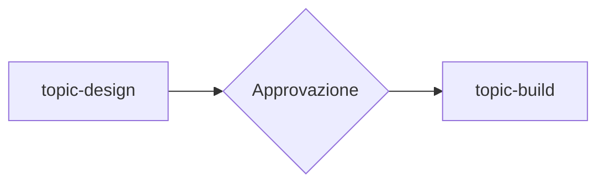

# Linee guida per Cloud Architect e DevOps

Questo repository pubblica linee guida di architettura enterprise: progettazione multi-tenant, progettazione cloud-agnostic, delivery, rollback dei database e continuità operativa. Ogni linea guida è supportata da un registro delle decisioni e, dove serve, da un template eseguibile.

## A chi si rivolge

- **Gli architetti** che decidono: servono le opzioni, i compromessi e la decisione registrata.
- **I team di delivery** che realizzano: servono template eseguibili da copiare.
- **Gli stakeholder** che devono capire: serve il problema e il risultato in termini chiari.

## Tre viste per ogni capitolo

Ogni capitolo offre le stesse tre viste:

- **Capire**: cos'è l'argomento e perché conta.
- **Decidere**: la matrice decisionale e il registro della decisione (ADR).
- **Copiare**: il template eseguibile e come adottarlo.

## Come nasce un argomento

Un argomento attraversa due workflow agentici con un'approvazione umana nel mezzo. `topic-design` esegue ricerche in parallelo e produce un design con matrice decisionale e bozza di ADR. Dopo l'approvazione, `topic-build` scrive il capitolo, disegna i diagrammi, aggiunge la parte eseguibile, la verifica, esegue una revisione avversariale e produce la traduzione italiana.

L'inglese è la fonte canonica. La versione italiana è una traduzione mantenuta allo stesso percorso.
